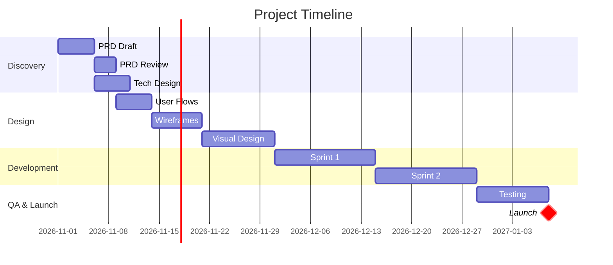
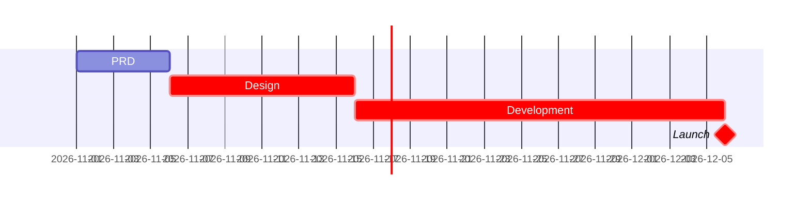

# Skill: Gantt Chart Generation

Create project timelines with dependencies for planning and Jira integration.

## When to Use

- Planning project timeline
- Identifying critical path
- Communicating schedule to stakeholders
- Setting up Jira Plans/Timeline

## Quick Start

```
/product-os:plan --from prd.md
```

## Output Formats

### Mermaid Gantt (Primary)



### CSV Export (for tools)

```csv
Task ID,Task Name,Start,End,Duration,Dependencies,Assignee
PRD-01,PRD Draft,2026-11-01,2026-11-05,5,,Product
PRD-02,PRD Review,2026-11-06,2026-11-08,3,PRD-01,Product
TECH-01,Tech Design,2026-11-06,2026-11-10,5,PRD-01,Engineering
DES-01,User Flows,2026-11-09,2026-11-13,5,PRD-02,Design
```

## Mermaid Syntax

### Basic Task
```
taskname :taskid, start-date, duration
taskname :taskid, start-date, end-date
```

### Dependencies
```
taskname :taskid, after predecessor, duration
```

### Milestones
```
milestone :milestone, taskid, after predecessor, 0d
```

### Critical Path
```
critical-task :crit, taskid, start, duration
```

### Sections
```
section Section Name
    task1 :t1, date, 5d
    task2 :t2, after t1, 3d
```

## Dependency Types

| Type | Mermaid | Jira Link |
|------|---------|-----------|
| Finish-to-Start | `after task` | "blocks" / "is blocked by" |
| Start-to-Start | Not supported | Manual |
| Finish-to-Finish | Not supported | Manual |

## Jira Integration

Gantt data flows to Jira via `/product-os:jira-sync`:

### Fields Populated
| Gantt | Jira Field |
|-------|------------|
| Start date | Start Date (custom or built-in) |
| End date | Due Date |
| Dependencies | Issue Links (blocks) |

### Jira Plans/Timeline
With dates and dependencies set, Jira Plans automatically:
- Shows timeline bars
- Draws dependency arrows
- Highlights critical path
- Flags schedule conflicts

## Critical Path

The critical path is the longest sequence of dependent tasks. Any delay on the critical path delays the project.

**Identify it:**
1. Find all paths from start to end
2. Calculate total duration of each path
3. Longest path = critical path

**Mark it in Mermaid:**


## Duration Estimation

| Task Type | Typical Duration |
|-----------|------------------|
| PRD | 3-5 days |
| Technical design | 3-5 days |
| User flows | 3-5 days |
| Wireframes | 5-7 days |
| Visual design | 7-14 days |
| Sprint | 10-14 days |
| QA | 5-10 days |
| Launch prep | 3-5 days |

Add buffer for:
- Reviews/approvals (+2-3 days each)
- Holidays/PTO
- Dependencies on other teams
- Unknowns (10-20% buffer)

## Quality Checklist

- [ ] All tasks have start and end dates
- [ ] Dependencies are explicit
- [ ] Critical path identified
- [ ] Buffer included
- [ ] Milestones marked
- [ ] Mermaid renders correctly
- [ ] CSV exports for tools

## Tips

1. **Work backwards from deadline** — then see if it fits
2. **Parallel where possible** — reduce total duration
3. **Mark dependencies explicitly** — don't assume sequence
4. **Include buffer** — things always take longer
5. **Update weekly** — Gantt is a living document

## Common Pitfalls

| Pitfall | Problem | Fix |
|---------|---------|-----|
| No buffer | Delays cascade | Add 10-20% buffer |
| Sequential everything | Longer than needed | Parallelize independent work |
| Missing dependencies | Unrealistic schedule | Map all blockers |
| Too granular | Hard to maintain | Group into phases |
| Never updating | Stale information | Review weekly |

## Related

- `/product-os:plan` — Generate Gantt with project plan
- `/product-os:jira-sync` — Push dates to Jira
- `.claude/agents/project-planner.md` — Full agent specification
