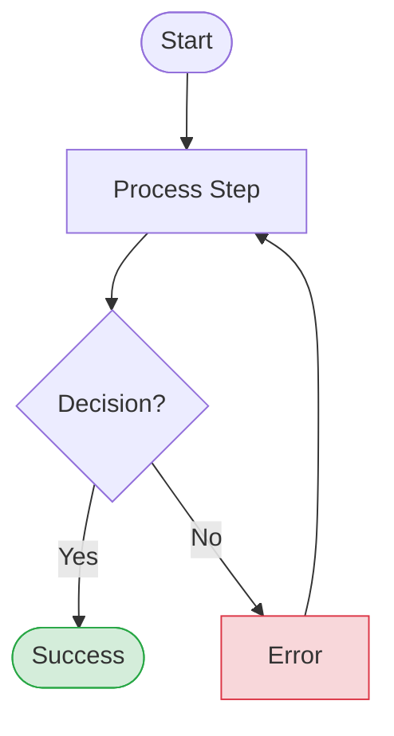

# Skill: User Flows

Create comprehensive user flows with canonical spec and multi-target rendering.

## When to Use

- Translating PRD use cases into design
- Documenting user journeys
- Planning screen inventory
- Communicating with engineering

## Quick Start

```
/product-os:flows --from prd.md --targets mermaid,claude-artifact
```

## Where It Goes and How to View It

| File (in `initiatives/<initiative>/<project>/`) | How to view | Confluence |
|-------------------------------------------------|-------------|------------|
| `flows.md` (Mermaid diagrams, always) | Renders as diagrams on GitHub, in claude.ai and in editors with a Mermaid preview | **User Flows** page under **2. Design**, via `/product-os:publish` (Mermaid macro, or PNG when the macro is missing) |
| `flows.yaml` (source of truth) | Any text editor | Not published; it feeds the other outputs |
| `journey-map.md`, `sitemap.md`, `flow-traceability.md` | Any Markdown viewer | Published with the design pages |
| `claude-artifact` target: interactive HTML | Open in a browser; renders as an artifact in claude.ai | Linked from the User Flows page |
| `figjam` target: FigJam board (Figma MCP) | Open the board link in Figma | Linked from the User Flows page |

## Flow Types

| Type | Purpose | When to Use |
|------|---------|-------------|
| **Task Flow** | Linear happy path | Documenting core value |
| **User Flow** | Multi-path with decisions | Full UX design |
| **System Flow** | Swimlanes (user/FE/BE) | Technical handoff |
| **Journey Map** | Emotional arc | Experience strategy |
| **Sitemap/IA** | Navigation structure | Information architecture |

## Canonical Spec Format

All flows defined in YAML (single source of truth):

```yaml
version: "1.0"
project: "project-slug"

flows:
  - id: "FLOW-001"
    name: "User Registration"
    type: "user-flow"
    prd_refs: ["REQ-001", "REQ-002"]
    personas: ["new-visitor"]
    
    nodes:
      - id: "start"
        type: "terminal"
        label: "User lands on signup"
        state: "neutral"
        
      - id: "form"
        type: "process"
        label: "Display registration form"
        screen_ref: "SCR-002"   # SCR-### from wireframes.md; prototype section #scr-002
        
      - id: "validate"
        type: "decision"
        label: "Form valid?"
        
      - id: "success"
        type: "terminal"
        label: "Account created"
        state: "success"
    
    edges:
      - from: "start"
        to: "form"
      - from: "form"
        to: "validate"
        trigger: "User clicks Submit"
      - from: "validate"
        to: "success"
        condition: "Yes"
        style: "primary"
```

## Rendering Targets

| Target | Command Flag | Output |
|--------|--------------|--------|
| Mermaid | `mermaid` (default) | `flows.md` |
| Claude Artifact | `claude-artifact` | Interactive HTML |
| FigJam | `figjam` | FigJam board (via MCP) |
| Excalidraw | `excalidraw` | `.excalidraw` file |
| draw.io | `drawio` | `.drawio` file |
| Lucidchart | `lucidchart` | CSV import |
| Miro | `miro` | JSON export |
| Whimsical | `whimsical` | Markdown |

## Required States

Every user flow must include:

| State | Description | Must Include |
|-------|-------------|--------------|
| **Happy Path** | Primary success | Clear success indicator |
| **Validation Error** | User input problem | Specific error + recovery |
| **System Error** | Backend failure | Error message + retry |
| **Empty State** | No data | Guidance + CTA |
| **Permission Denied** | Access issue | Explanation + upgrade path |
| **Loading** | Async operation | Progress indicator |
| **Timeout** | Slow operation | Timeout message + retry |

## Mermaid Syntax



### Shape Reference

| Shape | Syntax | Use For |
|-------|--------|---------|
| Stadium | `([text])` | Start/End |
| Rectangle | `[text]` | Process |
| Diamond | `{text}` | Decision |
| Parallelogram | `[/text/]` | Input/Output |
| Cylinder | `[(text)]` | Database |

## Flow Completeness Checklist

- [ ] All entry points documented
- [ ] All decision points have 2+ exits
- [ ] Happy path clearly marked
- [ ] Error paths include recovery
- [ ] Empty states have CTAs
- [ ] No dead ends
- [ ] PRD requirements traced

## Tips

1. **Start with happy path** — then add complexity
2. **One flow per goal** — don't combine unrelated tasks
3. **Use canonical spec** — edit YAML, render to targets
4. **Include screen refs** — link flows to wireframes
5. **Mark primary path** — use thick arrows or `==>` in Mermaid

## Common Mistakes

| Mistake | Problem | Fix |
|---------|---------|-----|
| Missing error states | Users get stuck | Add every error path |
| Dead ends | Nowhere to go | Every end has next action |
| Too detailed | Can't see forest | Separate into sub-flows |
| No decision criteria | "Valid?" means what? | Specify conditions |
| Skipping empty states | Bad first-run UX | Always include |

## Related

- `/product-os:flows` — Generate flows
- `/product-os:wireframes` — Create wireframes from flows
- `.claude/agents/flow-designer.md` — Full agent specification
