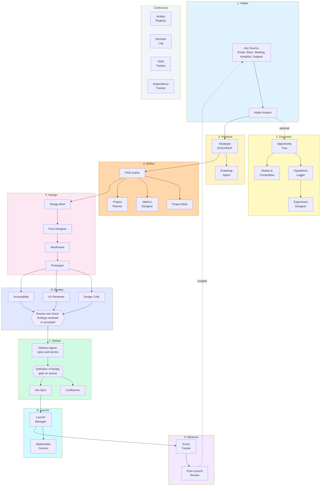
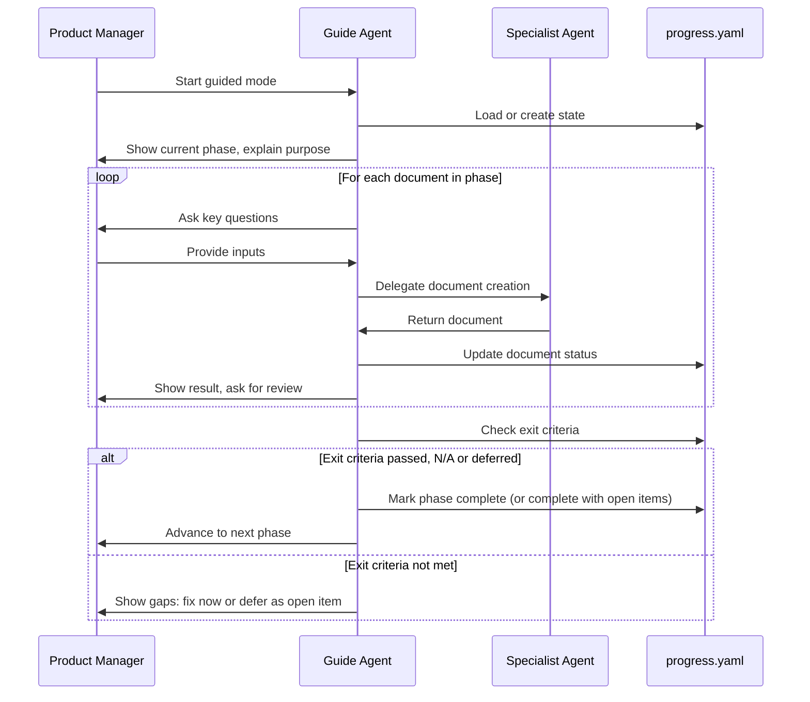

# Product OS

> AI agents that write the documents of product management and design, so your PMs spend their time on strategy, decisions and alignment.

**PM rigor leads; design serves product strategy.**

**New PM? Read three sections:** [Key Terms](#key-terms) → [Quick Start](#quick-start) for your tool → [Your First Project](#your-first-project-step-by-step). Everything from [Guided Mode](#guided-mode) down is reference.

[](LICENSE)

Works in **claude.ai**, **Claude Code** and **Cursor**.

**On this page:** [What it is](#what-is-product-os) · [Key terms](#key-terms) · [Where it runs](#where-it-runs) · [Quick Start](#quick-start) · [Your first project](#your-first-project-step-by-step) · [Workflow](#how-it-works) · [Success and metrics](#what-success-looks-like-validation-and-metrics) · [Document format](#what-every-document-and-page-looks-like) · [Examples](#examples-you-can-copy) · [Guided Mode](#guided-mode) · [Commands](#commands) · [Agents](#agents) · [Skills](#skills) · [Documents](#documents) · [Rolling it out](#rolling-it-out-to-a-team) · [Configuration](#configuration)

---

## What is Product OS?

PMs and designers lose hours to document work: writing PRDs from scratch, formatting Confluence pages, copying stories into Jira, redrawing the same flow diagrams. The strategic work (prioritization, trade-offs, alignment) gets squeezed.

Product OS gives you **40 specialist AI agents**, each owning one document or job, plus playbooks (skills) and templates they follow. You tell an agent what you need, review what it writes, approve or revise, and move on. Nothing reaches Confluence or Jira until you approve it.

In Claude Code you drive it with 47 commands, all named `/product-os:<command>`.
In claude.ai and Cursor you ask for the same work in plain language ("Run the PRD Author on this intake").

### Who it's for

| Role | What you get |
|------|--------------|
| **Head of Product** | One standard for PRDs, stories, gates and metrics across every team. OKRs, roadmaps and prioritization built in. |
| **Product Manager** | PRDs, briefs, plans and Jira-ready stories drafted for you to review, in one consistent format. |
| **Product Designer** | Design briefs, flow diagrams, wireframes and clickable prototypes, plus design critique, UX review and accessibility audits on those designs. |

### What stays with you

The agents do the writing; **you make the decisions**: what problem to solve, what to prioritize, which trade-offs to make, when to ship and what success looks like. Every step waits for your approval.

---

## Key Terms

Plain-language definitions of every term used on this page.

| Term | What it means |
|------|---------------|
| **Initiative** | A big goal or theme (for example "Customer Onboarding"). Holds one or more projects. |
| **Project** | One piece of work inside an initiative (for example "Self-Serve Signup"). Each project gets its own folder and Confluence hub page. |
| **Intake** | The first document: the raw request (email, Slack, meeting, data) rewritten as a clear problem with evidence. |
| **Proposal** | For brand-new ideas: research plus a first sketch of the solution, before anyone commits. |
| **PRD** | Product Requirements Document. What we build, for whom, why, and how we measure success. |
| **Project brief** | A one-page summary of the PRD for executives and stakeholders. |
| **Hypothesis** | Something we believe but have not proven yet ("a loading skeleton makes the wait feel shorter"). Each one gets a test. |
| **North star metric** | The single number that shows the project is working for users. |
| **Input metric** | A leading number the team can move directly, which pushes the north star. |
| **Guardrail metric** | A number that must not get worse while we chase the north star (error rate, cost, support load). |
| **Stop criteria** | The result that tells us to stop, roll back or rethink, and who makes that call. |
| **User flow** | A diagram of the steps a user takes through a task, including errors and dead ends. |
| **Low-fi wireframe** | A rough grayscale sketch of one screen: layout and content, no colors or brand. |
| **Clickable prototype** | The wireframes linked together so you can click through a flow in a browser. |
| **Design critique** | A review of the visual design (hierarchy, layout, consistency), with each finding rated by severity. |
| **UX review** | A usability review against Nielsen's 10 heuristics (well-known usability rules). |
| **Accessibility audit** | A check that people with disabilities can use the design, against WCAG 2.2 AA (the common accessibility standard). |
| **Epic** | A large piece of work in Jira that delivers one outcome. Holds stories. |
| **Story** | One small, buildable piece of an epic, written as "As a user, I want..., so that...". |
| **Acceptance criteria (Gherkin)** | The testable rules a story must meet, written as Given / When / Then. |
| **DoR / DoD gate** | Definition of Ready (a story is ready to build) and Definition of Done (it is really finished). A gate checks each rule and records Pass, Conditional, Fail, N/A or Not Verified with evidence. |
| **Not Verified** | A check that could not be done (no file, no tool). It is never counted as a pass. |
| **Open item / deferred** | Information you don't have yet. You defer it, Product OS records who provides it and when, and brings it back later. |
| **Confluence hub page** | The project's home page in Confluence: summary, metrics and a table linking every document. |
| **Guided mode** | The step-by-step path through all nine phases, with questions and progress tracking. |
| **Review exit check** | The end of Phase 6: every critique, UX and accessibility finding is resolved or accepted with a written risk before stories are written. |
| **Agent** | An AI role with one job (for example the PRD Author). Each is a file in `.claude/agents/`. |
| **Skill (playbook)** | A how-to the agents follow: a framework, a checklist or a writing rule. Each is a file in `.claude/skills/`. |
| **Command** | A Claude Code shortcut that runs an agent, typed as `/product-os:<name>`. In claude.ai and Cursor you ask in plain language instead. |
| **Template** | A blank document with the right headings, in `templates/`. Agents fill it in. |
| **Slug** | A short lowercase name with dashes, used for folders, for example `self-serve-signup`. |
| **Atlassian connector / MCP** | The link that lets Claude read and write Confluence and Jira. "Connector" in claude.ai, "MCP server" in Claude Code and Cursor. |
| **Plugin** | The Claude Code package that adds the `/product-os:` commands. |
| **Mermaid** | A text format for diagrams. GitHub, claude.ai and many editors draw it as a picture. |
| **FigJam** | Figma's whiteboard tool. Product OS can draw your user flows there. |
| **claude.ai Artifact** | A page claude.ai shows beside the chat (a diagram, a clickable prototype) that you can open and share. |
| **progress.yaml** | The file that records where you are in guided mode: phase, document status and open items. |
| **HANDOVER.md** | A short note at the end of a session: state, evidence and the next action, so the next session picks up cleanly. |
| **Spike** | A short, time-boxed investigation story used when the team can't estimate something yet. |
| **Feature flag** | A switch that turns a feature on or off for some users without a new release. |
| **RICE** | A prioritization score: Reach × Impact × Confidence ÷ Effort. |
| **WSJF** | Weighted Shortest Job First: the cost of delay divided by the size of the job. |
| **MoSCoW** | Sorting scope into Must have, Should have, Could have and Won't have. |
| **Kano** | Sorting features by how they affect satisfaction: basic, performance or delighter. |
| **JTBD** | Jobs to Be Done: the progress a user is trying to make, written as the "job" they hire the product for. |
| **TAM / SAM / SOM** | Market size: total addressable, serviceable addressable, and serviceable obtainable (the share you can realistically win). |
| **ADR** | Architecture Decision Record: a short record of a decision, why it was made and what was traded off. |

---

## Where It Runs

The same agents, skills and templates power all three. Pick the one your team already uses.

| | **claude.ai** | **Claude Code** | **Cursor** |
|---|---|---|---|
| **Best for** | PMs and designers who work in the browser or desktop app | PMs who keep docs in a repo; full automation | Teams already working in Cursor |
| **Setup** | A Claude Project with the instructions and starter files in `claude-ai/` | Installer + `product-os` plugin | Installer (adds Cursor rules and agents) |
| **How you start work** | Ask by name: "Start guided mode for project X" | `/product-os:guide` and the other slash commands | "Read `.claude/agents/guide.md` and start project X" |
| **Slash commands** | No (ask in plain language) | Yes, `/product-os:*` | No (role-based) |
| **Agents** | Claude takes on one agent role at a time from the project files | Each agent is a registered subagent | Native adapters + any agent by file |
| **Where documents live** | In the chat and project; download or copy into your repo | `initiatives/<initiative>/<project>/` in your repo | `initiatives/<initiative>/<project>/` in your repo |
| **Confluence and Jira** | Atlassian connector, if your workspace enables it (approval first) | Atlassian MCP or REST fallback (approval first) | Atlassian MCP or REST fallback (approval first) |

Progress (`progress.yaml`) and session handovers (`HANDOVER.md`) are plain files, so you can start in one tool and continue in another.

---

## Quick Start

### claude.ai

1. Download this repo (Code → Download ZIP) and unzip it. On a Mac, press **Cmd+Shift+.** in Finder to show the hidden `.claude` folder.
2. In claude.ai, create a **Project** (for example "Product OS").
3. Paste [`claude-ai/project-instructions.md`](claude-ai/project-instructions.md) (everything below its line) into the project's **Instructions**.
4. Upload the starter knowledge set listed in [`claude-ai/README.md`](claude-ai/README.md#starter-knowledge-set) to the project's **Knowledge**. Add more agents later as you need them.
5. Optional: turn on the Atlassian connector so Claude can publish to Confluence and Jira after you approve.
6. Start a chat in the project: *"Start Product OS guided mode for initiative customer-onboarding, project self-serve-signup."*

Full steps and tips: [Product OS in claude.ai](claude-ai/README.md).

### Claude Code

1. Install into your project:

   ```bash
   git clone https://github.com/johnedelatorre/product-os.git
   cd product-os
   ./scripts/install.sh /path/to/your/project --register-plugin
   ```

   Or, inside Claude Code: `/plugin marketplace add johnedelatorre/product-os`, then `/plugin install product-os@product-os`

2. Point it at Confluence and Jira: edit `product-os.config.yaml` (see [Configuration](#configuration)).
3. Start guided mode:

   ```bash
   /product-os:guide --initiative customer-onboarding --project self-serve-signup
   ```

### Cursor

1. Run the installer: `./scripts/install.sh /path/to/your/project --platform cursor`
2. Restart Cursor so it loads `.cursor/rules/product-os.mdc`.
3. In chat: *"Read `.claude/agents/guide.md` and help me start a project called self-serve-signup in initiative customer-onboarding."*

In Cursor you get 3 native Cursor agent adapters (Guide, PRD Author, Intake Analyst) in the agent picker; every other agent works by asking Cursor to read its file.

**Then, on any platform:** follow [Your First Project, Step by Step](#your-first-project-step-by-step). When you're ready to publish, Product OS shows the exact Confluence pages and Jira issues it will write and waits for your OK.

---

## Your First Project, Step by Step

This is the whole workflow, in order. Guided mode walks you through it and asks the questions for you; you can also run any step on its own.

**How to read each step**

| Row | Meaning |
|-----|---------|
| **Claude Code** | The slash command to type |
| **claude.ai or Cursor** | What to say instead (in Cursor, start with "Read `.claude/agents/guide.md` and...") |
| **Product OS asks you** | The questions to have answers ready for. "I don't know yet" is a fine answer: it becomes an open item |
| **You get** | The document it writes, and what that document is |
| **Where it lives** | The file in `initiatives/<initiative>/<project>/` and where it goes after you approve publishing |
| **Check before moving on** | What you confirm before the next step |
| **Example** | The same document, filled in, from the fictional Acme project |

**Before you start:** pick an initiative name and a project name, and gather what you have (the request, tickets, data, any existing PRD). Existing documents are detected and marked done.

### Step 1. Intake: turn the request into a problem

| | |
|---|---|
| **Claude Code** | `/product-os:guide --initiative <initiative> --project <project>` (starts here), or `/product-os:intake --input "<the request>"` |
| **claude.ai or Cursor** | "Start Product OS guided mode for initiative X, project Y. Here is the request: ..." |
| **Product OS asks you** | What was asked and by whom? Who has the problem? What evidence do you have (tickets, data, quotes)? Who are the stakeholders? |
| **You get** | `intake.md`: the request rewritten as a problem statement with evidence, affected users and stakeholders. No solution yet. |
| **Where it lives** | `intake.md` · Confluence: **1. Strategy & Definition** |
| **Check before moving on** | The problem is stated without a solution baked in · evidence is listed · stakeholders are named · you approve the framing |
| **Example** | [intake/intake.md](examples/acme-dashboard/intake/intake.md) |

What happens next depends on the request: a **new idea** goes to a proposal first (`/product-os:propose`), an **agreed change** goes to Discovery or Define, a **bug fix** goes straight to Deliver.

### Step 2. Discovery (optional): test what you believe

| | |
|---|---|
| **Claude Code** | `/product-os:opportunity-tree`, `/product-os:hypotheses`, `/product-os:market`, `/product-os:competitive`, `/product-os:research` |
| **claude.ai or Cursor** | "Run Product OS discovery: build the opportunity tree and log our hypotheses." |
| **Product OS asks you** | Which outcome are you trying to move? What do you believe that isn't proven? Who are the competitors? What research exists? |
| **You get** | `opportunity-tree.yaml` (outcome → opportunities → solutions), `hypothesis-log.yaml` and `hypothesis-log.md` (beliefs with test status), `market-analysis.md`, `research-synthesis.md` |
| **Where it lives** | Project folder · Confluence after you approve (outside the four standard groups; the publish plan shows where each page goes) |
| **Check before moving on** | Key hypotheses are written down · at least one opportunity has evidence. Skipping this step records the risks of skipping |
| **Example** | [PRD §2 Hypotheses](examples/acme-dashboard/pm/prd.md#2-hypotheses--validation) |

### Step 3. Prioritize: decide if and when to build

| | |
|---|---|
| **Claude Code** | `/product-os:prioritize --items prd.md --framework rice`, then `/product-os:roadmap` |
| **claude.ai or Cursor** | "Score this against our other work with RICE, then place it on the roadmap." |
| **Product OS asks you** | Reach, impact, confidence and effort for each item. What else competes for the team? |
| **You get** | `prioritization.md` (scores and rationale), `roadmap.md` (Now / Next / Later) |
| **Where it lives** | `prioritization.md` stays local · `roadmap.md` goes to Confluence |
| **Check before moving on** | A priority score exists · roadmap placement is decided · stakeholders agree |
| **Example** | No Acme file; blank templates: `templates/pm/prioritization.md`, `templates/pm/roadmap.md` |

### Step 4. Define: write the PRD, brief, metrics and plan

| | |
|---|---|
| **Claude Code** | `/product-os:prd --from intake.md` → `/product-os:review-prd --from prd.md` → `/product-os:brief --from prd.md` → `/product-os:metrics --from prd.md` → `/product-os:plan --from prd.md` |
| **claude.ai or Cursor** | "Write the PRD from intake.md, review it, then write the project brief, metrics framework and project plan." |
| **Product OS asks you** | Goals and non-goals · users and use cases · requirements · current baselines and targets · when to stop · team, owners and dates |
| **You get** | `prd.md` (19-section requirements), `prd-review.md` (blockers, gaps, suggestions, conflicts), `project-brief.md` (one page), `metrics-framework.md` (how success is measured), `project-plan.md`, `raci.md`, `gantt.md` |
| **Where it lives** | Confluence: PRD, review, brief and metrics in **1. Strategy & Definition**; plan, RACI and Gantt in **3. Delivery** |
| **Check before moving on** | PRD stage matches intent (Early, Defined, Delivery-ready) · review blockers resolved or deferred · metrics have baselines and targets (or a named TBD) · stop criteria have owners · RACI has one owner per row |
| **Example** | [pm/prd.md](examples/acme-dashboard/pm/prd.md) · [pm/project-brief.md](examples/acme-dashboard/pm/project-brief.md) · [pm/metrics-framework.md](examples/acme-dashboard/pm/metrics-framework.md) |

### Step 5. Design: flow diagrams, wireframes, clickable prototype

This is where user flow diagrams and clickable low-fi wireframes are made. Run the sub-steps in order; each one builds on the last.

| Sub-step | Claude Code | You get | How to open and share it |
|----------|-------------|---------|--------------------------|
| 5a. Design brief | `/product-os:design-brief --from prd.md` | `design-brief.md`: design goals, principles, constraints, accessibility target | Any Markdown viewer · Confluence **2. Design → Design Brief** |
| 5b. User flow diagrams | `/product-os:flows --from prd.md` | `flows.md` (Mermaid diagrams, happy path plus error, empty and timeout paths) and `flows.yaml` (the source the diagrams are drawn from), plus journey map and sitemap | `flows.md` renders as diagrams on GitHub, in claude.ai and in editors with a Mermaid preview. In claude.ai, if a diagram doesn't render, ask Claude to show the flow as an artifact or diagram. In Claude Code, add `--targets claude-artifact,figjam` for an interactive page or a FigJam board · Confluence **2. Design → User Flows** |
| 5c. Low-fi wireframes | `/product-os:wireframes --from flows.yaml --brief design-brief.md` | `wireframes.md`: one grayscale sketch per screen (IDs `SCR-###`, for example `SCR-001`), with states and notes | Any Markdown viewer · ask for HTML wireframes when you need more detail · Confluence **2. Design → Wireframes & Prototype** |
| 5d. Clickable low-fi prototype | `/product-os:prototype --from wireframes.md --flows flows.yaml` | `prototype.html`: the wireframes linked into a clickable flow with annotations; `prototype-react.tsx` for a claude.ai Artifact | Double-click `prototype.html` to open it in any browser, no install. `→`/`←` move through the flow, `a` shows notes. Share the file, or paste the `.tsx` into claude.ai for a shareable link · Confluence **2. Design → Wireframes & Prototype** (prototype attached or linked) |
| 5e. Figma (optional) | `/product-os:figma figjam --flows flows.yaml --url <figma-url>` (also `push`, `audit`, `tokens`) | A FigJam board of the flows, wireframe frames in Figma, or a Figma-vs-PRD audit | Open the Figma link · link it from the Confluence design pages |

| | |
|---|---|
| **claude.ai or Cursor** | "Write the design brief from prd.md, then the user flows, then low-fi wireframes, then a clickable HTML prototype." |
| **Product OS asks you** | Design system or brand to follow · platforms (web, mobile) · accessibility target · a Figma link, if you have one |
| **Where it lives** | Project folder · Confluence: **2. Design** (`flows.yaml` stays in the repo) |
| **Check before moving on** | Every PRD use case has a flow · each flow has error paths and no dead ends · every screen in the flows is wireframed with real content · you clicked through the prototype end to end |
| **Example** | [design/flows.md](examples/acme-dashboard/design/flows.md) · [design/flows.yaml](examples/acme-dashboard/design/flows.yaml) · [design/wireframes.md](examples/acme-dashboard/design/wireframes.md) · [design/prototype.html](examples/acme-dashboard/design/prototype.html) |

Full walkthrough with what to check at each sub-step: [From PRD to Reviewed Designs](docs/guides/design-workflow.md).

### Step 6. Review: critique the real designs, then the review exit check

| | |
|---|---|
| **Claude Code** | `/product-os:critique --designs prototype.html --prd prd.md` (or `--figma-url <url>`) · `/product-os:ux-review --designs prototype.html --flows flows.md` · `/product-os:a11y --target prototype.html` |
| **claude.ai or Cursor** | "Run a design critique, a UX review and an accessibility audit on prototype.html" (attach screenshots or share the Figma link) |
| **Product OS asks you** | Which design to review: a Figma link, screenshots, `prototype.html` (or a hosted URL) or `wireframes.md` |
| **You get** | `design-critique.md` (severity-rated visual findings), `ux-review.md` (usability findings by heuristic), `accessibility-audit.md` plus `a11y-issues.csv` (WCAG 2.2 AA issues) |
| **Where it lives** | Project folder · Confluence: **2. Design** |
| **Check before moving on (review exit check)** | Every critique, UX and accessibility finding is resolved or accepted with a written risk · no critical issue left open · WCAG 2.2 AA verified · every Not Verified item has an owner |
| **Example** | [design/design-critique.md](examples/acme-dashboard/design/design-critique.md) |

**Reviews run on the actual designs, never on a description.**

1. Each review needs a real design: Figma link, screenshots, prototype or wireframes. With no design, the agent stops and asks you for one.
2. Each report opens with a **What was reviewed** table: the files, screen and frame IDs, and the review date.
3. Every finding names the exact screen, frame and element, so you can find it in the design.
4. Anything the reviewer could not inspect is marked **Not Verified**. Wireframes alone cannot show color or contrast; a prototype is needed for keyboard checks; a Figma link is needed for brand and typography.

The **Definition of Ready gate** runs on the stories once they exist, in Step 7.

### Step 7. Deliver: epics, stories, Confluence and Jira

| | |
|---|---|
| **Claude Code** | `/product-os:deliver --from prd.md --designs design-brief.md,wireframes.md` → `/product-os:tracking --from prd.md` → `/product-os:gate --stories stories.md --gate dor` → `/product-os:publish --project initiatives/<initiative>/<project>/` → `/product-os:jira-sync --project initiatives/<initiative>/<project>/` |
| **claude.ai or Cursor** | "Write the epics and stories with Gherkin acceptance criteria, check them against Definition of Ready, then show me the Confluence and Jira publish plan." |
| **Product OS asks you** | Team split (frontend, backend) · known unknowns that need a spike · your Confluence space and Jira project · approval of the publish plan |
| **You get** | `epics.md` and `stories.md` (Jira-ready, with acceptance criteria, points and design links), `traceability.md` (requirement → story → test), `tracking-plan.md` (analytics events), `gate-report.md` (the Definition of Ready gate on the stories: Pass / Fail per rule, with evidence), then Confluence pages and Jira issues |
| **Where it lives** | Jira: one epic with child stories · Confluence: project hub page plus **3. Delivery** (epics and stories, traceability) and **4. Decisions & Launch** (event tracking plan) · `gate-report.md` stays local |
| **Check before moving on** | Every story has testable Given/When/Then criteria and points · unknowns are spikes, not guesses · traceability gaps have a reason · you approved exactly what gets written |
| **Example** | [jira/epic.md](examples/acme-dashboard/jira/epic.md) · [jira/stories.md](examples/acme-dashboard/jira/stories.md) · [confluence/00-hub-page.md](examples/acme-dashboard/confluence/00-hub-page.md) · [confluence page tree](examples/acme-dashboard/confluence/README.md) |

### Step 8. Launch: release notes, enablement, go or no-go

| | |
|---|---|
| **Claude Code** | `/product-os:launch --project initiatives/<initiative>/<project>` · `/product-os:comms` · `/product-os:release-gate --initiative <initiative> --project <project>` (when shipping code) |
| **claude.ai or Cursor** | "Prepare the launch: release notes, enablement and the launch checklist. List the open items first." |
| **Product OS asks you** | For each open item: resolve it now, or carry it forward as an accepted risk (with who accepted it) · who the audience is · how to roll back |
| **You get** | `release-notes.md`, `enablement.md` (for sales and support), `launch-checklist.md`, `decision-log.md` |
| **Where it lives** | Confluence **4. Decisions & Launch**: release notes, decision log · `enablement.md` stays local |
| **Check before moving on** | Open items decided · support enabled · monitoring and alerts live · rollback written and tested · PRD still matches what was built |
| **Example** | No Acme file; blank template: `templates/launch/release-notes.md` |

### Step 9. Measure: did it work?

| | |
|---|---|
| **Claude Code** | `/product-os:review-launch --project initiatives/<initiative>/<project> --prd prd.md` · `/product-os:retro` |
| **claude.ai or Cursor** | "Run the post-launch review against the PRD targets, then a retro." |
| **Product OS asks you** | Actual numbers and dashboard links for each metric · guardrail status · what the team learned |
| **You get** | `post-launch-review.md` (results vs targets, with evidence), decision-log updates, `followup-intake.md` (the next piece of work) |
| **Where it lives** | Confluence **4. Decisions & Launch**: post-launch review, decision log · the retro goes to Confluence outside the four standard groups (the publish plan shows where) |
| **Check before moving on** | Every metric compared to its target with evidence · guardrails checked, not assumed · stop criteria evaluated · follow-ups created, or "none needed" written down |
| **Example** | What it is measured against: [metrics framework §5 and §7](examples/acme-dashboard/pm/metrics-framework.md#5-stop-criteria-and-success-criteria) · blank template: `templates/pm/post-launch-review.md` |

---

## How It Works

A project moves from raw input to a measured launch. Each box is an agent.



**It's a guide, not a gate.** Start anywhere (have a PRD? start at design), skip what a small feature doesn't need, go back and revise, and run reviews in parallel. The continuous agents (Artifact Registry, Decision Log, Debt Tracker, Dependency Tracker) run across the whole lifecycle.

### How the documents connect

```
intake.md ──────────────────────────────────────────────────────────────────┐
    │                                                                        │
    ▼                                                                        │
prd.md (stage: Early → Defined → Delivery-ready)                            │
    │                                                                        │
    ├──▶ prd-review.md (if stage ≥ Defined)                                 │
    │        └── blockers, gaps, suggestions, conflicts                      │
    │                                                                        │
    ├──▶ project-brief.md (one-page summary)                                │
    │                                                                        │
    ├──▶ metrics-framework.md                                               │
    │        └── north star, inputs, guardrails, stop criteria              │
    │                                                                        │
    └──▶ project-plan.md, raci.md, gantt.md                                 │
             │                                                               │
             ▼                                                               │
    design-brief.md ──▶ flows.yaml ──▶ wireframes.md ──▶ prototype.html    │
             │                                                               │
             ▼                                                               │
    design-critique.md, ux-review.md, accessibility-audit.md                │
             │                                                               │
             ▼                                                               │
    Review exit check (Phase 6): findings resolved or accepted              │
             │                                                               │
             ▼                                                               │
    epics.md (T-shirt estimates) ──▶ stories.md (Fibonacci points)          │
             │                           │                                   │
             │                           ├── Gherkin acceptance criteria     │
             │                           ├── Testing requirements            │
             │                           ├── Observability requirements      │
             │                           └── Rollout/rollback requirements   │
             │                           │                                   │
             │                           ▼                                   │
             │              gate-report.md: Definition of Ready gate         │
             │              (pass/fail/NA/not-verified with evidence)        │
             │                                                               │
             ▼                                                               │
    traceability.md ◀───────────────────────────────────────────────────────┘
             │
             ▼
    Confluence pages + Jira issues (requires human approval)
             │
             ▼
    release-notes.md, enablement.md, launch-checklist.md
             │
             ▼
    post-launch-review.md (metrics vs targets with evidence)
```

---

## What Success Looks Like: Validation and Metrics

Success is defined before design starts and checked after launch. Each link in this chain is a document you can open.

| # | Question | Where it lives | Made by | Acme example |
|---|----------|----------------|---------|--------------|
| 1 | What do we believe will happen? | Hypotheses in the PRD and the hypothesis log | `/product-os:prd`, `/product-os:hypotheses` | [PRD §2 Hypotheses](examples/acme-dashboard/pm/prd.md#2-hypotheses--validation) |
| 2 | What number proves it worked? | `metrics-framework.md`: north star, input metrics, guardrails, baselines and targets | `/product-os:metrics` | [North star](examples/acme-dashboard/pm/metrics-framework.md#1-north-star-metric) · [Guardrails](examples/acme-dashboard/pm/metrics-framework.md#4-guardrail-metrics) |
| 3 | When do we stop or roll back? | Stop criteria and success criteria, each with an owner | `/product-os:metrics` | [Stop and success criteria](examples/acme-dashboard/pm/metrics-framework.md#5-stop-criteria-and-success-criteria) |
| 4 | How do we test each belief before relying on it? | Validation plan (per hypothesis: test, threshold, decision if it passes or fails) and experiment designs | `/product-os:metrics`, `/product-os:experiment` | [Validation plan](examples/acme-dashboard/pm/metrics-framework.md#7-validation-plan) |
| 5 | How do we collect the numbers? | `tracking-plan.md`: every analytics event and its properties | `/product-os:tracking` | [PRD §11 Analytics](examples/acme-dashboard/pm/prd.md#11-analytics--instrumentation) |
| 6 | Is it ready to build, done, safe to ship? | `gate-report.md` (Definition of Ready and Done) and the release gate | `/product-os:gate`, `/product-os:release-gate` | [Stories: Definition of Ready / Done](examples/acme-dashboard/jira/stories.md#definition-of-ready--done) |
| 7 | Did it work? | `post-launch-review.md`: actual vs target with evidence, guardrails, stop criteria | `/product-os:review-launch` | Blank template: `templates/pm/post-launch-review.md` |

Every story also carries a **Validation** section: the tests, analytics event and success metric it moves. A missing baseline or target is written as a named TBD (what is missing, who provides it) and tracked as an open item; it never blocks the work.

---

## What Every Document and Page Looks Like

Documents and Confluence pages open with the full standard header below, so a reader gets the point in 30 seconds. Jira epics and stories use trimmed versions of it (see the Jira table below and [Document Format Standard §3 and §4](docs/reference/document-format.md#3-jira-epic)).

```markdown
# Self-Serve Signup — PRD

**Requirements for letting new customers sign up without talking to sales.**

| Initiative | Project | Owner | Status | Last updated |
|------------|---------|-------|--------|--------------|

## Description          ← what this document covers, 2–4 sentences
## Problem Statement    ← who has the problem, evidence, cost of doing nothing
## Solution             ← what we will do; scope in and out
## Success Metrics      ← metric, baseline, target, how we measure
## Next Action          ← one action, one owner
---
[Document-specific sections follow]
```

**Confluence:** one hub page per project, with four groups under it.

| Page | What it holds |
|------|---------------|
| **[Project name]** (hub page) | The standard header plus a "Documents in this project" table linking every page |
| **1. Strategy & Definition** | Intake, proposal or project brief, PRD, PRD review, metrics framework |
| **2. Design** | Design brief, user flows, wireframes and prototype, design critique, UX review, accessibility audit |
| **3. Delivery** | Epics and stories, project plan, RACI, Gantt, risks, dependencies, traceability |
| **4. Decisions & Launch** | Decision log, event tracking plan, release notes, post-launch review |

**Jira:**

| Item | Summary format | Description holds |
|------|----------------|-------------------|
| **Epic** | `[Project] — [Outcome in plain words]` | Subtitle, Description, Problem Statement, Solution, Success Metrics, the story groups, and links to the PRD, designs and Confluence hub |
| **Story** | `[Verb] [thing] [for whom]` | "As a / I want / so that", Description, Problem Statement, Solution, Gherkin acceptance criteria, links to the actual screens, Validation, and discipline, points and dependencies |

Full rules: [Document Format Standard](docs/reference/document-format.md). Docs, pages and tickets show the current state only, with no version history.

---

## Examples You Can Copy

A complete fictional project, **Acme Dashboard Performance**, filled in end to end. Every document uses the standard header; the Jira examples use the trimmed epic and story formats. Start with the [gallery guide](examples/acme-dashboard/README.md).

| # | Example | What it shows | Made by |
|---|---------|---------------|---------|
| 1 | [Intake](examples/acme-dashboard/intake/intake.md) | A raw request turned into a problem with evidence | `/product-os:intake` |
| 2 | [Project brief](examples/acme-dashboard/pm/project-brief.md) | The one-page executive summary | `/product-os:brief` |
| 3 | [PRD](examples/acme-dashboard/pm/prd.md) | Requirements, hypotheses, success metrics, rollout | `/product-os:prd` |
| 4 | [Metrics framework](examples/acme-dashboard/pm/metrics-framework.md) | North star, inputs, guardrails, stop criteria, validation plan | `/product-os:metrics` |
| 5 | [User flows](examples/acme-dashboard/design/flows.md) + [flows.yaml](examples/acme-dashboard/design/flows.yaml) | Flow diagrams with step tables; the YAML is the source | `/product-os:flows` |
| 6 | [Wireframes](examples/acme-dashboard/design/wireframes.md) | Low-fi screens with notes and states | `/product-os:wireframes` |
| 7 | [Clickable prototype](examples/acme-dashboard/design/prototype.html) | Download and open in a browser; `←` `→` move between screens | `/product-os:prototype` |
| 8 | [Design critique](examples/acme-dashboard/design/design-critique.md) | A critique of the actual prototype; every finding cites a screen and element | `/product-os:critique` |
| 9 | [Jira epic](examples/acme-dashboard/jira/epic.md) | Summary and Description exactly as Jira shows them | `/product-os:deliver` |
| 10 | [Jira stories](examples/acme-dashboard/jira/stories.md) | Stories with Gherkin criteria, design links and validation | `/product-os:deliver` |
| 11 | [Confluence hub page](examples/acme-dashboard/confluence/00-hub-page.md) | The project home page with the documents table | `/product-os:publish` |
| 12 | [Confluence page tree](examples/acme-dashboard/confluence/README.md) | Which file becomes which Confluence page | `/product-os:publish` |

To use one as a template: copy it into `initiatives/<initiative>/<project>/`, keep the headings, replace the content. Blank templates are in `templates/`.

---

## Guided Mode

Guided mode is the easiest way in, and the recommended path for new PMs. It walks you through 9 phases, asks the key questions, hands each document to the right agent and tracks progress in `progress.yaml`.

| Platform | Start | Where am I? | Next step |
|----------|-------|-------------|-----------|
| claude.ai | "Start Product OS guided mode for initiative X, project Y" | "Product OS status" | "Do the next Product OS step" |
| Claude Code | `/product-os:guide --initiative X --project Y` | `/product-os:status` | `/product-os:next` |
| Cursor | "Read `.claude/agents/guide.md` and start project Y in initiative X" | "Show guided-mode status" | "Do the next step" |

| # | Phase | What happens | Skip or come back later |
|---|-------|--------------|-------------------------|
| 1 | **Intake** | Raw input becomes a problem statement | Defer what you don't have yet |
| 2 | **Discovery** | Explore the problem space | Skip the phase, or defer items |
| 3 | **Prioritize** | Decide if and when to build | Defer what you don't have yet |
| 4 | **Define** | PRD, brief, metrics, plan | Defer what you don't have yet |
| 5 | **Design** | Flows, wireframes, prototype | Defer what you don't have yet |
| 6 | **Review** | Critique, UX review, accessibility | Defer what you don't have yet |
| 7 | **Deliver** | Epics, stories, Confluence, Jira | Defer what you don't have yet |
| 8 | **Launch** | Release notes, enablement | Defer what you don't have yet |
| 9 | **Measure** | Post-launch review, follow-ups | Defer what you don't have yet |

**Missing information? Keep going.** Only Discovery can be skipped, but no phase stops you for missing information. Say "I don't have the baseline yet, come back to it later" and the guide asks who can provide it and when to revisit, records it as an open item and moves on. Documents still get written, with the gap marked TBD. Open items show first in status and come back when you reach their revisit phase; resolve one any time. Before Launch you decide per item: resolve it now, or carry it forward as an accepted risk. Publishing to Confluence or Jira still needs your explicit approval.



**Already have a PRD or other docs?** Bring them in (copy into `initiatives/<initiative>/<project>/`, or upload them to the claude.ai project) and start guided mode. It detects what exists, marks it done and lets you jump to any phase.

Full playbook: [Guided Workflow](docs/guides/guided-workflow.md).

---

## Commands

Every command is a Claude Code slash command. In claude.ai or Cursor, ask for the same thing in plain language ("write the PRD from this intake", "run a UX review on the wireframes").

<details>
<summary><b>All 47 commands, by phase</b> (click to expand)</summary>

**Guided mode and sessions**

| Command | What it does |
|---------|--------------|
| `/product-os:guide` | Start or resume guided mode, or jump to a phase |
| `/product-os:status` | Show progress through guided mode |
| `/product-os:next` | Do the next recommended step |
| `/product-os:handover` | Write a handover for the next session: state, evidence, next action |
| `/product-os:new-project` | Run the full pipeline from intake to publishing, with checkpoints |

**Intake and discovery**

| Command | What it does |
|---------|--------------|
| `/product-os:intake` | Turn a raw requirement into a problem/opportunity statement |
| `/product-os:propose` | Research a new idea and propose what to build, interface first |
| `/product-os:opportunity-tree` | Outcome → opportunity → solution tree |
| `/product-os:hypotheses` | Track and validate hypotheses |
| `/product-os:market` | Market analysis brief (TAM/SAM/SOM, trends, segments) |
| `/product-os:competitive` | Competitive analysis (feature matrix, SWOT) |
| `/product-os:research` | Research plan or synthesis |
| `/product-os:experiment` | A/B test design with sample size |

**Prioritize and strategy**

| Command | What it does |
|---------|--------------|
| `/product-os:prioritize` | RICE / WSJF / MoSCoW / Kano scoring |
| `/product-os:roadmap` | Now / Next / Later roadmap |
| `/product-os:okrs` | OKRs and metric trees |
| `/product-os:prfaq` | Amazon-style PR/FAQ |

**Define**

| Command | What it does |
|---------|--------------|
| `/product-os:prd` | Full PRD (19 sections) |
| `/product-os:review-prd` | Multi-perspective PRD review: blockers, gaps, suggestions, conflicts |
| `/product-os:brief` | One-page executive project brief |
| `/product-os:plan` | Project plan, RACI and Gantt chart |
| `/product-os:metrics` | North star, input metrics, guardrails |
| `/product-os:tracking` | Analytics event tracking plan |
| `/product-os:risks` | Risk register |
| `/product-os:dependencies` | Dependencies and risks |

**Design**

| Command | What it does |
|---------|--------------|
| `/product-os:design-brief` | Design brief from the PRD |
| `/product-os:flows` | User flows (happy path, edge cases, errors) |
| `/product-os:wireframes` | Low-fidelity wireframes from flows |
| `/product-os:prototype` | Clickable HTML/React prototype |
| `/product-os:figma` | Work with Figma via MCP |
| `/product-os:artifacts` | Design artifact registry |

**Review and gates**

| Command | What it does |
|---------|--------------|
| `/product-os:critique` | Severity-rated visual design critique |
| `/product-os:ux-review` | Nielsen's heuristics evaluation |
| `/product-os:a11y` | WCAG 2.2 AA accessibility audit |
| `/product-os:gate` | Definition of Ready / Done check |

**Deliver and publish**

| Command | What it does |
|---------|--------------|
| `/product-os:deliver` | Epics and stories with Gherkin acceptance criteria and points |
| `/product-os:publish` | Publish project docs to Confluence (after approval) |
| `/product-os:jira-sync` | Create or update Jira epics and stories (after approval) |

**Launch**

| Command | What it does |
|---------|--------------|
| `/product-os:launch` | Release notes, enablement, changelog |
| `/product-os:comms` | Stakeholder updates |
| `/product-os:release-gate` | Go/no-go, independent review, build verification |

**Measure and learn**

| Command | What it does |
|---------|--------------|
| `/product-os:review-launch` | Post-launch results vs PRD goals |
| `/product-os:retro` | Retrospective and learnings |

**Governance**

| Command | What it does |
|---------|--------------|
| `/product-os:decision` | Log a decision (ADR style) |
| `/product-os:debt` | Tech and design debt tracker |
| `/product-os:cleanup` | Clean version history out of docs, Confluence pages and Jira tickets |
| `/product-os:audit-intent` | Audit code against documented intent |

</details>

Arguments and examples for each: [Command Reference](docs/reference/commands.md).

---

## Agents

Product OS includes **40 specialist agents**, each with one responsibility. The guide and the commands pick the right one; you can also call any agent directly by name.

<details>
<summary><b>All 40 agents, by group, with their commands</b> (click to expand)</summary>

| Group | Agent | Command | What it does |
|-------|-------|---------|--------------|
| **Workflow** | Guide | `/product-os:guide` | Walks you through the 9 phases |
| | Orchestrator | `/product-os:new-project` | Runs the full pipeline with checkpoints |
| **Pipeline** | Intake Analyst | `/product-os:intake` | Structures raw requirements |
| | Strategist | `/product-os:prioritize` | RICE/WSJF/MoSCoW/Kano scoring |
| | Roadmap Agent | `/product-os:roadmap` | Now/Next/Later roadmaps |
| | PRD Author | `/product-os:prd` | Comprehensive 19-section PRDs |
| | Project Brief | `/product-os:brief` | One-page executive summaries |
| | Project Planner | `/product-os:plan` | RACI, Gantt, project plans |
| **Discovery** | Opportunity Tree | `/product-os:opportunity-tree` | Outcome → opportunity → solution trees |
| | Hypothesis Logger | `/product-os:hypotheses` | Tracks and validates hypotheses |
| | Market Analyst | `/product-os:market` | TAM/SAM/SOM, trends, segments |
| | Competitive Analyst | `/product-os:competitive` | Feature matrices, SWOT |
| | Experiment Designer | `/product-os:experiment` | A/B tests with sample sizes |
| | UX Researcher | `/product-os:research` | Research plans and synthesis |
| **Design** | Product Designer | `/product-os:design-brief` | Design briefs and direction |
| | Flow Designer | `/product-os:flows` | User flows, journey maps |
| | Wireframer | `/product-os:wireframes` | Low-fidelity layouts |
| | Prototyper | `/product-os:prototype` | Clickable HTML/React |
| | Figma Agent | `/product-os:figma` | Figma MCP integration |
| **Review & gates** | Design Critic | `/product-os:critique` | Severity-rated visual feedback |
| | UX Reviewer | `/product-os:ux-review` | Nielsen's heuristics evaluation |
| | Accessibility Auditor | `/product-os:a11y` | WCAG 2.2 AA audit |
| | Gate Keeper | `/product-os:gate` | DoR/DoD validation |
| **Delivery** | Delivery Agent | `/product-os:deliver` | Epics and stories with points |
| | Confluence Publisher | `/product-os:publish` | Publishes to Confluence |
| | Jira Sync | `/product-os:jira-sync` | Creates/updates Jira issues |
| **Metrics** | Metrics Designer | `/product-os:metrics` | North star, guardrails, success criteria |
| | Event Tracker | `/product-os:tracking` | Analytics event specifications |
| | Post-Launch Reviewer | `/product-os:review-launch` | Results vs PRD goals |
| **Launch** | Launch Manager | `/product-os:launch` | Release notes, enablement, changelog |
| | Stakeholder Comms | `/product-os:comms` | Updates and summaries |
| **Governance** | Artifact Registry | `/product-os:artifacts` | Tracks all design artifacts |
| | Dependency Tracker | `/product-os:dependencies` | Dependencies + risks + RACI |
| | Risk Manager | `/product-os:risks` | Risk register |
| | Debt Tracker | `/product-os:debt` | Tech and design debt |
| | Decision Logger | `/product-os:decision` | ADR-style decisions |
| | Doc Cleaner | `/product-os:cleanup` | Strips version history from docs, pages and tickets |
| **Tools** | OKR Agent | `/product-os:okrs` | Objectives and key results |
| | Retro Facilitator | `/product-os:retro` | Retrospectives |
| | PR/FAQ Author | `/product-os:prfaq` | Amazon-style PR/FAQs |

</details>

**Calling an agent directly:**
- **claude.ai:** "Act as the Product OS Wireframer and create wireframes from flows.md."
- **Claude Code:** use its command, or "use the wireframer agent on flows.md".
- **Cursor:** "Read `.claude/agents/wireframer.md` and create wireframes from flows.md."

Each agent's inputs, outputs and examples: [Agent Guide Index](docs/guides/agents/index.md).

---

## Skills

Skills are the playbooks agents follow: frameworks, best practices and quality checklists. Product OS ships 41 reusable skills in `.claude/skills/`. Agents read them automatically; you can also point Claude at one ("use the prioritization skill to score these features").

<details>
<summary><b>All 41 skills, by area, with the agents that use them</b> (click to expand)</summary>

| Area | Skill | What it teaches | Used by |
|------|-------|-----------------|---------|
| **How work is written** | Clear Output | 10 rules for actionable output, TL;DR blocks | All agents |
| | Doc Hygiene | Current-state-only docs; cleanup of version history; lint and invention guard | Doc Cleaner, all artifact-writing agents |
| **Workflow** | Guided Workflow | 9-phase `progress.yaml` state tracking | Guide |
| | Session Handover | State, evidence, next action for the next session | Guide, `/product-os:handover` |
| | Context Freshness | Verify baselines and assumptions are current | Guide, Orchestrator |
| **Strategy** | Proposal | Research an idea, propose a solution interface-first | Intake Analyst, PRD Author |
| | Prioritization | RICE, WSJF, MoSCoW, Kano frameworks | Strategist |
| | Beachhead Segment | Choosing the first market segment to win | Market Analyst, Strategist |
| | Value Proposition | 6-part value proposition with JTBD framing | Market Analyst, Strategist |
| | Value Curve | Differentiation vs. deliberate parity by factor | Competitive Analyst, Strategist |
| | Growth Loops | Product-driven acquisition flywheels | Roadmap Agent |
| | Opportunity Tree | Outcome-opportunity-solution mapping | Opportunity Tree |
| | Hypothesis Logging | Hypothesis format, validation tracking | Hypothesis Logger |
| **Definition** | PRD Writing | 19-section PRD structure, requirements formatting | PRD Author |
| | Project Brief | One-page constraint, executive audience | Project Brief |
| | Metrics Framework | North star, inputs, guardrails | Metrics Designer |
| | Event Tracking | Analytics event specification | Event Tracker |
| **Planning** | Estimation | Early sizing vs. sprint-ready estimates | Orchestrator, Delivery Agent |
| | RACI Matrix | Responsibility assignment, one-R rule | Project Planner |
| | Gantt Generation | Mermaid syntax, Jira Plans integration | Project Planner |
| | Dependency Tracking | Dependencies, risks, RACI integration | Dependency Tracker |
| **Design** | Jobs → Screen Map | Job → screen → question → primary action | Flow Designer, Design Critic |
| | User Flows | Canonical YAML spec, multi-target rendering | Flow Designer |
| | Wireframing | ASCII and HTML formats, layout patterns | Wireframer |
| | Prototype Generation | Self-contained HTML, React artifacts | Prototyper |
| | Artifact Registry | Design artifact tracking, link validation | Artifact Registry |
| **Quality** | Design Critique | Visual hierarchy, Gestalt, severity ratings | Design Critic |
| | UX Heuristics | Nielsen's 10 heuristics, Laws of UX | UX Reviewer |
| | Accessibility Audit | WCAG 2.2 AA criteria, axe-core | Accessibility Auditor |
| | DoR/DoD Gates | Definition of Ready/Done criteria | Gate Keeper |
| **Delivery** | Story Pointing | Fibonacci scale, complexity factors | Delivery Agent |
| | Discipline Labeling | Frontend/backend/fullstack assignment | Delivery Agent |
| | Confluence Publishing | Page hierarchy, backlog tables, approval before writes | Confluence Publisher |
| | Jira Sync | Epic/story creation, dependency links, approval before writes | Jira Sync |
| | Debt Tracking | Tech and design debt prioritization | Debt Tracker |
| **Launch and learn** | Launch GTM | Release notes, enablement, changelog | Launch Manager |
| | Post-Launch Review | Goal comparison, learning loop | Post-Launch Reviewer |
| **Shipping code** | Release Gate | Go/no-go, verification, rollback before shipping | Gate Keeper, Launch Manager |
| | Independent Review | Fresh, unsteered code review with bounded iterations | Gate Keeper |
| | Intended vs. Implemented | Audit code against documented intent | Gate Keeper, `/product-os:audit-intent` |
| | Shipping Artifacts | Docs that make AI-built code reviewable | `/product-os:audit-intent`, `/product-os:release-gate` |

</details>


---

## Documents

Every document Product OS can write, with where it ends up. In Claude Code and Cursor, every document lives in `initiatives/<initiative>/<project>/` (for example `prd.md`, `flows.yaml`, `stories.md`).

<details>
<summary><b>Every document, its agent and where it is published</b> (click to expand)</summary>

| Document | What it is | When to use | Agent | Destination |
|----------|-----------|-------------|-------|-------------|
| **Intake** | Structured problem statement | First step for any new work | Intake Analyst | Confluence: 1. Strategy & Definition |
| **Opportunity Tree** | Outcome → opportunities → solutions | Discovery | Opportunity Tree | Confluence: outside the groups* |
| **Hypothesis Log** | Assumptions with validation status | Throughout discovery | Hypothesis Logger | Confluence: outside the groups* |
| **Market Analysis** | TAM/SAM/SOM, trends, segments | Strategic planning | Market Analyst | Confluence: outside the groups* |
| **Competitive Analysis** | Feature matrix, SWOT | Strategic planning | Competitive Analyst | Confluence: outside the groups* |
| **Experiment Design** | A/B test setup with sample size | Data-driven decisions | Experiment Designer | Confluence: outside the groups* |
| **Prioritization** | RICE/WSJF/MoSCoW/Kano scoring | Backlog grooming | Strategist | Local |
| **Roadmap** | Now/Next/Later view | Stakeholder communication | Roadmap Agent | Confluence: outside the groups* |
| **OKRs** | Objectives and key results | Quarterly planning | OKR Agent | Confluence: outside the groups* |
| **PR/FAQ** | Amazon-style press release | Early validation | PR/FAQ Author | Local |
| **PRD** | Comprehensive requirements (19 sections) | Features needing a full spec | PRD Author | Confluence: 1. Strategy & Definition |
| **Project Brief** | One-page executive summary | Stakeholder alignment | Project Brief | Confluence: 1. Strategy & Definition |
| **Metrics Framework** | North star, inputs, guardrails | Every initiative | Metrics Designer | Confluence: 1. Strategy & Definition |
| **Project Plan** | Phases, milestones, timeline | Complex projects | Project Planner | Confluence: 3. Delivery |
| **RACI Matrix** | Responsibility assignment | Cross-functional projects | Project Planner | Confluence: 3. Delivery |
| **Gantt Chart** | Timeline with dependencies | Sprint planning, Jira Plans | Project Planner | Confluence: 3. Delivery + Jira Plans |
| **Risk Register** | Risks with mitigations | Project planning | Risk Manager | Confluence: 3. Delivery (Risks) |
| **Design Brief** | Design direction and constraints | Before wireframes | Product Designer | Confluence: 2. Design |
| **User Flows** | Step-by-step journeys (YAML + Mermaid) | Multi-step features | Flow Designer | Confluence: 2. Design |
| **Wireframes** | Low-fidelity layouts | Before visual design | Wireframer | Confluence: 2. Design (Wireframes & Prototype page) |
| **Prototype** | Clickable HTML/React demo | User testing | Prototyper | Confluence: 2. Design (Wireframes & Prototype page, prototype attached or linked) |
| **Artifact Registry** | Links to all design assets | Throughout project | Artifact Registry | Confluence: outside the groups* |
| **Design Critique** | Severity-rated visual feedback | Before handoff | Design Critic | Confluence: 2. Design |
| **UX Review** | Nielsen's heuristics evaluation | Quality gate | UX Reviewer | Confluence: 2. Design |
| **Accessibility Audit** | WCAG 2.2 AA compliance | Before launch | Accessibility Auditor | Confluence: 2. Design |
| **Gate Report** | DoR/DoD compliance | Sprint planning | Gate Keeper | Local |
| **Epics & Stories** | User stories with ACs and points | Sprint backlog | Delivery Agent | Jira + Confluence: 3. Delivery (Epics & Stories page) |
| **Dependency Register** | Dependencies + risks + RACI | Project planning | Dependency Tracker | Confluence: 3. Delivery (Dependencies) |
| **Event Tracking Plan** | Analytics events spec | Before launch | Event Tracker | Confluence: 4. Decisions & Launch |
| **Release Notes** | Customer-facing changes | Launch | Launch Manager | Confluence: 4. Decisions & Launch |
| **Enablement** | Sales/support materials | Launch | Launch Manager | Local |
| **Stakeholder Update** | Progress summary | Weekly | Stakeholder Comms | Email/Confluence |
| **Post-Launch Review** | Results vs PRD goals | 14+ days after launch | Post-Launch Reviewer | Confluence: 4. Decisions & Launch |
| **Retrospective** | Start/Stop/Continue | End of project | Retro Facilitator | Confluence: outside the groups* |
| **Debt Register** | Tech and design debt | Ongoing | Debt Tracker | Confluence: outside the groups* |
| **Decision Log** | ADR-style records | Capturing rationale | Decision Logger | Confluence: 4. Decisions & Launch |

\* Not one of the four standard group pages. The publish plan proposes where the page goes under the project hub, and you approve it before anything is written.

</details>


---

## PM Rigor, Built In

These are the standards every PM gets without having to remember them.

| Practice | What it means for your team |
|----------|-----------------------------|
| **PRD stages** | Every PRD is marked Early (hypotheses), Defined (requirements) or Delivery-ready (evidence-backed), so readers know how much to trust it. |
| **Evidence and hypotheses** | Claims carry their source and confidence; hypotheses carry validation status; alternatives considered and stop criteria (when to kill a feature, and who decides) are written down. |
| **Multi-perspective PRD review** | Reviews a PRD from feasibility, UX, strategy, research, privacy/security and customer angles, and sorts findings into blockers, gaps, suggestions and conflicts (each conflict with an owner). |
| **Estimates that match the phase** | T-shirt sizes to sequence the roadmap, week ranges with confidence for planning, Fibonacci points for sprint commitment. Spikes handle unknowns. |
| **Traceability** | Requirements link to epics, stories and tests; metrics link to instrumentation and dashboards. Gaps need a written reason. |
| **Gates with evidence** | Definition of Ready / Done checks report Pass, Conditional, Fail, N/A or Not Verified, each with evidence. Not Verified blocks a release. |
| **Decision records** | Each decision records reversibility, trade-offs, review triggers and who decided. |
| **Approval before publishing** | Agents show exactly what they will write to Confluence or Jira and wait for your OK. |
| **AI feature specs** | Features with AI or ML get an optional spec section with evaluation criteria. |

### How documents are written

Every agent and document follows the **Clear Output Style** (always on): lead with the next action, numbered steps, short lists, a TL;DR at the top of every document, and no preamble. Full depth stays; the style shapes structure and wording, not content. Details: [Clear Output Style](docs/guides/clear-output-style.md).

**Current state only.** Docs, Confluence pages, epics and tickets describe the plan as it stands today: no version banners, history blocks, change narratives or retired items. Page history, git and Jira history keep the record. If a project's docs have already piled up history, the Doc Cleaner cleans them, with your approval before any Confluence or Jira write.

---

## Rolling It Out to a Team

For a Head of Product bringing Product OS to several PMs. Items marked TBD are decisions for your organization; Product OS does not set them.

| Topic | What to do |
|-------|------------|
| **Pilot** | Start with one PM on one real project, run end to end in guided mode. Widen only after that project reaches Deliver. |
| **Owner of templates and format** | One person owns `templates/` and the [Document Format Standard](docs/reference/document-format.md), and approves changes to them. TBD: the Head of Product names the owner. |
| **Customizing templates** | Edit the files in `templates/` (headings, sections, wording). Agents fill in whatever the template holds. Keep the standard header at the top. |
| **Jira field mapping** | Set `jira.project_key`, `jira.issue_types`, `jira.epic_link_mode`, `jira.custom_fields` (story points, epic link, epic name, start date), `jira.discipline_mapping` and `jira.default_labels` in `product-os.config.yaml` to match your instance. Confluence location: `confluence.space_key` and `confluence.initiatives_parent_page_id`. See [Configuration](#configuration). |
| **Training path** | 1. Read the [Acme example gallery](examples/acme-dashboard/README.md) end to end. 2. Run guided mode on a real project, with [Your First Project](#your-first-project-step-by-step) open beside it. |
| **Prerequisites and access** | claude.ai: a plan that includes Projects (TBD: confirm with your admin). Confluence and Jira: the Atlassian connector (claude.ai) or Atlassian MCP server (Claude Code, Cursor), which may need admin approval. Figma steps: the Figma MCP plus a Figma seat ([Figma MCP setup](docs/setup/figma-mcp.md)). |
| **Time per project** | TBD: measured in the pilot (owner: Head of Product). |
| **Data handling** | Don't paste customer personal data or confidential figures unless your company's AI policy allows it. Nothing is written to Confluence or Jira without your approval of the publish plan. |

**Lite path for small features.** Use only the steps a small change needs; everything else can be deferred as open items.

1. **Intake:** `/product-os:intake` (or "Run intake on this request").
2. **PRD at Early stage:** `/product-os:prd --from intake.md`, and tell the PRD Author the stage is Early.
3. **Stories:** `/product-os:deliver --from prd.md --designs <design files>`, then `/product-os:gate --stories stories.md --gate dor`. `--designs` is required: pass the design files you have; with none, run `/product-os:design-brief --from prd.md` first and pass `design-brief.md`.
4. Skip Discovery. Defer Prioritize, Design, Review, Launch and Measure items as open items, and bring them back if the feature grows.

---

## Configuration

```yaml
# product-os.config.yaml
confluence:
  base_url: "https://yourcompany.atlassian.net/wiki"
  space_key: "PROD"
  initiatives_parent_page_id: "123456789"

jira:
  base_url: "https://yourcompany.atlassian.net"
  project_key: "PROJ"
```

- **claude.ai:** no config file. Fill in your Confluence space and Jira project under "Our team" in [`claude-ai/project-instructions.md`](claude-ai/project-instructions.md), and enable the Atlassian connector.
- **Claude Code and Cursor:** with the Atlassian MCP server connected, no credentials are needed. Only the REST fallback (`scripts/atlassian-fallback.py`) needs a `.env`:

  ```bash
  cp .env.example .env
  # ATLASSIAN_EMAIL=your@email.com
  # ATLASSIAN_API_TOKEN=your-api-token
  ```

Setup guides: [Installation and Platform Setup](docs/setup/installation.md) · [Atlassian](docs/setup/atlassian.md) · [Figma MCP](docs/setup/figma-mcp.md)

---

## Documentation

| Resource | Description |
|----------|-------------|
| [Installation and Platform Setup](docs/setup/installation.md) | claude.ai, Claude Code and Cursor setup; install options; upgrades; repo layout |
| [Product OS in claude.ai](claude-ai/README.md) | claude.ai setup, the starter knowledge set and the [project instructions](claude-ai/project-instructions.md) to paste |
| [Guided Workflow](docs/guides/guided-workflow.md) | The 9-phase playbook |
| [From PRD to Reviewed Designs](docs/guides/design-workflow.md) | Where flows, wireframes and the clickable prototype are made, how to open them, and how they are reviewed |
| [Document Format Standard](docs/reference/document-format.md) | The header documents and Confluence pages use, the trimmed Jira epic and story formats, and the Confluence page structure |
| [Example gallery](examples/acme-dashboard/README.md) | A full fictional project, end to end, to read and copy |
| [Pipeline Overview](docs/guides/pipeline-overview.md) | How stages connect |
| [Command Reference](docs/reference/commands.md) | Every command with arguments and examples |
| [Agent Guides](docs/guides/agents/index.md) | Deep-dive per agent |
| [Platform Compatibility](docs/guides/platform-compatibility.md) | Capabilities and differences by platform |
| [Clear Output Style](docs/guides/clear-output-style.md) | How every document is written |
| [CHANGELOG](CHANGELOG.md) | Release history |
| [AGENTS.md](AGENTS.md) · [CLAUDE.md](CLAUDE.md) | Agent orchestration and root instructions |

---

## License

MIT License © 2026 John De La Torre-Ugarte. See [LICENSE](LICENSE).

## Contributing

See [CONTRIBUTING.md](CONTRIBUTING.md).
