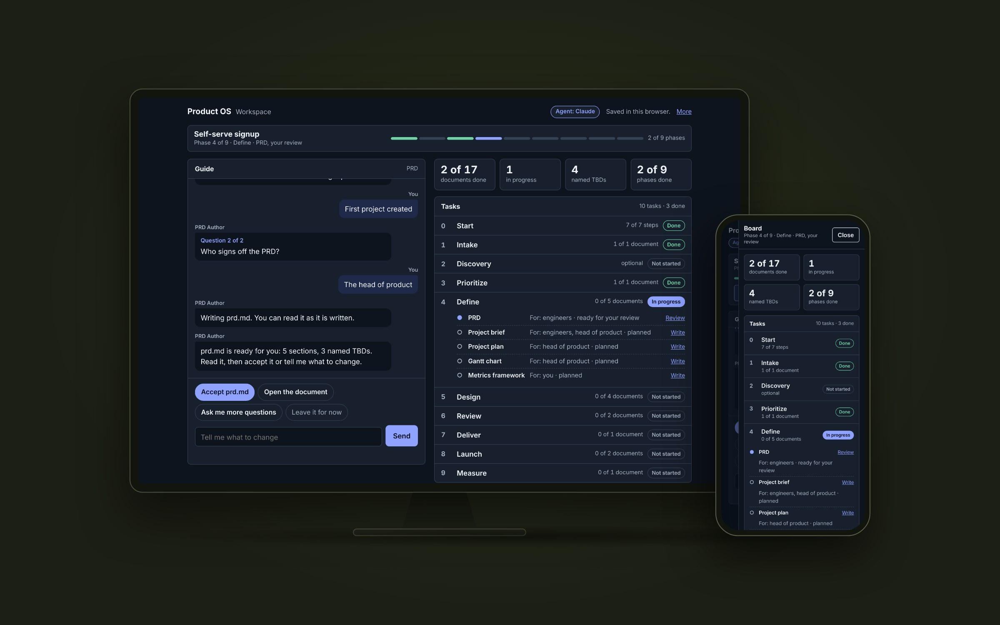
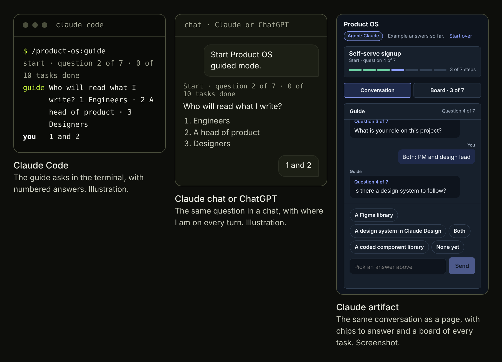
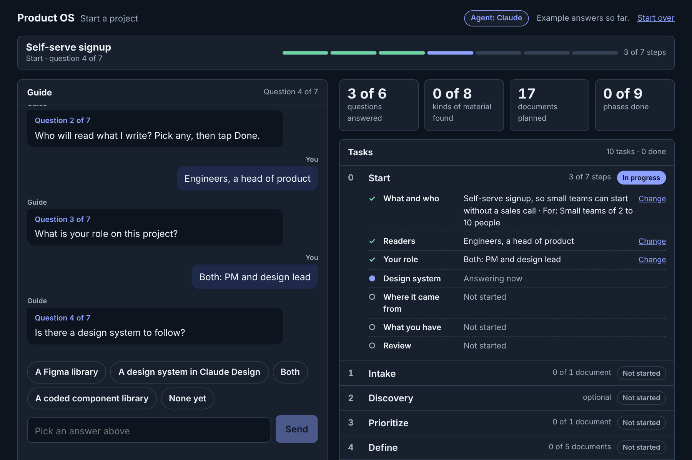
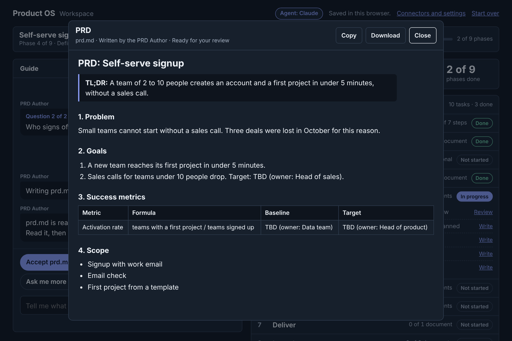
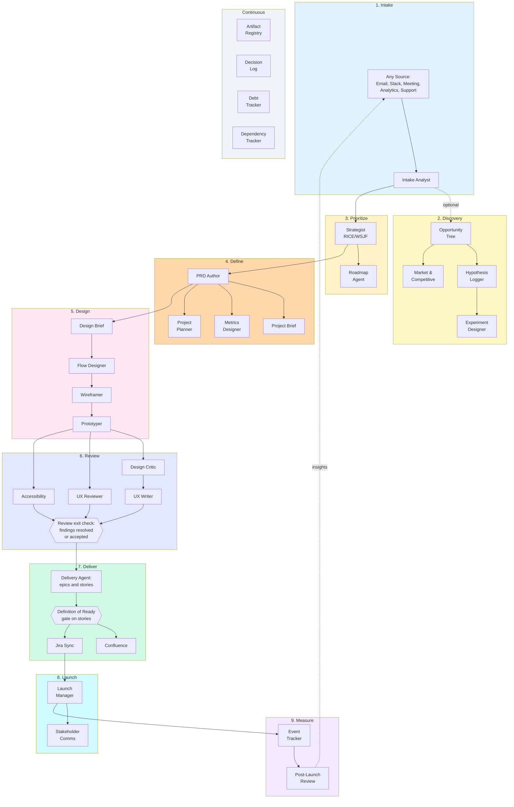
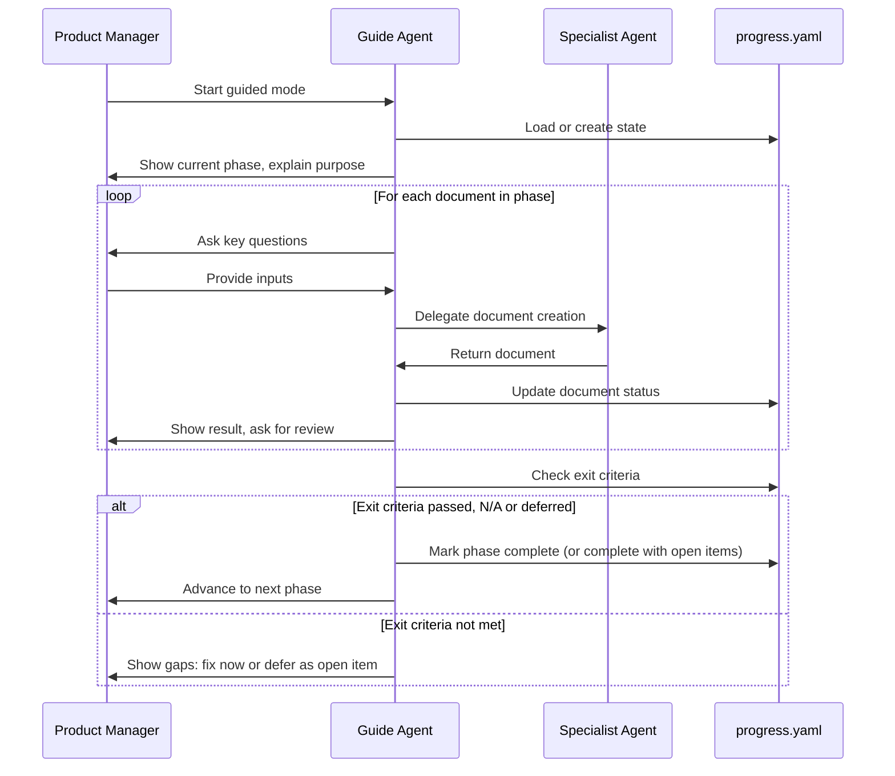

# Product OS

> AI agents that write the documents of product management and design, so your PMs spend their time on strategy, decisions and alignment.

[](LICENSE)



*The Product OS workspace (path B), on a computer and on a phone: the guide asks, you answer with chips, each agent writes its document, and the board shows every task. On the phone the board slides out over the conversation. Screenshots of `artifact/product-os.html`.*

## What is Product OS?

Product OS is **41 AI agents that write the documents of product management and design**. You make the decisions. The agents ask, write, and wait for your approval at every step.

**The problem it solves**

1. PMs and designers lose hours to document work: writing PRDs from scratch, formatting Confluence pages, copying stories into Jira, redrawing flow diagrams. The strategic work gets squeezed.
2. When AI writes every document it can, the team gets too much to read, and tickets that read as generic.
3. Product OS asks before it writes, makes only what you and your readers need, and hands the team one link.

**Who it is for**

| Role | What you get |
|------|--------------|
| **Head of Product** | One standard for PRDs, stories, gates and metrics across every team. OKRs, roadmaps and prioritization built in. |
| **Product Manager** | PRDs, briefs, plans and Jira-ready stories drafted for you to review, in one consistent format. |
| **Product Designer** | Design briefs, flow diagrams, wireframes and clickable prototypes, plus a design critique, a UX writing pass, a UX review and an accessibility audit on those designs. |

**What it outputs**

| For | What comes out |
|-----|----------------|
| **Your team** | One link: the epic. It links to the PRD, project brief, user flows, final design, UX writing guide and an end-to-end prototype, with short tickets under it. |
| **You** | The documents you ask for: project plan, Gantt chart, design brief, design critique, metrics framework and more. |
| **Confluence and Jira** | Pages and tickets, published only after you approve. |

---

## Start Here

Three steps. Everything below "Reference" is there when you need it; you do not have to read it first.

### 1. Pick your path

Where do you work? Pick one row and follow its steps.

| Where you work | Pick this path | Setup | Go to |
|----------------|----------------|-------|-------|
| In the Claude app, not in a code editor | **A · Claude chat** | About 3 minutes | [Path A steps](#path-a--claude-chat) |
| You want a UI: the conversation, the documents and a board of every task on one screen | **B · Claude artifact** | About 2 minutes | [Path B steps](#path-b--claude-artifact-the-visual-start) |
| In ChatGPT | **C · ChatGPT** | About 10 minutes | [Path C steps](#path-c--chatgpt) |
| In a repo, with Claude Code | **D · Claude Code** | About 5 minutes | [Path D steps](#path-d--claude-code) |
| In Cursor | **E · Cursor** | About 5 minutes | [Path E steps](#path-e--cursor) |

Not sure? A PM who does not use a terminal picks A or C. The questions, the documents and the handoff are the same on every path.

**On your phone.** Paths A, B and C also run in the Claude and ChatGPT apps for iOS and Android. Set the project up once on a computer, then open it in the app: the questions and the documents are the same. The board is one tap or one word away: the artifact slides it out over the conversation, and in chat you reply `board`, `task 4` or `docs`.



*The same question on three paths. Claude Code and the chat are illustrations. The Claude artifact is a screenshot.*

### 2. Have these ready

1. **The request**: the email, message or note that started this.
2. **Anything you already have**: a PRD, customer feedback, analytics, a schema, screenshots. All optional.
3. **Your design system and existing designs**, in Figma or in Claude Design, if there are any.
4. **Who will read the output**: engineers, a head of product, designers, a client.
5. **Your Confluence space and Jira project**, if you want Product OS to publish there.

"I don't have that" is always a valid answer.

### 3. Follow the flow

1. **You say:** "Start Product OS guided mode."
2. **It asks seven questions**, one at a time, then plays back what it understood. Nothing is written before your yes.
3. **It writes each document**, asking the decisions that document needs: the intake, the PRD, the project brief, the user flows, the wireframes and the prototype.
4. **It reviews the real design**: a design critique paired with a UX writing pass. You get the final designs and the UX writing guide.
5. **It hands off**: one link to share with your team, the epic, with short tickets under it. Then it asks what the team said.

You approve every step, and nothing reaches Confluence or Jira without your OK.

<details>
<summary><b>How the paths compare</b> (click to expand)</summary>

| | **A · Claude chat** | **C · ChatGPT** | **D · Claude Code** | **E · Cursor** |
|---|---|---|---|---|
| **Setup** | The Product OS plugin, added to your own Claude account (or a Claude Project with the files in `claude-ai/`) | A ChatGPT Project or custom GPT with the instructions and 8-file pack in `chatgpt/` | Installer + `product-os` plugin | Installer (adds Cursor rules and agents) |
| **How you start work** | "Start guided mode for project X" | "Start guided mode for project X" | `/product-os:guide` and the other slash commands | "Read `.claude/agents/guide.md` and start project X" |
| **Slash commands** | No (plain language) | No (plain language) | Yes, `/product-os:*` | No (role-based) |
| **Agents** | All 41, one role at a time, from the plugin | One role at a time, from the pack | Each agent is a registered subagent | Native adapters + any agent by file |
| **Where documents live** | Files in the chat; download or copy them | Files in the chat or canvas; download them | `initiatives/<initiative>/<project>/` in your repo | `initiatives/<initiative>/<project>/` in your repo |
| **Confluence and Jira** | Atlassian connector, if your workspace enables it (approval first) | Atlassian Rovo app, if your workspace and region have it (approval first) | Atlassian MCP or REST fallback (approval first) | Atlassian MCP or REST fallback (approval first) |

Path B is the visual start for paths A and C: it asks the start questions on a page and hands a brief to the chat, where the documents are written. Progress (`progress.yaml`) and session handovers (`HANDOVER.md`) are plain files, so you can start on one path and continue on another.

</details>

---

## Quick Start

The steps for the path you picked in [Start Here](#start-here).

### Path A · Claude chat

**Add the plugin (recommended, about 3 minutes).** It puts all of Product OS in your own Claude account: 41 agents, 48 commands, 44 playbooks, the templates and the visual workspace. Nothing is shared with anyone else's copy.

1. In Claude (claude.ai or the desktop app), open **Customize > Plugins**.
2. Choose **Add > Add marketplace** and enter `johnedelatorre/product-os`. Claude pulls Product OS in from GitHub. Then add the **Product OS** plugin from it.
   Or download this repo (Code → Download ZIP) and choose **Add > Upload plugin** with the ZIP.
3. Start a chat: *"Start Product OS guided mode for initiative customer-onboarding, project self-serve-signup."*
4. For the UI, say: *"Open the Product OS workspace."* Claude publishes it as your own artifact.

The plugin is saved to your account, so it is also in the Claude apps for iOS and Android and in Claude Code. In a chat, Claude takes one agent role at a time. In a Cowork task and in Claude Code, the same 41 agents run as subagents and the commands run as `/product-os:<name>`.

**Without plugins: a Claude Project (about 10 minutes).** A starter set of 27 files, uploaded by hand.

1. Download this repo (Code → Download ZIP) and unzip it. On a Mac, press **Cmd+Shift+.** in Finder to show the hidden `.claude` folder.
2. In claude.ai, create a **Project** (for example "Product OS").
3. Paste [`claude-ai/project-instructions.md`](claude-ai/project-instructions.md) (everything below its line) into the project's **Instructions**.
4. Upload the starter knowledge set listed in [`claude-ai/README.md`](claude-ai/README.md#starter-knowledge-set) to the project's **Knowledge**. Add more agents later as you need them.
5. Optional: turn on the Atlassian connector so Claude can publish to Confluence and Jira after you approve.
6. Start a chat in the project: *"Start Product OS guided mode for initiative customer-onboarding, project self-serve-signup."*

Full steps and tips: [Product OS in claude.ai](claude-ai/README.md).

### Path B · Claude artifact, the visual start

For PMs who want a UI: the conversation, the documents and a board of every task on one screen. All nine phases run in the page.



1. **With the plugin (path A):** say *"Open the Product OS workspace."* Claude publishes the page as your own artifact. Go to step 3.
   **Without it:** download [`artifact/product-os.html`](artifact/product-os.html).
2. In Claude, attach the file and say: *"Publish this page as an artifact. Declare these capabilities for it: `sample` with images, and `downloads`."* The artifact is yours, and private to you.
3. Open the artifact and answer the seven start questions with chips or by typing.
4. Tap **Start: Intake**. The agent for each document asks its questions, writes the document in the page, and waits for you to accept it or ask for a change.
5. Follow the board through the nine phases. Open, copy or download any document. Run any of the 41 agents and 48 commands from "All agents and commands".



The page carries every agent, playbook, command and template, and uses your own Claude to write. Publishing to Confluence and Jira happens in your chat, with the documents you download. What it does and does not do: [Product OS as a Claude artifact](artifact/README.md).

### Path C · ChatGPT

For PMs who work in ChatGPT and not in a code editor.

1. Download this repo (Code → Download ZIP), unzip it and open the `chatgpt` folder.
2. In ChatGPT, create a **Project** (for example "Product OS").
3. Paste [`chatgpt/project-instructions.md`](chatgpt/project-instructions.md) (everything below its line) into the project's **Instructions**.
4. Upload the 8 files in [`chatgpt/pack/`](chatgpt/pack/). They bundle the core agents, skills, formats and templates, and fit a Go or Plus project (25 files) and a custom GPT (20 files).
5. Optional: connect the Atlassian Rovo app so ChatGPT can publish to Confluence and Jira after you approve.
6. Start a chat in the project: *"Start Product OS guided mode for initiative customer-onboarding, project self-serve-signup."*

A head of product can also build it once as a custom GPT and share one link with every PM. Full steps, plan limits and what differs from Claude Code: [Product OS in ChatGPT](chatgpt/README.md).

### Path D · Claude Code

1. Install into your project:

   ```bash
   git clone https://github.com/johnedelatorre/product-os.git
   cd product-os
   ./scripts/install.sh /path/to/your/project --register-plugin
   ```

   Or, inside Claude Code: `/plugin marketplace add johnedelatorre/product-os`, then `/plugin install product-os@product-os`

2. Point it at Confluence and Jira: edit `product-os.config.yaml` (see [Configuration](#configuration)).
3. Start guided mode:

   ```bash
   /product-os:guide --initiative customer-onboarding --project self-serve-signup
   ```

### Path E · Cursor

1. Run the installer: `./scripts/install.sh /path/to/your/project --platform cursor`
2. Restart Cursor so it loads `.cursor/rules/product-os.mdc`.
3. In chat: *"Read `.claude/agents/guide.md` and help me start a project called self-serve-signup in initiative customer-onboarding."*

In Cursor you get 3 native Cursor agent adapters (Guide, PRD Author, Intake Analyst) in the agent picker; every other agent works by asking Cursor to read its file.

**Then, on any path:** follow [Your First Project, Step by Step](#your-first-project-step-by-step). When you're ready to publish, Product OS shows the exact Confluence pages and Jira issues it will write and waits for your OK.

---

## Reference

Everything from here down explains how Product OS works. Read a section when you need it.

**PM rigor leads; design serves product strategy.**

**In this reference:** [How you work with it](#how-you-work-with-it) · [Key terms](#key-terms) · [Design critique and UX writing](#design-critique-and-the-ux-writing-pass) · [Your first project](#your-first-project-step-by-step) · [Workflow](#how-it-works) · [Success and metrics](#what-success-looks-like-validation-and-metrics) · [Document format](#what-every-document-and-page-looks-like) · [Examples](#examples-you-can-copy) · [Guided Mode](#guided-mode) · [Commands](#commands) · [Agents](#agents) · [Skills](#skills) · [Documents](#documents) · [Rolling it out](#rolling-it-out-to-a-team) · [Configuration](#configuration)

---

## How You Work With It

In Claude Code you drive Product OS with 48 commands, all named `/product-os:<command>`. In Claude chat, ChatGPT and Cursor you ask for the same work in plain language ("Run the PRD Author on this intake").

### What stays with you

The agents do the writing; **you make the decisions**: what problem to solve, what to prioritize, which trade-offs to make, when to ship and what success looks like. Every step waits for your approval.

### It asks before it writes

Product OS does not produce every document it can. It asks guided questions, one at a time, each with its place ("Question 2 of 7"), short numbered options and a recommended answer.

**At the start of a project: seven questions**

| # | Question | What it decides |
|---|----------|-----------------|
| 1 | **What are you building, and who will use it?** | The frame for everything, and the product's users |
| 2 | **Who will read what I write?** Engineers, a head of product, designers, executives or investors, a client, or only you | Which outputs are made, how they are written, and where each reader starts |
| 3 | **What is your role on this project?** PM, design lead, both, founder | The documents recommended for you |
| 4 | **Is there a design system to follow, and are there existing designs to match?** Each can be in Figma, in Claude Design, or both | Every design Product OS or you make, in Claude Design or in Figma, follows the system and matches the existing pages: the design brief, wireframes, prototype and final design, and the components named in tickets |
| 5 | **Where did this come from?** | The origin of the initiative, stated plainly in the intake |
| 6 | **What do you already have?** One step: emails, proposals, customer feedback, analytics, existing PRDs, the tech stack, schemas, existing designs | Product OS sorts it and answers with **Found** and **Missing**. "That is all" is always a valid answer. |
| 7 | **Does this look right?** The playback: what it understood and what it will make | Nothing is written before your yes |

Questions 2, 3 and 4 are saved for your team. On the next project they become one line to confirm, and you answer four questions.

**It is a conversation with an agent.** On every path the question comes from the agent, with quick replies: chips in the Claude artifact, numbered options in Claude Code, Claude chat and ChatGPT. Every turn opens with where you are and the task counts, and the whole status board (Start plus the nine phases, each done, in progress or not started, with its numbers) is shown when a task finishes or when you ask.

**Connectors and settings, on every path.** One place shows what Product OS is connected to (Confluence, Jira, Figma, Claude Design), what it does without each one, and your saved settings: readers, role, design system, Confluence space, Jira project. It is a section of the board in the artifact, the words `connectors` and `settings` in chat, and `/product-os:status --connectors` in Claude Code.

**In every phase: the questions keep coming.** Before each document, the agent says how many questions it has (at most 5), asks the decisions that document needs, and confirms what was decided before the document is finished. You never have to say "ask me guided questions". Rules: [`.claude/skills/guided-questions.md`](.claude/skills/guided-questions.md).

**At the handoff: two confirmations.** What each reader group gets, built from your earlier answers, and the ticket tree: which work sits under which ticket. You accept it or move items before anything reaches Jira.

**After the handoff: one question.** What did the team say was missing, and what was too much? The answer is saved as your team's default for the next project.

Every run ends with one list: **for the team** (one link to share, the epic), **for you**, and what was **not created**.

### What your team gets: the handoff

Engineers and heads of product told us the full document set was too much to read. So the team gets a short set, and the epic links to all of it.

| # | The team gets | Notes |
|---|---------------|-------|
| 1 | **PRD** | Well detailed: the one place for the problem, requirements, testing, rollout and success metrics |
| 2 | **Project brief** | One page |
| 3 | **User flows** | The diagrams |
| 4 | **Final design** | One link: the main Figma file, or the Claude design |
| 5 | **UX writing guide** | The voice, the words and the final copy for every screen. The final design already carries this copy |
| 6 | **End-to-end prototype** | Clickable: pick a user, then one straight path, first screen to last |
| 7 | **The epic** | Where the team starts. A "Start here" line for each reader group, links to 1–6 in its description and as Jira links, and a closing line asking for feedback |
| 8 | **Short tickets** | User story, problem, requirements, a link to that ticket's own design page, a line saying "use the copy in the design as is", a "Done when" checklist, an estimate, sub-tasks |

**Specific, not generic.** Every ticket line names a real screen, component, field or rule in the project. Filler such as "handle errors gracefully" is not allowed, lists stop at 5 lines, and the epic and every ticket get a final Clear Output pass and a ready-to-run check, so the team can start from the tickets as they are.

Low-fidelity wireframes and a schema are optional extras. **Backend tickets stay high level**: Product OS says what the backend must do and leaves an "Engineering to complete" section for the engineers. Everything else you asked for lives under one **PM workspace** page in Confluence, for you. Rules: [`.claude/skills/engineering-handoff.md`](.claude/skills/engineering-handoff.md).

### Design critique and the UX writing pass

Every project with screens gets a **UX writing pass**. It is paired with the **design critique**, and it produces the **UX writing guide**.

**How the pair runs**

1. **Design critique.** The Design Critic reviews the real design: layout, hierarchy, consistency, fit with the PRD. Its findings on wording go to the UX Writer.
2. **You decide.** For each Critical and Major finding: fix it now, or accept it with a reason.
3. **Intake for the pass.** The UX Writer asks for anything that shows how your product already writes: prior designs, screenshots, a voice or style guide. With none, it works from the designs alone and confirms the voice with you.
4. **UX writing pass.** It writes the final copy for every screen, in flow order: titles, labels, help text, buttons, messages, and empty, loading and error states. You approve it.
5. **Into the design.** The fixes and the final copy are put into the wireframes, the prototypes and the final design.

**What you get**

| Output | What it is | Where it goes |
|--------|------------|---------------|
| **The final designs** | The design with the critique's accepted fixes and the approved copy in it | The one final design the team gets |
| **UX writing guide** (`ux-writing.md`) | The voice and tone, the words the product uses, the copy patterns, and the final copy for every screen | Linked from the epic's Handoff table and the links page |
| **One line in every ticket with a screen** | "Copy: use the copy in the design as is. It has been through the UX writing pass.", with a link to the guide | In the ticket, under Design |

| | |
|---|---|
| **Claude Code** | `/product-os:critique --designs prototype.html --prd prd.md`, then `/product-os:ux-writing --designs prototype.html --prd prd.md --prior <screenshots>` |
| **Claude chat, ChatGPT or Cursor** | "Run a design critique with the UX writing pass on these designs" (attach the designs and any screenshots of the current product) |
| **Example** | [design/design-critique.md](examples/acme-dashboard/design/design-critique.md) and [design/ux-writing.md](examples/acme-dashboard/design/ux-writing.md) |

Rules: [`.claude/skills/ux-writing.md`](.claude/skills/ux-writing.md). Agent: [`.claude/agents/ux-writer.md`](.claude/agents/ux-writer.md). Template: [`templates/design/ux-writing-guide.md`](templates/design/ux-writing-guide.md).

---

## Key Terms

Plain-language definitions of every term used on this page.

| Term | What it means |
|------|---------------|
| **Initiative** | A big goal or theme (for example "Customer Onboarding"). Holds one or more projects. |
| **Project** | One piece of work inside an initiative (for example "Self-Serve Signup"). Each project gets its own folder and Confluence links page. |
| **Intake** | The first document: the raw request (email, Slack, meeting, data) rewritten as a clear problem with evidence. |
| **Proposal** | For brand-new ideas: research plus a first sketch of the solution, before anyone commits. |
| **PRD** | Product Requirements Document. What we build, for whom, why, and how we measure success. |
| **Project brief** | A one-page summary of the PRD for executives and stakeholders. |
| **Hypothesis** | Something we believe but have not proven yet ("a loading skeleton makes the wait feel shorter"). Each one gets a test. |
| **North star metric** | The single number that shows the project is working for users. |
| **Input metric** | A leading number the team can move directly, which pushes the north star. |
| **Guardrail metric** | A number that must not get worse while we chase the north star (error rate, cost, support load). |
| **Stop criteria** | The result that tells us to stop, roll back or rethink, and who makes that call. |
| **User flow** | A diagram of the steps a user takes through a task, including errors and dead ends. |
| **Low-fi wireframe** | A rough grayscale sketch of one screen: layout and content, no colors or brand. |
| **Clickable prototype** | The wireframes linked together so you can click through a flow in a browser. |
| **Design critique** | A review of the visual design (hierarchy, layout, consistency), with each finding rated by severity. |
| **UX writing pass** | A review of every word on every screen (titles, labels, buttons, errors, empty states) against how the product already writes. It runs with the design critique. |
| **UX writing guide** | The document the pass produces (`ux-writing.md`): the voice, the words the product uses, and the final copy for every screen. The epic links to it, and each ticket says to use the copy as is. |
| **Design system** | The shared components, colors, type and spacing a product is built from, in Figma, in Claude Design, or both. Product OS asks for it at the start, and every design follows it. |
| **UX review** | A usability review against Nielsen's 10 heuristics (well-known usability rules). |
| **Accessibility audit** | A check that people with disabilities can use the design, against WCAG 2.2 AA (the common accessibility standard). |
| **Handoff** | The short set of outputs the team gets: PRD, project brief, user flows, final design, end-to-end prototype, and the epic with its tickets. |
| **Epic** | A large piece of work in Jira that delivers one outcome. Holds stories. In Product OS it is also the team's hub: it links to every handoff output. |
| **Story (ticket)** | One small, buildable piece of an epic, written as "As a user, I want..., so that...". Kept short: problem, requirements, design link, "Done when", estimate. |
| **Sub-task** | A step inside a story (frontend, backend, design, testing, tracking). It sits under its story in Jira and carries no points. |
| **Ticket tree** | The proposed organization of the backlog: which work sits under which ticket. You accept it before anything goes to Jira. |
| **Done when** | The acceptance criteria: a short checklist of plain sentences a tester can check. |
| **DoR / DoD gate** | Definition of Ready (a story is ready to build) and Definition of Done (it is really finished). A gate checks each rule and records Pass, Conditional, Fail, N/A or Not Verified with evidence. |
| **Not Verified** | A check that could not be done (no file, no tool). It is never counted as a pass. |
| **Open item / deferred** | Information you don't have yet. You defer it, Product OS records who provides it and when, and brings it back later. |
| **Links page** | The project's page in Confluence: summary, metrics and the Handoff table, with the same links as the epic. |
| **PM workspace** | One Confluence page, under the project page, that holds the documents you asked for yourself. The team's pages do not link to it. |
| **Guided mode** | The step-by-step path through all nine phases, with questions and progress tracking. |
| **Review exit check** | The end of Phase 6: every critique, UX and accessibility finding is resolved or accepted with a written risk before stories are written. |
| **Agent** | An AI role with one job (for example the PRD Author). Each is a file in `.claude/agents/`. |
| **Skill (playbook)** | A how-to the agents follow: a framework, a checklist or a writing rule. Each is a file in `.claude/skills/`. |
| **Command** | A Claude Code shortcut that runs an agent, typed as `/product-os:<name>`. In claude.ai and Cursor you ask in plain language instead. |
| **Template** | A blank document with the right headings, in `templates/`. Agents fill it in. |
| **Slug** | A short lowercase name with dashes, used for folders, for example `self-serve-signup`. |
| **Atlassian connector / MCP** | The link that lets Claude read and write Confluence and Jira. "Connector" in claude.ai, "MCP server" in Claude Code and Cursor. |
| **Plugin** | The Claude Code package that adds the `/product-os:` commands. |
| **Mermaid** | A text format for diagrams. GitHub, claude.ai and many editors draw it as a picture. |
| **FigJam** | Figma's whiteboard tool. Product OS can draw your user flows there. |
| **claude.ai Artifact** | A page claude.ai shows beside the chat (a diagram, a clickable prototype) that you can open and share. |
| **progress.yaml** | The file that records where you are in guided mode: phase, document status and open items. |
| **HANDOVER.md** | A short note at the end of a session: state, evidence and the next action, so the next session picks up cleanly. |
| **Spike** | A short, time-boxed investigation story used when the team can't estimate something yet. |
| **Feature flag** | A switch that turns a feature on or off for some users without a new release. |
| **RICE** | A prioritization score: Reach × Impact × Confidence ÷ Effort. |
| **WSJF** | Weighted Shortest Job First: the cost of delay divided by the size of the job. |
| **MoSCoW** | Sorting scope into Must have, Should have, Could have and Won't have. |
| **Kano** | Sorting features by how they affect satisfaction: basic, performance or delighter. |
| **JTBD** | Jobs to Be Done: the progress a user is trying to make, written as the "job" they hire the product for. |
| **TAM / SAM / SOM** | Market size: total addressable, serviceable addressable, and serviceable obtainable (the share you can realistically win). |
| **ADR** | Architecture Decision Record: a short record of a decision, why it was made and what was traded off. |

---

## Your First Project, Step by Step

This is the whole workflow, in order. Guided mode walks you through it and asks the questions for you; you can also run any step on its own.

**How to read each step**

| Row | Meaning |
|-----|---------|
| **Claude Code** | The slash command to type |
| **claude.ai or Cursor** | What to say instead (in Cursor, start with "Read `.claude/agents/guide.md` and...") |
| **Product OS asks you** | The questions to have answers ready for. "I don't know yet" is a fine answer: it becomes an open item |
| **You get** | The document it writes, and what that document is |
| **Where it lives** | The file in `initiatives/<initiative>/<project>/` and where it goes after you approve publishing |
| **Check before moving on** | What you confirm before the next step |
| **Example** | The same document, filled in, from the fictional Acme project |

**Before you start:** pick an initiative name and a project name, and gather what you have. Product OS asks for it first, one question at a time: where the initiative came from, the request (proposals, emails, tickets), customer feedback, competitive analysis, product analytics, existing PRDs and platform docs, the tech stack and any backend schemas, existing designs or a previous project to follow, and constraints. You do not need all of it. Existing documents are detected and marked done.

### Step 1. Intake: turn the request into a problem

| | |
|---|---|
| **Claude Code** | `/product-os:guide --initiative <initiative> --project <project>` (starts here), or `/product-os:intake --input "<the request>"` |
| **claude.ai or Cursor** | "Start Product OS guided mode for initiative X, project Y. Here is the request: ..." |
| **Product OS asks you** | The seven start questions: what you are building and who will use it · who will read what it writes · your role · the design system to follow and the existing designs to match · where it came from · everything you have, in one step · whether its playback is right. Then, for the intake: which problem matters most, which evidence is strongest, who else has a say |
| **You get** | `intake.md`: the request rewritten as a problem statement with evidence, affected users and stakeholders. No solution yet. |
| **Where it lives** | `intake.md` · Confluence: **PM workspace → 1. Strategy & Definition** |
| **Check before moving on** | The problem is stated without a solution baked in · evidence is listed · stakeholders are named · you approve the framing |
| **Example** | [intake/intake.md](examples/acme-dashboard/intake/intake.md) |

What happens next depends on the request: a **new idea** goes to a proposal first (`/product-os:propose`), an **agreed change** goes to Discovery or Define, a **bug fix** goes straight to Deliver.

### Step 2. Discovery (optional): test what you believe

| | |
|---|---|
| **Claude Code** | `/product-os:opportunity-tree`, `/product-os:hypotheses`, `/product-os:market`, `/product-os:competitive`, `/product-os:research` |
| **claude.ai or Cursor** | "Run Product OS discovery: build the opportunity tree and log our hypotheses." |
| **Product OS asks you** | Which outcome are you trying to move? What do you believe that isn't proven? Who are the competitors? What research exists? |
| **You get** | `opportunity-tree.yaml` (outcome → opportunities → solutions), `hypothesis-log.yaml` and `hypothesis-log.md` (beliefs with test status), `market-analysis.md`, `research-synthesis.md` |
| **Where it lives** | Project folder · Confluence after you approve (outside the four standard groups; the publish plan shows where each page goes) |
| **Check before moving on** | Key hypotheses are written down · at least one opportunity has evidence. Skipping this step records the risks of skipping |
| **Example** | [PRD §2 Hypotheses](examples/acme-dashboard/pm/prd.md#2-hypotheses--validation) |

### Step 3. Prioritize: decide if and when to build

| | |
|---|---|
| **Claude Code** | `/product-os:prioritize --items prd.md --framework rice`, then `/product-os:roadmap` |
| **claude.ai or Cursor** | "Score this against our other work with RICE, then place it on the roadmap." |
| **Product OS asks you** | Reach, impact, confidence and effort for each item. What else competes for the team? |
| **You get** | `prioritization.md` (scores and rationale), `roadmap.md` (Now / Next / Later) |
| **Where it lives** | `prioritization.md` stays local · `roadmap.md` goes to Confluence |
| **Check before moving on** | A priority score exists · roadmap placement is decided · stakeholders agree |
| **Example** | No Acme file; blank templates: `templates/pm/prioritization.md`, `templates/pm/roadmap.md` |

### Step 4. Define: write the PRD, brief, metrics and plan

| | |
|---|---|
| **Claude Code** | `/product-os:prd --from intake.md` → `/product-os:review-prd --from prd.md` → `/product-os:brief --from prd.md` → `/product-os:metrics --from prd.md` → `/product-os:plan --from prd.md` |
| **claude.ai or Cursor** | "Write the PRD from intake.md, review it, then write the project brief, metrics framework and project plan." |
| **Product OS asks you** | Goals and non-goals · users and use cases · requirements · current baselines and targets · when to stop · team, owners and dates |
| **You get** | `prd.md` (19-section requirements), `prd-review.md` (blockers, gaps, suggestions, conflicts), `project-brief.md` (one page), `metrics-framework.md` (how success is measured), `project-plan.md`, `raci.md`, `gantt.md` |
| **Where it lives** | Confluence: PRD and brief directly under the project page, for the team; metrics in **PM workspace → 1. Strategy & Definition**; plan, RACI and Gantt in **PM workspace → 3. Delivery**, when you asked for them |
| **Check before moving on** | PRD stage matches intent (Early, Defined, Delivery-ready) · review blockers resolved or deferred · metrics have baselines and targets (or a named TBD) · stop criteria have owners · RACI has one owner per row |
| **Example** | [pm/prd.md](examples/acme-dashboard/pm/prd.md) · [pm/project-brief.md](examples/acme-dashboard/pm/project-brief.md) · [pm/metrics-framework.md](examples/acme-dashboard/pm/metrics-framework.md) |

### Step 5. Design: flow diagrams, wireframes, clickable prototype

This is where user flow diagrams and clickable low-fi wireframes are made. Run the sub-steps in order; each one builds on the last.

| Sub-step | Claude Code | You get | How to open and share it |
|----------|-------------|---------|--------------------------|
| 5a. Design brief | `/product-os:design-brief --from prd.md` | `design-brief.md`: design goals, principles, constraints, accessibility target | Any Markdown viewer · Confluence **PM workspace → 2. Design → Design Brief** |
| 5b. User flow diagrams | `/product-os:flows --from prd.md` | `flows.md` (Mermaid diagrams, happy path plus error, empty and timeout paths) and `flows.yaml` (the source the diagrams are drawn from), plus journey map and sitemap | `flows.md` renders as diagrams on GitHub, in claude.ai and in editors with a Mermaid preview. In claude.ai, if a diagram doesn't render, ask Claude to show the flow as an artifact or diagram. In Claude Code, add `--targets claude-artifact,figjam` for an interactive page or a FigJam board · Confluence **User Flows**, under the project page, for the team |
| 5c. Low-fi wireframes | `/product-os:wireframes --from flows.yaml --brief design-brief.md` | `wireframes.md`: one grayscale sketch per screen (IDs `SCR-###`, for example `SCR-001`), with states and notes | Any Markdown viewer · ask for HTML wireframes when you need more detail · Confluence **PM workspace → 2. Design → Wireframes & Prototype**, or under the project page when you attach it to the epic |
| 5d. Clickable low-fi prototype | `/product-os:prototype --from wireframes.md --flows flows.yaml` | `prototype.html`: the wireframes linked into a clickable flow with annotations; `prototype-react.tsx` for a claude.ai Artifact | Double-click `prototype.html` to open it in any browser, no install. `→`/`←` move through the flow, `a` shows notes. Share the file, or paste the `.tsx` into claude.ai for a shareable link · Confluence **PM workspace → 2. Design → Wireframes & Prototype** (prototype attached or linked). The team's end-to-end version, `prototype-handoff.html`, is linked from the epic |
| 5e. Figma (optional) | `/product-os:figma figjam --flows flows.yaml --url <figma-url>` (also `push`, `audit`, `tokens`) | A FigJam board of the flows, wireframe frames in Figma, or a Figma-vs-PRD audit | Open the Figma link · link it from the Confluence design pages |

| | |
|---|---|
| **claude.ai or Cursor** | "Write the design brief from prd.md, then the user flows, then low-fi wireframes, then a clickable HTML prototype." |
| **Product OS asks you** | Design system or brand to follow · platforms (web, mobile) · accessibility target · a Figma link, if you have one |
| **Where it lives** | Project folder · Confluence: user flows under the project page, for the team; the rest in **PM workspace → 2. Design** (`flows.yaml` stays in the repo) |
| **Check before moving on** | Every PRD use case has a flow · each flow has error paths and no dead ends · every screen in the flows is wireframed with real content · you clicked through the prototype end to end |
| **Example** | [design/flows.md](examples/acme-dashboard/design/flows.md) · [design/flows.yaml](examples/acme-dashboard/design/flows.yaml) · [design/wireframes.md](examples/acme-dashboard/design/wireframes.md) · [design/prototype.html](examples/acme-dashboard/design/prototype.html) |

Full walkthrough with what to check at each sub-step: [From PRD to Reviewed Designs](docs/guides/design-workflow.md).

### Step 6. Review: design critique and UX writing pass on the real designs, then the review exit check

| | |
|---|---|
| **Claude Code** | `/product-os:critique --designs prototype.html --prd prd.md` (or `--figma-url <url>`) · `/product-os:ux-writing --designs prototype.html --prd prd.md --prior <screenshots>` · `/product-os:ux-review --designs prototype.html --flows flows.md` · `/product-os:a11y --target prototype.html` |
| **claude.ai or Cursor** | "Run a design critique with the UX writing pass, a UX review and an accessibility audit on prototype.html" (attach screenshots or share the Figma link) |
| **Product OS asks you** | Which design to review: a Figma link, screenshots, `prototype.html` (or a hosted URL) or `wireframes.md` · for each Critical and Major finding: fix it now or accept it · prior designs, screenshots or a style guide that show how the product already writes |
| **You get** | `design-critique.md` (severity-rated visual findings), `ux-writing.md` (the UX writing guide: voice, words and the final copy for every screen) and the designs with that copy in them, `ux-review.md` (usability findings by heuristic), `accessibility-audit.md` plus `a11y-issues.csv` (WCAG 2.2 AA issues) |
| **Where it lives** | Project folder · Confluence: **PM workspace → 2. Design** |
| **Check before moving on (review exit check)** | Every critique, UX and accessibility finding is resolved or accepted with a written risk · no critical issue left open · the UX writing pass is done and the final design carries its copy · WCAG 2.2 AA verified · every Not Verified item has an owner |
| **Example** | [design/design-critique.md](examples/acme-dashboard/design/design-critique.md) · [design/ux-writing.md](examples/acme-dashboard/design/ux-writing.md) |

**Reviews run on the actual designs, never on a description.**

1. Each review needs a real design: Figma link, screenshots, prototype or wireframes. With no design, the agent stops and asks you for one.
2. Each report opens with a **What was reviewed** table: the files, screen and frame IDs, and the review date.
3. Every finding names the exact screen, frame and element, so you can find it in the design.
4. Anything the reviewer could not inspect is marked **Not Verified**. Wireframes alone cannot show color or contrast; a prototype is needed for keyboard checks; a Figma link is needed for brand and typography.

The **Definition of Ready gate** runs on the stories once they exist, in Step 7.

### Step 7. Deliver: the handoff, the epic, short tickets, Confluence and Jira

| | |
|---|---|
| **Claude Code** | `/product-os:deliver --from prd.md --designs design-brief.md,wireframes.md` → `/product-os:tracking --from prd.md` → `/product-os:gate --stories stories.md --gate dor` → `/product-os:publish --project initiatives/<initiative>/<project>/` → `/product-os:jira-sync --project initiatives/<initiative>/<project>/` |
| **claude.ai or Cursor** | "Ask me the outputs question, write the epic and short tickets, propose the ticket tree, check the tickets against Definition of Ready, then show me the Confluence and Jira publish plan." |
| **Product OS asks you** | What goes to the team (the standard handoff is recommended) · any other outputs to attach to the epic · which design is final · how tickets are organized · whether the proposed ticket tree is right · known unknowns that need a spike · your Confluence space and Jira project · approval of the publish plan |
| **You get** | `epics.md` (the epic, which links to every handoff output) and `stories.md` (short tickets with a "Done when" checklist, points, sub-tasks and a link to each ticket's own design page; backend tickets left for the engineers to complete), `traceability.md` (requirement → story → test), `tracking-plan.md` (analytics events), `gate-report.md` (the Definition of Ready gate on the stories: Pass / Fail per rule, with evidence), then Confluence pages and Jira issues |
| **Where it lives** | Jira: one epic with the handoff links, child stories and their sub-tasks · Confluence: the project's links page, the team's pages (PRD, brief, user flows, Epics & Stories) and **PM workspace** for everything you asked for yourself · `gate-report.md` stays local |
| **Check before moving on** | The epic links to every handoff output · every story has a testable "Done when" checklist and points, at 1–5 points · you accepted the ticket tree · unknowns are spikes, not guesses · traceability gaps have a reason · you approved exactly what gets written · you have the one link to share with the team: the epic |
| **Example** | [jira/epic.md](examples/acme-dashboard/jira/epic.md) · [jira/stories.md](examples/acme-dashboard/jira/stories.md) · [confluence/00-hub-page.md](examples/acme-dashboard/confluence/00-hub-page.md) · [confluence page tree](examples/acme-dashboard/confluence/README.md) |

### Step 8. Launch: release notes, enablement, go or no-go

| | |
|---|---|
| **Claude Code** | `/product-os:launch --project initiatives/<initiative>/<project>` · `/product-os:comms` · `/product-os:release-gate --initiative <initiative> --project <project>` (when shipping code) |
| **claude.ai or Cursor** | "Prepare the launch: release notes, enablement and the launch checklist. List the open items first." |
| **Product OS asks you** | For each open item: resolve it now, or carry it forward as an accepted risk (with who accepted it) · who the audience is · how to roll back |
| **You get** | `release-notes.md`, `enablement.md` (for sales and support), `launch-checklist.md`, `decision-log.md` |
| **Where it lives** | Confluence **PM workspace → 4. Decisions & Launch**: release notes, decision log · `enablement.md` stays local |
| **Check before moving on** | Open items decided · support enabled · monitoring and alerts live · rollback written and tested · PRD still matches what was built |
| **Example** | No Acme file; blank template: `templates/launch/release-notes.md` |

### Step 9. Measure: did it work?

| | |
|---|---|
| **Claude Code** | `/product-os:review-launch --project initiatives/<initiative>/<project> --prd prd.md` · `/product-os:retro` |
| **claude.ai or Cursor** | "Run the post-launch review against the PRD targets, then a retro." |
| **Product OS asks you** | Actual numbers and dashboard links for each metric · guardrail status · what the team learned |
| **You get** | `post-launch-review.md` (results vs targets, with evidence), decision-log updates, `followup-intake.md` (the next piece of work) |
| **Where it lives** | Confluence **PM workspace → 4. Decisions & Launch**: post-launch review, decision log · the retro goes to Confluence outside the four standard groups (the publish plan shows where) |
| **Check before moving on** | Every metric compared to its target with evidence · guardrails checked, not assumed · stop criteria evaluated · follow-ups created, or "none needed" written down |
| **Example** | What it is measured against: [metrics framework §5 and §7](examples/acme-dashboard/pm/metrics-framework.md#5-stop-criteria-and-success-criteria) · blank template: `templates/pm/post-launch-review.md` |

---

## How It Works

A project moves from raw input to a measured launch. Each box is an agent.



**It's a guide, not a gate.** Start anywhere (have a PRD? start at design), skip what a small feature doesn't need, go back and revise, and run reviews in parallel. The continuous agents (Artifact Registry, Decision Log, Debt Tracker, Dependency Tracker) run across the whole lifecycle.

### How the documents connect

```
intake.md ──────────────────────────────────────────────────────────────────┐
    │                                                                        │
    ▼                                                                        │
prd.md (stage: Early → Defined → Delivery-ready)                            │
    │                                                                        │
    ├──▶ prd-review.md (if stage ≥ Defined)                                 │
    │        └── blockers, gaps, suggestions, conflicts                      │
    │                                                                        │
    ├──▶ project-brief.md (one-page summary)                                │
    │                                                                        │
    ├──▶ metrics-framework.md                                               │
    │        └── north star, inputs, guardrails, stop criteria              │
    │                                                                        │
    └──▶ project-plan.md, raci.md, gantt.md                                 │
             │                                                               │
             ▼                                                               │
    design-brief.md ──▶ flows.yaml ──▶ wireframes.md ──▶ prototype.html    │
             │                                                               │
             ▼                                                               │
    design-critique.md, ux-writing.md, ux-review.md, accessibility-audit.md │
             │                                                               │
             ▼                                                               │
    Review exit check (Phase 6): findings resolved or accepted              │
             │                                                               │
             ▼                                                               │
    epics.md (T-shirt estimates) ──▶ stories.md (Fibonacci points)          │
             │                           │                                   │
             │                           ├── User story and problem          │
             │                           ├── Requirements and design link    │
             │                           ├── "Done when" checklist           │
             │                           └── Estimate and sub-tasks          │
             │                           │                                   │
             │                           ▼                                   │
             │              gate-report.md: Definition of Ready gate         │
             │              (pass/fail/NA/not-verified with evidence)        │
             │                                                               │
             ▼                                                               │
    traceability.md ◀───────────────────────────────────────────────────────┘
             │
             ▼
    Confluence pages + Jira issues (requires human approval)
             │
             ▼
    release-notes.md, enablement.md, launch-checklist.md
             │
             ▼
    post-launch-review.md (metrics vs targets with evidence)
```

---

## What Success Looks Like: Validation and Metrics

Success is defined before design starts and checked after launch. Each link in this chain is a document you can open.

| # | Question | Where it lives | Made by | Acme example |
|---|----------|----------------|---------|--------------|
| 1 | What do we believe will happen? | Hypotheses in the PRD and the hypothesis log | `/product-os:prd`, `/product-os:hypotheses` | [PRD §2 Hypotheses](examples/acme-dashboard/pm/prd.md#2-hypotheses--validation) |
| 2 | What number proves it worked? | `metrics-framework.md`: north star, input metrics, guardrails, baselines and targets | `/product-os:metrics` | [North star](examples/acme-dashboard/pm/metrics-framework.md#1-north-star-metric) · [Guardrails](examples/acme-dashboard/pm/metrics-framework.md#4-guardrail-metrics) |
| 3 | When do we stop or roll back? | Stop criteria and success criteria, each with an owner | `/product-os:metrics` | [Stop and success criteria](examples/acme-dashboard/pm/metrics-framework.md#5-stop-criteria-and-success-criteria) |
| 4 | How do we test each belief before relying on it? | Validation plan (per hypothesis: test, threshold, decision if it passes or fails) and experiment designs | `/product-os:metrics`, `/product-os:experiment` | [Validation plan](examples/acme-dashboard/pm/metrics-framework.md#7-validation-plan) |
| 5 | How do we collect the numbers? | `tracking-plan.md`: every analytics event and its properties | `/product-os:tracking` | [PRD §11 Analytics](examples/acme-dashboard/pm/prd.md#11-analytics--instrumentation) |
| 6 | Is it ready to build, done, safe to ship? | `gate-report.md` (Definition of Ready and Done) and the release gate | `/product-os:gate`, `/product-os:release-gate` | [Stories: Definition of Ready / Done](examples/acme-dashboard/jira/stories.md#definition-of-ready--done) |
| 7 | Did it work? | `post-launch-review.md`: actual vs target with evidence, guardrails, stop criteria | `/product-os:review-launch` | Blank template: `templates/pm/post-launch-review.md` |

Every story also carries a **Validation** section: the tests, analytics event and success metric it moves. A missing baseline or target is written as a named TBD (what is missing, who provides it) and tracked as an open item; it never blocks the work.

---

## What Every Document and Page Looks Like

Documents and Confluence pages open with the full standard header below, so a reader gets the point in 30 seconds. Jira epics and stories use trimmed versions of it (see the Jira table below and [Document Format Standard §3 and §4](docs/reference/document-format.md#3-jira-epic)).

```markdown
# Self-Serve Signup — PRD

**Requirements for letting new customers sign up without talking to sales.**

| Initiative | Project | Owner | Status | Last updated |
|------------|---------|-------|--------|--------------|

## Description          ← what this document covers, 2–4 sentences
## Problem Statement    ← who has the problem, evidence, cost of doing nothing
## Solution             ← what we will do; scope in and out
## Success Metrics      ← metric, baseline, target, how we measure
## Next Action          ← one action, one owner
---
[Document-specific sections follow]
```

**Confluence:** one links page per project for the team, and one PM workspace page for you.

| Page | What it holds |
|------|---------------|
| **[Project name]** (links page) | The standard header plus the "Handoff" table, with the same links as the epic |
| **PRD, Project Brief, User Flows** | The team's pages, directly under the project page, plus any extras you attached |
| **Epics & Stories** | What each epic delivers, the handoff links and the ticket tree with Jira links |
| **PM workspace** | Everything you asked for yourself, in four groups: 1. Strategy & Definition · 2. Design · 3. Delivery · 4. Decisions & Launch |

**Jira:**

| Item | Summary format | Description holds |
|------|----------------|-------------------|
| **Epic** | `[Project] — [Outcome in plain words]` | Subtitle, What and why, Who it is for, a Start here line per reader group, the Handoff table (PRD, project brief, user flows, final design, UX writing guide, end-to-end prototype, extras), the ticket list, one estimate line and a closing Feedback line. Each handoff output is also a Jira link on the epic |
| **Story** | `[Verb] [thing] [for whom]` | "As a / I want / so that", a short Problem, Requirements, UX and design requirements, a link to that ticket's own design page, the Copy line ("use the copy in the design as is", with a link to the UX writing guide), a "Done when" checklist and an Estimate. Backend tickets add an empty "Engineering to complete" section |
| **Sub-task** | `[frontend] [step]` | Nothing: the parent story has the detail |

Full rules: [Document Format Standard](docs/reference/document-format.md). Docs, pages and tickets show the current state only, with no version history.

---

## Examples You Can Copy

A complete fictional project, **Acme Dashboard Performance**, filled in end to end. Every document uses the standard header; the Jira examples show the epic as the team's hub and the short ticket format. Start with the [gallery guide](examples/acme-dashboard/README.md).

| # | Example | What it shows | Made by |
|---|---------|---------------|---------|
| 1 | [Intake](examples/acme-dashboard/intake/intake.md) | A raw request turned into a problem with evidence | `/product-os:intake` |
| 2 | [Project brief](examples/acme-dashboard/pm/project-brief.md) | The one-page executive summary | `/product-os:brief` |
| 3 | [PRD](examples/acme-dashboard/pm/prd.md) | Requirements, hypotheses, success metrics, rollout | `/product-os:prd` |
| 4 | [Metrics framework](examples/acme-dashboard/pm/metrics-framework.md) | North star, inputs, guardrails, stop criteria, validation plan | `/product-os:metrics` |
| 5 | [User flows](examples/acme-dashboard/design/flows.md) + [flows.yaml](examples/acme-dashboard/design/flows.yaml) | Flow diagrams with step tables; the YAML is the source | `/product-os:flows` |
| 6 | [Wireframes](examples/acme-dashboard/design/wireframes.md) | Low-fi screens with notes and states | `/product-os:wireframes` |
| 7 | [Clickable prototype](examples/acme-dashboard/design/prototype.html) | The full version with every state, for design review. Download and open in a browser; `←` `→` move between screens | `/product-os:prototype` |
| 7a | [Handoff prototype](examples/acme-dashboard/design/prototype-handoff.html) | The team's version: pick a user, then one straight path end to end | `/product-os:prototype --handoff` |
| 8 | [Design critique](examples/acme-dashboard/design/design-critique.md) | A critique of the actual prototype; every finding cites a screen and element | `/product-os:critique` |
| 8a | [UX writing guide](examples/acme-dashboard/design/ux-writing.md) | The output of the UX writing pass, paired with the critique: voice, words and the final copy for every screen | `/product-os:ux-writing` |
| 9 | [Jira epic](examples/acme-dashboard/jira/epic.md) | The team's hub: the Handoff links, the ticket list, and the ticket tree the PM accepted | `/product-os:deliver` |
| 10 | [Jira stories](examples/acme-dashboard/jira/stories.md) | Short tickets with a "Done when" checklist, design links and sub-tasks; backend parts left for engineering; PM notes at the end | `/product-os:deliver` |
| 11 | [Confluence links page](examples/acme-dashboard/confluence/00-hub-page.md) | The project page with the Handoff table, pointing to the epic | `/product-os:publish` |
| 12 | [Confluence page tree](examples/acme-dashboard/confluence/README.md) | Which file becomes which Confluence page | `/product-os:publish` |

To use one as a template: copy it into `initiatives/<initiative>/<project>/`, keep the headings, replace the content. Blank templates are in `templates/`.

---

## Guided Mode

Guided mode is the easiest way in, and the recommended path for new PMs. It walks you through 9 phases, asks the key questions, hands each document to the right agent and tracks progress in `progress.yaml`.

| Platform | Start | Where am I? | Next step |
|----------|-------|-------------|-----------|
| claude.ai | "Start Product OS guided mode for initiative X, project Y" | "Product OS status" | "Do the next Product OS step" |
| Claude Code | `/product-os:guide --initiative X --project Y` | `/product-os:status` | `/product-os:next` |
| Cursor | "Read `.claude/agents/guide.md` and start project Y in initiative X" | "Show guided-mode status" | "Do the next step" |

| # | Phase | What happens | Skip or come back later |
|---|-------|--------------|-------------------------|
| 1 | **Intake** | Raw input becomes a problem statement | Defer what you don't have yet |
| 2 | **Discovery** | Explore the problem space | Skip the phase, or defer items |
| 3 | **Prioritize** | Decide if and when to build | Defer what you don't have yet |
| 4 | **Define** | PRD, brief, metrics, plan | Defer what you don't have yet |
| 5 | **Design** | Flows, wireframes, prototype | Defer what you don't have yet |
| 6 | **Review** | Critique, UX review, accessibility | Defer what you don't have yet |
| 7 | **Deliver** | Epics, stories, Confluence, Jira | Defer what you don't have yet |
| 8 | **Launch** | Release notes, enablement | Defer what you don't have yet |
| 9 | **Measure** | Post-launch review, follow-ups | Defer what you don't have yet |

**Missing information? Keep going.** Only Discovery can be skipped, but no phase stops you for missing information. Say "I don't have the baseline yet, come back to it later" and the guide asks who can provide it and when to revisit, records it as an open item and moves on. Documents still get written, with the gap marked TBD. Open items show first in status and come back when you reach their revisit phase; resolve one any time. Before Launch you decide per item: resolve it now, or carry it forward as an accepted risk. Publishing to Confluence or Jira still needs your explicit approval.



**Already have a PRD or other docs?** Bring them in (copy into `initiatives/<initiative>/<project>/`, or upload them to the claude.ai project) and start guided mode. It detects what exists, marks it done and lets you jump to any phase.

Full playbook: [Guided Workflow](docs/guides/guided-workflow.md).

---

## Commands

Every command is a Claude Code slash command. In claude.ai or Cursor, ask for the same thing in plain language ("write the PRD from this intake", "run a UX review on the wireframes").

<details>
<summary><b>All 48 commands, by phase</b> (click to expand)</summary>

**Guided mode and sessions**

| Command | What it does |
|---------|--------------|
| `/product-os:guide` | Start or resume guided mode, or jump to a phase |
| `/product-os:status` | Show progress through guided mode |
| `/product-os:next` | Do the next recommended step |
| `/product-os:handover` | Write a handover for the next session: state, evidence, next action |
| `/product-os:new-project` | Run the full pipeline from intake to publishing, with checkpoints |

**Intake and discovery**

| Command | What it does |
|---------|--------------|
| `/product-os:intake` | Turn a raw requirement into a problem/opportunity statement |
| `/product-os:propose` | Research a new idea and propose what to build, interface first |
| `/product-os:opportunity-tree` | Outcome → opportunity → solution tree |
| `/product-os:hypotheses` | Track and validate hypotheses |
| `/product-os:market` | Market analysis brief (TAM/SAM/SOM, trends, segments) |
| `/product-os:competitive` | Competitive analysis (feature matrix, SWOT) |
| `/product-os:research` | Research plan or synthesis |
| `/product-os:experiment` | A/B test design with sample size |

**Prioritize and strategy**

| Command | What it does |
|---------|--------------|
| `/product-os:prioritize` | RICE / WSJF / MoSCoW / Kano scoring |
| `/product-os:roadmap` | Now / Next / Later roadmap |
| `/product-os:okrs` | OKRs and metric trees |
| `/product-os:prfaq` | Amazon-style PR/FAQ |

**Define**

| Command | What it does |
|---------|--------------|
| `/product-os:prd` | Full PRD (19 sections) |
| `/product-os:review-prd` | Multi-perspective PRD review: blockers, gaps, suggestions, conflicts |
| `/product-os:brief` | One-page executive project brief |
| `/product-os:plan` | Project plan, RACI and Gantt chart |
| `/product-os:metrics` | North star, input metrics, guardrails |
| `/product-os:tracking` | Analytics event tracking plan |
| `/product-os:risks` | Risk register |
| `/product-os:dependencies` | Dependencies and risks |

**Design**

| Command | What it does |
|---------|--------------|
| `/product-os:design-brief` | Design brief from the PRD |
| `/product-os:flows` | User flows (happy path, edge cases, errors) |
| `/product-os:wireframes` | Low-fidelity wireframes from flows |
| `/product-os:prototype` | Clickable HTML/React prototype |
| `/product-os:figma` | Work with Figma via MCP |
| `/product-os:artifacts` | Design artifact registry |

**Review and gates**

| Command | What it does |
|---------|--------------|
| `/product-os:critique` | Severity-rated visual design critique |
| `/product-os:ux-writing` | The UX writing pass, paired with the critique: the UX writing guide and the final copy for every screen |
| `/product-os:ux-review` | Nielsen's heuristics evaluation |
| `/product-os:a11y` | WCAG 2.2 AA accessibility audit |
| `/product-os:gate` | Definition of Ready / Done check |

**Deliver and publish**

| Command | What it does |
|---------|--------------|
| `/product-os:deliver` | The engineering handoff: asks what goes to the team, then writes the epic (the team's hub), short tickets with points, and a ticket tree you approve |
| `/product-os:publish` | Publish to Confluence (after approval): a links page and the team's pages, with your own documents under PM workspace |
| `/product-os:jira-sync` | Create or update the Jira epic with its handoff links, stories and sub-tasks (after approval) |

**Launch**

| Command | What it does |
|---------|--------------|
| `/product-os:launch` | Release notes, enablement, changelog |
| `/product-os:comms` | Stakeholder updates |
| `/product-os:release-gate` | Go/no-go, independent review, build verification |

**Measure and learn**

| Command | What it does |
|---------|--------------|
| `/product-os:review-launch` | Post-launch results vs PRD goals |
| `/product-os:retro` | Retrospective and learnings |

**Governance**

| Command | What it does |
|---------|--------------|
| `/product-os:decision` | Log a decision (ADR style) |
| `/product-os:debt` | Tech and design debt tracker |
| `/product-os:cleanup` | Clean version history out of docs, Confluence pages and Jira tickets |
| `/product-os:audit-intent` | Audit code against documented intent |

</details>

Arguments and examples for each: [Command Reference](docs/reference/commands.md).

---

## Agents

Product OS includes **41 specialist agents**, each with one responsibility. The guide and the commands pick the right one; you can also call any agent directly by name.

<details>
<summary><b>All 41 agents, by group, with their commands</b> (click to expand)</summary>

| Group | Agent | Command | What it does |
|-------|-------|---------|--------------|
| **Workflow** | Guide | `/product-os:guide` | Walks you through the 9 phases |
| | Orchestrator | `/product-os:new-project` | Runs the full pipeline with checkpoints |
| **Pipeline** | Intake Analyst | `/product-os:intake` | Structures raw requirements |
| | Strategist | `/product-os:prioritize` | RICE/WSJF/MoSCoW/Kano scoring |
| | Roadmap Agent | `/product-os:roadmap` | Now/Next/Later roadmaps |
| | PRD Author | `/product-os:prd` | Comprehensive 19-section PRDs |
| | Project Brief | `/product-os:brief` | One-page executive summaries |
| | Project Planner | `/product-os:plan` | RACI, Gantt, project plans |
| **Discovery** | Opportunity Tree | `/product-os:opportunity-tree` | Outcome → opportunity → solution trees |
| | Hypothesis Logger | `/product-os:hypotheses` | Tracks and validates hypotheses |
| | Market Analyst | `/product-os:market` | TAM/SAM/SOM, trends, segments |
| | Competitive Analyst | `/product-os:competitive` | Feature matrices, SWOT |
| | Experiment Designer | `/product-os:experiment` | A/B tests with sample sizes |
| | UX Researcher | `/product-os:research` | Research plans and synthesis |
| **Design** | Product Designer | `/product-os:design-brief` | Design briefs and direction |
| | Flow Designer | `/product-os:flows` | User flows, journey maps |
| | Wireframer | `/product-os:wireframes` | Low-fidelity layouts |
| | Prototyper | `/product-os:prototype` | Clickable HTML/React |
| | Figma Agent | `/product-os:figma` | Figma MCP integration |
| **Review & gates** | Design Critic | `/product-os:critique` | Severity-rated visual feedback |
| | UX Writer | `/product-os:ux-writing` | The UX writing pass and the UX writing guide |
| | UX Reviewer | `/product-os:ux-review` | Nielsen's heuristics evaluation |
| | Accessibility Auditor | `/product-os:a11y` | WCAG 2.2 AA audit |
| | Gate Keeper | `/product-os:gate` | DoR/DoD validation |
| **Delivery** | Delivery Agent | `/product-os:deliver` | The engineering handoff: the epic as hub, short tickets with points, the ticket tree |
| | Confluence Publisher | `/product-os:publish` | Publishes to Confluence |
| | Jira Sync | `/product-os:jira-sync` | Creates/updates Jira issues |
| **Metrics** | Metrics Designer | `/product-os:metrics` | North star, guardrails, success criteria |
| | Event Tracker | `/product-os:tracking` | Analytics event specifications |
| | Post-Launch Reviewer | `/product-os:review-launch` | Results vs PRD goals |
| **Launch** | Launch Manager | `/product-os:launch` | Release notes, enablement, changelog |
| | Stakeholder Comms | `/product-os:comms` | Updates and summaries |
| **Governance** | Artifact Registry | `/product-os:artifacts` | Tracks all design artifacts |
| | Dependency Tracker | `/product-os:dependencies` | Dependencies + risks + RACI |
| | Risk Manager | `/product-os:risks` | Risk register |
| | Debt Tracker | `/product-os:debt` | Tech and design debt |
| | Decision Logger | `/product-os:decision` | ADR-style decisions |
| | Doc Cleaner | `/product-os:cleanup` | Strips version history from docs, pages and tickets |
| **Tools** | OKR Agent | `/product-os:okrs` | Objectives and key results |
| | Retro Facilitator | `/product-os:retro` | Retrospectives |
| | PR/FAQ Author | `/product-os:prfaq` | Amazon-style PR/FAQs |

</details>

**Calling an agent directly:**
- **claude.ai:** "Act as the Product OS Wireframer and create wireframes from flows.md."
- **Claude Code:** use its command, or "use the wireframer agent on flows.md".
- **Cursor:** "Read `.claude/agents/wireframer.md` and create wireframes from flows.md."

Each agent's inputs, outputs and examples: [Agent Guide Index](docs/guides/agents/index.md).

---

## Skills

Skills are the playbooks agents follow: frameworks, best practices and quality checklists. Product OS ships 44 reusable skills in `.claude/skills/`. Agents read them automatically; you can also point Claude at one ("use the prioritization skill to score these features").

<details>
<summary><b>All 44 skills, by area, with the agents that use them</b> (click to expand)</summary>

| Area | Skill | What it teaches | Used by |
|------|-------|-----------------|---------|
| **How work is written** | Clear Output | 10 rules for actionable output, TL;DR blocks | All agents |
| | Guided Questions | Always on: every agent asks before it writes and keeps asking until its document is finished | All agents |
| | Doc Hygiene | Current-state-only docs; cleanup of version history; lint and invention guard | Doc Cleaner, all artifact-writing agents |
| **Workflow** | Guided Workflow | 9-phase `progress.yaml` state tracking | Guide |
| | Session Handover | State, evidence, next action for the next session | Guide, `/product-os:handover` |
| | Context Freshness | Verify baselines and assumptions are current | Guide, Orchestrator |
| **Strategy** | Proposal | Research an idea, propose a solution interface-first | Intake Analyst, PRD Author |
| | Prioritization | RICE, WSJF, MoSCoW, Kano frameworks | Strategist |
| | Beachhead Segment | Choosing the first market segment to win | Market Analyst, Strategist |
| | Value Proposition | 6-part value proposition with JTBD framing | Market Analyst, Strategist |
| | Value Curve | Differentiation vs. deliberate parity by factor | Competitive Analyst, Strategist |
| | Growth Loops | Product-driven acquisition flywheels | Roadmap Agent |
| | Opportunity Tree | Outcome-opportunity-solution mapping | Opportunity Tree |
| | Hypothesis Logging | Hypothesis format, validation tracking | Hypothesis Logger |
| **Definition** | PRD Writing | 19-section PRD structure, requirements formatting | PRD Author |
| | Project Brief | One-page constraint, executive audience | Project Brief |
| | Metrics Framework | North star, inputs, guardrails | Metrics Designer |
| | Event Tracking | Analytics event specification | Event Tracker |
| **Planning** | Estimation | Early sizing vs. sprint-ready estimates | Orchestrator, Delivery Agent |
| | RACI Matrix | Responsibility assignment, one-R rule | Project Planner |
| | Gantt Generation | Mermaid syntax, Jira Plans integration | Project Planner |
| | Dependency Tracking | Dependencies, risks, RACI integration | Dependency Tracker |
| **Design** | Jobs → Screen Map | Job → screen → question → primary action | Flow Designer, Design Critic |
| | User Flows | Canonical YAML spec, multi-target rendering | Flow Designer |
| | Wireframing | ASCII and HTML formats, layout patterns | Wireframer |
| | Prototype Generation | Self-contained HTML, React artifacts | Prototyper |
| | Artifact Registry | Design artifact tracking, link validation | Artifact Registry |
| **Quality** | Design Critique | Visual hierarchy, Gestalt, severity ratings | Design Critic |
| | UX Writing | The UX writing pass, voice and terms, copy patterns, the UX writing guide | UX Writer, Design Critic, Delivery Agent |
| | UX Heuristics | Nielsen's 10 heuristics, Laws of UX | UX Reviewer |
| | Accessibility Audit | WCAG 2.2 AA criteria, axe-core | Accessibility Auditor |
| | DoR/DoD Gates | Definition of Ready/Done criteria | Gate Keeper |
| **Delivery** | Engineering Handoff | The start questions, readers and role, what each reader group gets, the epic as hub, short tickets, the ticket tree, feedback after the handoff, PM workspace | Guide, Delivery Agent, Prototyper, Confluence Publisher, Jira Sync |
| | Story Pointing | Fibonacci scale, complexity factors | Delivery Agent |
| | Discipline Labeling | Frontend/backend/fullstack assignment | Delivery Agent |
| | Confluence Publishing | Page hierarchy, backlog tables, approval before writes | Confluence Publisher |
| | Jira Sync | Epic/story creation, dependency links, approval before writes | Jira Sync |
| | Debt Tracking | Tech and design debt prioritization | Debt Tracker |
| **Launch and learn** | Launch GTM | Release notes, enablement, changelog | Launch Manager |
| | Post-Launch Review | Goal comparison, learning loop | Post-Launch Reviewer |
| **Shipping code** | Release Gate | Go/no-go, verification, rollback before shipping | Gate Keeper, Launch Manager |
| | Independent Review | Fresh, unsteered code review with bounded iterations | Gate Keeper |
| | Intended vs. Implemented | Audit code against documented intent | Gate Keeper, `/product-os:audit-intent` |
| | Shipping Artifacts | Docs that make AI-built code reviewable | `/product-os:audit-intent`, `/product-os:release-gate` |

</details>


---

## Documents

Every document Product OS can write, with where it ends up. In Claude Code and Cursor, every document lives in `initiatives/<initiative>/<project>/` (for example `prd.md`, `flows.yaml`, `stories.md`).

<details>
<summary><b>Every document, its agent and where it is published</b> (click to expand)</summary>

| Document | What it is | When to use | Agent | Destination |
|----------|-----------|-------------|-------|-------------|
| **Intake** | Structured problem statement | First step for any new work | Intake Analyst | Confluence: PM workspace · 1. Strategy & Definition |
| **Opportunity Tree** | Outcome → opportunities → solutions | Discovery | Opportunity Tree | Confluence: outside the groups* |
| **Hypothesis Log** | Assumptions with validation status | Throughout discovery | Hypothesis Logger | Confluence: outside the groups* |
| **Market Analysis** | TAM/SAM/SOM, trends, segments | Strategic planning | Market Analyst | Confluence: outside the groups* |
| **Competitive Analysis** | Feature matrix, SWOT | Strategic planning | Competitive Analyst | Confluence: outside the groups* |
| **Experiment Design** | A/B test setup with sample size | Data-driven decisions | Experiment Designer | Confluence: outside the groups* |
| **Prioritization** | RICE/WSJF/MoSCoW/Kano scoring | Backlog grooming | Strategist | Local |
| **Roadmap** | Now/Next/Later view | Stakeholder communication | Roadmap Agent | Confluence: outside the groups* |
| **OKRs** | Objectives and key results | Quarterly planning | OKR Agent | Confluence: outside the groups* |
| **PR/FAQ** | Amazon-style press release | Early validation | PR/FAQ Author | Local |
| **PRD** | Comprehensive requirements (19 sections) | Features needing a full spec | PRD Author | Confluence: under the project page, for the team|
| **Project Brief** | One-page executive summary | Stakeholder alignment | Project Brief | Confluence: under the project page, for the team|
| **Metrics Framework** | North star, inputs, guardrails | Every initiative | Metrics Designer | Confluence: PM workspace · 1. Strategy & Definition |
| **Project Plan** | Phases, milestones, timeline | Complex projects | Project Planner | Confluence: PM workspace · 3. Delivery |
| **RACI Matrix** | Responsibility assignment | Cross-functional projects | Project Planner | Confluence: PM workspace · 3. Delivery |
| **Gantt Chart** | Timeline with dependencies | Sprint planning, Jira Plans | Project Planner | Confluence: PM workspace · 3. Delivery + Jira Plans |
| **Risk Register** | Risks with mitigations | Project planning | Risk Manager | Confluence: PM workspace · 3. Delivery (Risks) |
| **Design Brief** | Design direction and constraints | Before wireframes | Product Designer | Confluence: PM workspace · 2. Design |
| **User Flows** | Step-by-step journeys (YAML + Mermaid) | Multi-step features | Flow Designer | Confluence: under the project page, for the team|
| **Wireframes** | Low-fidelity layouts | Before visual design | Wireframer | Confluence: PM workspace · 2. Design (Wireframes & Prototype page) |
| **Handoff Prototype** | The team's end-to-end prototype: one straight path per user | Engineering handoff | Prototyper | Linked from the epic and the links page |
| **Prototype** | Clickable HTML/React demo | User testing | Prototyper | Confluence: PM workspace · 2. Design (Wireframes & Prototype page, prototype attached or linked) |
| **Artifact Registry** | Links to all design assets | Throughout project | Artifact Registry | Confluence: outside the groups* |
| **Design Critique** | Severity-rated visual feedback | Before handoff | Design Critic | Confluence: PM workspace · 2. Design |
| **UX Writing Guide** | Voice, words and the final copy for every screen | With the design critique, before handoff | UX Writer | Confluence: under the project page, for the team; linked from the epic |
| **UX Review** | Nielsen's heuristics evaluation | Quality gate | UX Reviewer | Confluence: PM workspace · 2. Design |
| **Accessibility Audit** | WCAG 2.2 AA compliance | Before launch | Accessibility Auditor | Confluence: PM workspace · 2. Design |
| **Gate Report** | DoR/DoD compliance | Sprint planning | Gate Keeper | Local |
| **Epics & Stories** | The epic (the team's hub) and short tickets with a "Done when" checklist and points | Sprint backlog | Delivery Agent | Jira + Confluence: Epics & Stories page, for the team |
| **Dependency Register** | Dependencies + risks + RACI | Project planning | Dependency Tracker | Confluence: PM workspace · 3. Delivery (Dependencies) |
| **Event Tracking Plan** | Analytics events spec | Before launch | Event Tracker | Confluence: PM workspace · 4. Decisions & Launch |
| **Release Notes** | Customer-facing changes | Launch | Launch Manager | Confluence: PM workspace · 4. Decisions & Launch |
| **Enablement** | Sales/support materials | Launch | Launch Manager | Local |
| **Stakeholder Update** | Progress summary | Weekly | Stakeholder Comms | Email/Confluence |
| **Post-Launch Review** | Results vs PRD goals | 14+ days after launch | Post-Launch Reviewer | Confluence: PM workspace · 4. Decisions & Launch |
| **Retrospective** | Start/Stop/Continue | End of project | Retro Facilitator | Confluence: outside the groups* |
| **Debt Register** | Tech and design debt | Ongoing | Debt Tracker | Confluence: outside the groups* |
| **Decision Log** | ADR-style records | Capturing rationale | Decision Logger | Confluence: PM workspace · 4. Decisions & Launch |

\* Not one of the four standard group pages. The publish plan proposes where the page goes under the project hub, and you approve it before anything is written.

</details>


---

## PM Rigor, Built In

These are the standards every PM gets without having to remember them.

| Practice | What it means for your team |
|----------|-----------------------------|
| **PRD stages** | Every PRD is marked Early (hypotheses), Defined (requirements) or Delivery-ready (evidence-backed), so readers know how much to trust it. |
| **Evidence and hypotheses** | Claims carry their source and confidence; hypotheses carry validation status; alternatives considered and stop criteria (when to kill a feature, and who decides) are written down. |
| **Multi-perspective PRD review** | Reviews a PRD from feasibility, UX, strategy, research, privacy/security and customer angles, and sorts findings into blockers, gaps, suggestions and conflicts (each conflict with an owner). |
| **Estimates that match the phase** | T-shirt sizes to sequence the roadmap, week ranges with confidence for planning, Fibonacci points for sprint commitment. Spikes handle unknowns. |
| **Traceability** | Requirements link to epics, stories and tests; metrics link to instrumentation and dashboards. Gaps need a written reason. |
| **Gates with evidence** | Definition of Ready / Done checks report Pass, Conditional, Fail, N/A or Not Verified, each with evidence. Not Verified blocks a release. |
| **Decision records** | Each decision records reversibility, trade-offs, review triggers and who decided. |
| **Approval before publishing** | Agents show exactly what they will write to Confluence or Jira and wait for your OK. |
| **AI feature specs** | Features with AI or ML get an optional spec section with evaluation criteria. |

### How documents are written

Every agent and document follows the **Clear Output Style** (always on): lead with the next action, numbered steps, short lists, a TL;DR at the top of every document, and no preamble. Full depth stays; the style shapes structure and wording, not content. Details: [Clear Output Style](docs/guides/clear-output-style.md).

**Current state only.** Docs, Confluence pages, epics and tickets describe the plan as it stands today: no version banners, history blocks, change narratives or retired items. Page history, git and Jira history keep the record. If a project's docs have already piled up history, the Doc Cleaner cleans them, with your approval before any Confluence or Jira write.

---

## Rolling It Out to a Team

For a Head of Product bringing Product OS to several PMs. Items marked TBD are decisions for your organization; Product OS does not set them.

| Topic | What to do |
|-------|------------|
| **Pilot** | Start with one PM on one real project, run end to end in guided mode. Widen only after that project reaches Deliver. |
| **Owner of templates and format** | One person owns `templates/` and the [Document Format Standard](docs/reference/document-format.md), and approves changes to them. TBD: the Head of Product names the owner. |
| **Customizing templates** | Edit the files in `templates/` (headings, sections, wording). Agents fill in whatever the template holds. Keep the standard header at the top. |
| **Jira field mapping** | Set `jira.project_key`, `jira.issue_types`, `jira.epic_link_mode`, `jira.custom_fields` (story points, epic link, epic name, start date), `jira.discipline_mapping` and `jira.default_labels` in `product-os.config.yaml` to match your instance. Confluence location: `confluence.space_key` and `confluence.initiatives_parent_page_id`. See [Configuration](#configuration). |
| **Training path** | 1. Read the [Acme example gallery](examples/acme-dashboard/README.md) end to end. 2. Run guided mode on a real project, with [Your First Project](#your-first-project-step-by-step) open beside it. |
| **Prerequisites and access** | claude.ai: a plan that includes Projects (TBD: confirm with your admin). Confluence and Jira: the Atlassian connector (claude.ai) or Atlassian MCP server (Claude Code, Cursor), which may need admin approval. Figma steps: the Figma MCP plus a Figma seat ([Figma MCP setup](docs/setup/figma-mcp.md)). |
| **Time per project** | TBD: measured in the pilot (owner: Head of Product). |
| **Data handling** | Don't paste customer personal data or confidential figures unless your company's AI policy allows it. Nothing is written to Confluence or Jira without your approval of the publish plan. |

**Lite path for small features.** Use only the steps a small change needs; everything else can be deferred as open items.

1. **Intake:** `/product-os:intake` (or "Run intake on this request").
2. **PRD at Early stage:** `/product-os:prd --from intake.md`, and tell the PRD Author the stage is Early.
3. **Stories:** `/product-os:deliver --from prd.md --designs <design files>`, then `/product-os:gate --stories stories.md --gate dor`. `--designs` is required: pass the design files you have; with none, run `/product-os:design-brief --from prd.md` first and pass `design-brief.md`.
4. Skip Discovery. Defer Prioritize, Design, Review, Launch and Measure items as open items, and bring them back if the feature grows.

---

## Configuration

```yaml
# product-os.config.yaml
confluence:
  base_url: "https://yourcompany.atlassian.net/wiki"
  space_key: "PROD"
  initiatives_parent_page_id: "123456789"

jira:
  base_url: "https://yourcompany.atlassian.net"
  project_key: "PROJ"
```

- **claude.ai:** no config file. Fill in your Confluence space and Jira project under "Our team" in [`claude-ai/project-instructions.md`](claude-ai/project-instructions.md), and enable the Atlassian connector.
- **Claude Code and Cursor:** with the Atlassian MCP server connected, no credentials are needed. Only the REST fallback (`scripts/atlassian-fallback.py`) needs a `.env`:

  ```bash
  cp .env.example .env
  # ATLASSIAN_EMAIL=your@email.com
  # ATLASSIAN_API_TOKEN=your-api-token
  ```

Setup guides: [Installation and Platform Setup](docs/setup/installation.md) · [Atlassian](docs/setup/atlassian.md) · [Figma MCP](docs/setup/figma-mcp.md)

---

## Documentation

| Resource | Description |
|----------|-------------|
| [Installation and Platform Setup](docs/setup/installation.md) | claude.ai, Claude Code and Cursor setup; install options; upgrades; repo layout |
| [Product OS in claude.ai](claude-ai/README.md) | claude.ai setup, the starter knowledge set and the [project instructions](claude-ai/project-instructions.md) to paste |
| [Guided Workflow](docs/guides/guided-workflow.md) | The 9-phase playbook |
| [From PRD to Reviewed Designs](docs/guides/design-workflow.md) | Where flows, wireframes and the clickable prototype are made, how to open them, and how they are reviewed |
| [Document Format Standard](docs/reference/document-format.md) | The header documents and Confluence pages use, the trimmed Jira epic and story formats, and the Confluence page structure |
| [Example gallery](examples/acme-dashboard/README.md) | A full fictional project, end to end, to read and copy |
| [Pipeline Overview](docs/guides/pipeline-overview.md) | How stages connect |
| [Command Reference](docs/reference/commands.md) | Every command with arguments and examples |
| [Agent Guides](docs/guides/agents/index.md) | Deep-dive per agent |
| [Platform Compatibility](docs/guides/platform-compatibility.md) | Capabilities and differences by platform |
| [Clear Output Style](docs/guides/clear-output-style.md) | How every document is written |
| [CHANGELOG](CHANGELOG.md) | Release history |
| [AGENTS.md](AGENTS.md) · [CLAUDE.md](CLAUDE.md) | Agent orchestration and root instructions |

---

## License

MIT License © 2026 John De La Torre-Ugarte. See [LICENSE](LICENSE).

## Contributing

See [CONTRIBUTING.md](CONTRIBUTING.md).
