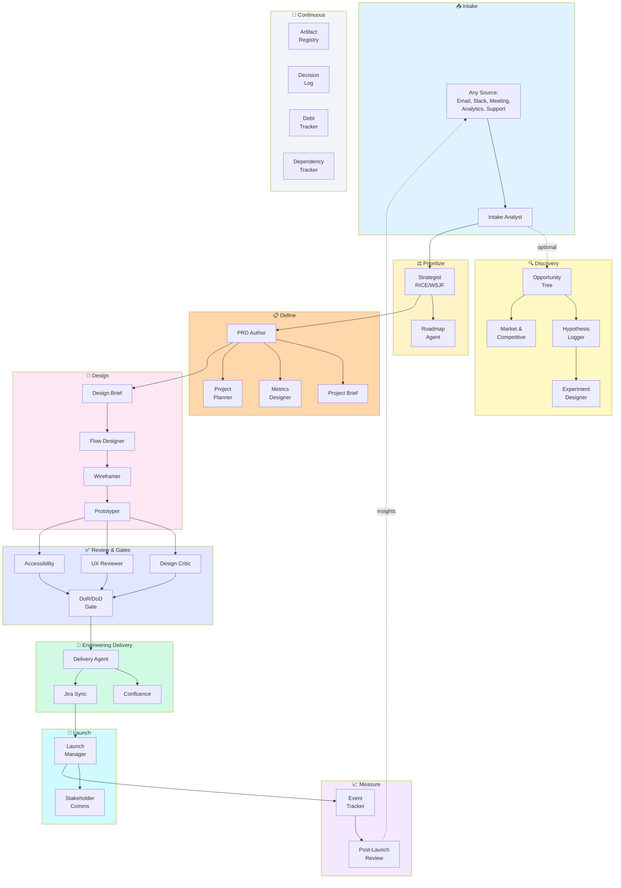

# Product OS

> AI agents that do the artifact work of product management and design, so your PMs spend their time on strategy, decisions and alignment.

**PM rigor leads; design serves product strategy.**

[](LICENSE)

**Start here:** install it (2 minutes), then run `/product-os:guide`. Guided mode walks a PM through a project one phase at a time. See [Quick Start](#-quick-start).

---

## What is Product OS?

PMs and designers lose hours to artifact work: writing PRDs from scratch, formatting Confluence pages, copying stories into Jira, redrawing the same flow diagrams, chasing consistent documentation across teams. The strategic work (prioritization, trade-offs, stakeholder alignment) gets squeezed.

Product OS gives you **40 specialist AI agents**, each owning one artifact or job. You tell an agent what you need, review its output, approve or revise, and move on. Every document follows a proven template, and nothing reaches Confluence or Jira until you approve it.

It runs in Claude Code (47 commands, all named `/product-os:<command>`) and in Cursor.
In Cursor you get 3 native Cursor agent adapters, and every other agent works by asking Cursor to read its file.

### Who it's for

| Role | What you get |
|------|--------------|
| **Head of Product** | One standard for PRDs, stories, gates and metrics across every team. OKRs, roadmaps and prioritization frameworks built in. |
| **Product Manager** | PRDs, briefs, plans and Jira-ready stories in a fraction of the time, with consistent quality. |
| **Product Designer** | Design briefs, flows, wireframes and prototypes, plus design critique, UX review and accessibility audits. |

### What stays with you

The agents do the writing; **you make the decisions**: what problem to solve, what to prioritize, which trade-offs to make, when to ship and what success looks like. Every stage waits for your approval.

---

## 🔄 How It Works

A project moves from raw input to a measured launch. Each box is an agent.



**It's a guide, not a gate.** Start anywhere (have a PRD? start at design), skip what a small feature doesn't need, go back and revise, and run reviews in parallel. The continuous agents (Artifact Registry, Decision Log, Debt Tracker, Dependency Tracker) run across the whole lifecycle.

---

## 🚀 Quick Start

1. **Install** into your project:

   ```bash
   git clone https://github.com/johnedelatorre/product-os.git
   cd product-os
   ./scripts/install.sh /path/to/your/project --register-plugin
   ```

   Or, inside Claude Code: `/plugin install product-os --marketplace johnedelatorre/product-os`

2. **Point it at Confluence and Jira:** edit `product-os.config.yaml` (see [Configuration](#-configuration)).

3. **Start a project in guided mode:**

   ```bash
   /product-os:guide --initiative customer-onboarding --project self-serve-signup
   ```

4. **Review and approve** each document as the guide produces it. When you're ready, it shows the Confluence pages and Jira issues it will write, and writes them only after you approve.

More install options, Cursor setup and upgrades: [Installation and Platform Setup](docs/setup/installation.md).

---

## 🧭 Guided Mode

Guided mode is the easiest way in, and the recommended path for new PMs. It walks you through 9 phases, asks the key questions, delegates each document to the right agent and tracks progress in `progress.yaml`.

```bash
/product-os:guide --initiative customer-onboarding --project signup   # start or resume
/product-os:status                                                    # where am I?
/product-os:next                                                      # do the next step
```

| # | Phase | What happens | Can skip? |
|---|-------|--------------|-----------|
| 1 | **Intake** | Raw input becomes a problem statement | No |
| 2 | **Discovery** | Explore the problem space | Yes |
| 3 | **Prioritize** | Decide if and when to build | No |
| 4 | **Define** | PRD, brief, metrics, plan | No |
| 5 | **Design** | Flows, wireframes, prototype | No |
| 6 | **Review** | Critique, UX review, accessibility | No |
| 7 | **Deliver** | Epics, stories, Confluence, Jira | No |
| 8 | **Launch** | Release notes, enablement | No |
| 9 | **Measure** | Post-launch review, follow-ups | No |


**Already have a PRD or other docs?** Copy them into `initiatives/<initiative>/<project>/` and run `/product-os:guide`. It detects existing files, marks them done and lets you jump to any phase.

Full playbook: [Guided Workflow](docs/guides/guided-workflow.md).

---

## 📄 What You Get

### How the documents connect

```
intake.md ──────────────────────────────────────────────────────────────────┐
    │                                                                        │
    ▼                                                                        │
prd.md (stage: Early → Defined → Delivery-ready)                            │
    │                                                                        │
    ├──▶ prd-review.md (if stage ≥ Defined)                                 │
    │        └── blockers, gaps, suggestions, conflicts                      │
    │                                                                        │
    ├──▶ project-brief.md (one-page summary)                                │
    │                                                                        │
    ├──▶ metrics-framework.md                                               │
    │        └── north star, inputs, guardrails, stop criteria              │
    │                                                                        │
    └──▶ project-plan.md, raci.md, gantt.md                                 │
             │                                                               │
             ▼                                                               │
    design-brief.md ──▶ flows.yaml ──▶ wireframes.md ──▶ prototype.html    │
             │                                                               │
             ▼                                                               │
    design-critique.md, ux-review.md, accessibility-audit.md                │
             │                                                               │
             ▼                                                               │
    gate-report.md (pass/fail/NA/not-verified with evidence)                │
             │                                                               │
             ▼                                                               │
    epics.md (T-shirt estimates) ──▶ stories.md (Fibonacci points)          │
             │                           │                                   │
             │                           ├── Gherkin acceptance criteria     │
             │                           ├── Testing requirements            │
             │                           ├── Observability requirements      │
             │                           └── Rollout/rollback requirements   │
             │                                                               │
             ▼                                                               │
    traceability.md ◀───────────────────────────────────────────────────────┘
             │
             ▼
    Confluence pages + Jira issues (requires human approval)
             │
             ▼
    release-notes.md, enablement.md, launch-checklist.md
             │
             ▼
    post-launch-review.md (metrics vs targets with evidence)
```

### Every document, by phase

| Phase | Documents (agent) |
|-------|-------------------|
| **Intake** | Intake (Intake Analyst) |
| **Discovery** | Opportunity Tree, Hypothesis Log, Market Analysis, Competitive Analysis, Experiment Design, Research Plan |
| **Prioritize** | Prioritization scoring (Strategist), Roadmap, OKRs |
| **Define** | PRD (PRD Author), PRD Review, Project Brief, Metrics Framework, Project Plan, RACI, Gantt Chart, Risk Register, PR/FAQ |
| **Design** | Design Brief, User Flows, Wireframes, Prototype, Artifact Registry |
| **Review** | Design Critique, UX Review, Accessibility Audit, Gate Report |
| **Deliver** | Epics & Stories (Delivery Agent), Traceability, Dependency Register, Confluence pages, Jira issues |
| **Launch** | Release Notes, Enablement, Stakeholder Update, Event Tracking Plan |
| **Measure** | Post-Launch Review, Retrospective, Debt Register, Decision Log |

<details>
<summary><strong>Full document table: what each is, when to use it, where it's published</strong></summary>

| Document | What It Is | When to Use | Agent | Destination |
|----------|-----------|-------------|-------|-------------|
| **Intake** | Structured problem statement | First step for any new work | Intake Analyst | Local |
| **Opportunity Tree** | Outcome → opportunities → solutions | Discovery phase | Opportunity Tree | Confluence |
| **Hypothesis Log** | Assumptions with validation status | Throughout discovery | Hypothesis Logger | Confluence |
| **Market Analysis** | TAM/SAM/SOM, trends, segments | Strategic planning | Market Analyst | Confluence |
| **PRD** | Comprehensive requirements (19 sections) | Features needing full spec | PRD Author | Confluence |
| **Project Brief** | One-page executive summary | Stakeholder alignment | Project Brief | Confluence |
| **Metrics Framework** | North star, inputs, guardrails | Every initiative | Metrics Designer | Confluence |
| **Project Plan** | Phases, milestones, timeline | Complex projects | Project Planner | Confluence |
| **RACI Matrix** | Responsibility assignment | Cross-functional projects | Project Planner | Confluence |
| **Gantt Chart** | Timeline with dependencies | Sprint planning, Jira Plans | Project Planner | Confluence + Jira |
| **Prioritization** | RICE/WSJF/MoSCoW/Kano scoring | Backlog grooming | Strategist | Local |
| **Design Brief** | Design direction and constraints | Before wireframes | Product Designer | Confluence |
| **User Flows** | Step-by-step journeys (YAML + Mermaid) | Multi-step features | Flow Designer | Confluence |
| **Wireframes** | Low-fidelity layouts | Before visual design | Wireframer | Confluence |
| **Prototype** | Clickable HTML/React demo | User testing | Prototyper | Local |
| **Design Critique** | Severity-rated visual feedback | Before handoff | Design Critic | Confluence |
| **UX Review** | Nielsen's heuristics evaluation | Quality gate | UX Reviewer | Confluence |
| **Accessibility Audit** | WCAG 2.2 AA compliance | Before launch | Accessibility Auditor | Confluence |
| **Artifact Registry** | Links to all design assets | Throughout project | Artifact Registry | Confluence |
| **Gate Report** | DoR/DoD compliance | Sprint planning | Gate Keeper | Local |
| **Epics & Stories** | User stories with ACs and points | Sprint backlog | Delivery Agent | Jira |
| **Dependency Register** | Dependencies + risks + RACI | Project planning | Dependency Tracker | Confluence |
| **Debt Register** | Tech and design debt | Ongoing | Debt Tracker | Confluence |
| **Event Tracking Plan** | Analytics events spec | Before launch | Event Tracker | Confluence |
| **Release Notes** | Customer-facing changes | Launch | Launch Manager | Confluence |
| **Enablement** | Sales/support materials | Launch | Launch Manager | Local |
| **Post-Launch Review** | Results vs PRD goals | 14+ days after | Post-Launch Reviewer | Confluence |
| **OKRs** | Objectives and key results | Quarterly planning | OKR Agent | Confluence |
| **Roadmap** | Now/Next/Later view | Stakeholder comm | Roadmap Agent | Confluence |
| **Competitive Analysis** | Feature matrix, SWOT | Strategic planning | Competitive Analyst | Confluence |
| **Experiment Design** | A/B test setup with sample size | Data-driven decisions | Experiment Designer | Confluence |
| **Risk Register** | Risks with mitigations | Project planning | Risk Manager | Confluence |
| **Decision Log** | ADR-style records | Capturing rationale | Decision Logger | Confluence |
| **PR/FAQ** | Amazon-style press release | Early validation | PR/FAQ Author | Local |
| **Retrospective** | Start/Stop/Continue | End of project | Retro Facilitator | Confluence |
| **Stakeholder Update** | Progress summary | Weekly | Stakeholder Comms | Email/Confluence |

Locally, every document lives in `initiatives/<initiative>/<project>/` (for example `prd.md`, `flows.yaml`, `stories.md`, `publish-manifest.json`).

</details>

---

## ✅ PM Rigor, Built In

These are the standards every PM gets without having to remember them.

| Practice | What it means for your team |
|----------|-----------------------------|
| **PRD stages** | Every PRD is marked Early (hypotheses), Defined (requirements) or Delivery-ready (evidence-backed), so readers know how much to trust it. |
| **Evidence and hypotheses** | Claims carry their source and confidence; hypotheses carry validation status; alternatives considered and stop criteria (when to kill a feature, and who decides) are written down. |
| **Multi-perspective PRD review** | `/product-os:review-prd` reviews a PRD from feasibility, UX, strategy, research, privacy/security and customer angles, and sorts findings into blockers, gaps, suggestions and conflicts (each conflict with an owner). |
| **Estimates that match the phase** | T-shirt sizes to sequence the roadmap, week ranges with confidence for planning, Fibonacci points for sprint commitment. Spikes handle unknowns. |
| **Traceability** | Requirements link to epics, stories and tests; metrics link to instrumentation and dashboards. Gaps need a written reason. |
| **Gates with evidence** | Definition of Ready / Done checks report Pass, Conditional, Fail, N/A or Not Verified, each with evidence. Not Verified blocks a release. |
| **Decision records** | Each decision records reversibility, trade-offs, review triggers and who decided. |
| **Approval before publishing** | Agents show exactly what they will write to Confluence or Jira and wait for your OK. |
| **AI feature specs** | Features with AI or ML get an optional spec section with evaluation criteria. |

### How documents are written

Every agent and document follows the **Clear Output Style** (always on): lead with the next action, numbered steps, short lists, a TL;DR at the top of every document, and no preamble. Full depth stays; the style shapes structure and wording, not content. Details: [Clear Output Style](docs/guides/clear-output-style.md).

**Current state only.** Docs, Confluence pages, epics and tickets describe the plan as it stands today: no version banners, history blocks, change narratives or retired items. Page history, git and Jira history keep the record. If a project's docs have already piled up history, `/product-os:cleanup` cleans them, with your approval before any Confluence or Jira write.

---

## 🧰 Commands You'll Use Most

```bash
/product-os:guide          # Start or resume guided mode
/product-os:next           # Do the next recommended step
/product-os:status         # See progress
/product-os:intake         # Turn a raw ask into a problem statement
/product-os:propose        # Research a new idea and propose a solution
/product-os:prd            # Write a PRD
/product-os:review-prd     # Multi-perspective PRD review
/product-os:prioritize     # RICE / WSJF / MoSCoW / Kano scoring
/product-os:deliver        # Epics and stories with acceptance criteria
/product-os:publish        # Publish to Confluence (after approval)
/product-os:jira-sync      # Create or update Jira issues (after approval)
/product-os:cleanup        # Clean version history out of docs, pages and tickets
```

Every command, grouped by phase: [Command Reference](docs/reference/commands.md).

---

## 🤖 Agents

Product OS includes **40 specialist agents**, each with one responsibility. You rarely call them directly; the guide and the commands above pick the right one.

| Group | Agents |
|-------|--------|
| **Pipeline** | Orchestrator, Intake Analyst, Strategist, Roadmap Agent, PRD Author, Project Brief, Project Planner |
| **Discovery** | Opportunity Tree, Hypothesis Logger, Market Analyst, Competitive Analyst, Experiment Designer, UX Researcher |
| **Design** | Product Designer, Flow Designer, Wireframer, Prototyper, Figma Agent |
| **Review & gates** | Design Critic, UX Reviewer, Accessibility Auditor, Gate Keeper |
| **Delivery** | Delivery Agent, Confluence Publisher, Jira Sync |
| **Metrics** | Metrics Designer, Event Tracker, Post-Launch Reviewer |
| **Launch** | Launch Manager, Stakeholder Comms |
| **Governance** | Artifact Registry, Dependency Tracker, Risk Manager, Debt Tracker, Decision Logger, Doc Cleaner |
| **Tools** | OKR Agent, Retro Facilitator, PR/FAQ Author |
| **Workflow** | Guide |

<details>
<summary><strong>Every agent with its command</strong></summary>

| Agent | Command | What It Does |
|-------|---------|--------------|
| **Guide** | `/product-os:guide` | Walks you through the 9 phases |
| **Orchestrator** | `/product-os:new-project` | Runs full pipeline with checkpoints |
| **Intake Analyst** | `/product-os:intake` | Structures raw requirements |
| **Strategist** | `/product-os:prioritize` | RICE/WSJF/MoSCoW/Kano scoring |
| **Roadmap Agent** | `/product-os:roadmap` | Now/Next/Later roadmaps |
| **PRD Author** | `/product-os:prd` | Comprehensive 19-section PRDs |
| **Project Brief** | `/product-os:brief` | One-page executive summaries |
| **Project Planner** | `/product-os:plan` | RACI, Gantt, project plans |
| **Opportunity Tree** | `/product-os:opportunity-tree` | Outcome → opportunity → solution trees |
| **Hypothesis Logger** | `/product-os:hypotheses` | Track and validate hypotheses |
| **Market Analyst** | `/product-os:market` | TAM/SAM/SOM, trends, segments |
| **Competitive Analyst** | `/product-os:competitive` | Feature matrices, SWOT |
| **Experiment Designer** | `/product-os:experiment` | A/B test design with sample sizes |
| **UX Researcher** | `/product-os:research` | Research plans, synthesis |
| **Product Designer** | `/product-os:design-brief` | Design briefs and direction |
| **Flow Designer** | `/product-os:flows` | User flows, journey maps |
| **Wireframer** | `/product-os:wireframes` | Low-fidelity layouts |
| **Prototyper** | `/product-os:prototype` | Clickable HTML/React |
| **Figma Agent** | `/product-os:figma` | Figma MCP integration |
| **Design Critic** | `/product-os:critique` | Severity-rated visual feedback |
| **UX Reviewer** | `/product-os:ux-review` | Nielsen's heuristics evaluation |
| **Accessibility Auditor** | `/product-os:a11y` | WCAG 2.2 AA audit |
| **Gate Keeper** | `/product-os:gate` | DoR/DoD validation |
| **Delivery Agent** | `/product-os:deliver` | Epics and stories with points |
| **Confluence Publisher** | `/product-os:publish` | Publishes to Confluence |
| **Jira Sync** | `/product-os:jira-sync` | Creates/updates Jira issues |
| **Metrics Designer** | `/product-os:metrics` | North star, guardrails, success criteria |
| **Event Tracker** | `/product-os:tracking` | Analytics event specifications |
| **Post-Launch Reviewer** | `/product-os:review-launch` | Results vs PRD goals |
| **Launch Manager** | `/product-os:launch` | Release notes, enablement, changelog |
| **Stakeholder Comms** | `/product-os:comms` | Updates and summaries |
| **Artifact Registry** | `/product-os:artifacts` | Track all design artifacts |
| **Dependency Tracker** | `/product-os:dependencies` | Dependencies + risks + RACI |
| **Risk Manager** | `/product-os:risks` | Risk register |
| **Debt Tracker** | `/product-os:debt` | Tech and design debt |
| **Decision Logger** | `/product-os:decision` | ADR-style decisions |
| **Doc Cleaner** | `/product-os:cleanup` | Strips version history from docs, pages and tickets |
| **OKR Agent** | `/product-os:okrs` | Objectives and key results |
| **Retro Facilitator** | `/product-os:retro` | Retrospectives |
| **PR/FAQ Author** | `/product-os:prfaq` | Amazon-style PR/FAQs |

Each agent has a guide (what it does, inputs, outputs, examples): [Agent Guide Index](docs/guides/agents/index.md).

</details>

---

## 🧠 Skills

Skills are the playbooks agents follow: frameworks, best practices and quality checklists (for example PRD writing, RICE/WSJF prioritization, story pointing, WCAG audits, Nielsen's heuristics, release gates). Product OS ships 41 reusable skills in `.claude/skills/`.

<details>
<summary><strong>All skills and which agents use them</strong></summary>

| Skill | What It Teaches | Used By |
|-------|-----------------|---------|
| **Clear Output** | 10 rules for actionable output, TL;DR blocks | All Agents |
| **Doc Hygiene** | Current-state-only docs, cleanup of version history, lint and invention guard | Doc Cleaner, all artifact-writing agents |
| **Guided Workflow** | 9-phase `progress.yaml` state tracking | Guide |
| **Session Handover** | State, evidence, next action for the next session | Guide, `/product-os:handover` |
| **Context Freshness** | Verify baselines and assumptions are current | Guide, Orchestrator |
| **Proposal** | Research an idea, propose a solution interface-first | Intake Analyst, PRD Author |
| **PRD Writing** | 19-section PRD structure, requirements formatting | PRD Author |
| **Project Brief** | One-page constraint, executive audience | Project Brief |
| **Prioritization** | RICE, WSJF, MoSCoW, Kano frameworks | Strategist |
| **Beachhead Segment** | Choosing the first market segment to win | Market Analyst, Strategist |
| **Value Proposition** | 6-part value proposition with JTBD framing | Market Analyst, Strategist |
| **Value Curve** | Differentiation vs. deliberate parity by factor | Competitive Analyst, Strategist |
| **Growth Loops** | Product-driven acquisition flywheels | Roadmap Agent |
| **Estimation** | Early sizing vs. sprint-ready estimates | Orchestrator, Delivery Agent |
| **Story Pointing** | Fibonacci scale, complexity factors | Delivery Agent |
| **Discipline Labeling** | Frontend/backend/fullstack assignment | Delivery Agent |
| **RACI Matrix** | Responsibility assignment, one-R rule | Project Planner |
| **Gantt Generation** | Mermaid syntax, Jira Plans integration | Project Planner |
| **Jobs → Screen Map** | Job → screen → question → primary action | Flow Designer, Design Critic |
| **User Flows** | Canonical YAML spec, multi-target rendering | Flow Designer |
| **Wireframing** | ASCII and HTML formats, layout patterns | Wireframer |
| **Prototype Generation** | Self-contained HTML, React artifacts | Prototyper |
| **Design Critique** | Visual hierarchy, Gestalt, severity ratings | Design Critic |
| **UX Heuristics** | Nielsen's 10 heuristics, Laws of UX | UX Reviewer |
| **Accessibility Audit** | WCAG 2.2 AA criteria, axe-core | Accessibility Auditor |
| **Confluence Publishing** | Page hierarchy, backlog tables, approval before writes | Confluence Publisher |
| **Jira Sync** | Epic/story creation, dependency links, approval before writes | Jira Sync |
| **Artifact Registry** | Design artifact tracking, link validation | Artifact Registry |
| **Opportunity Tree** | Outcome-opportunity-solution mapping | Opportunity Tree |
| **Hypothesis Logging** | Hypothesis format, validation tracking | Hypothesis Logger |
| **Metrics Framework** | North star, inputs, guardrails | Metrics Designer |
| **Event Tracking** | Analytics event specification | Event Tracker |
| **Post-Launch Review** | Goal comparison, learning loop | Post-Launch Reviewer |
| **Launch GTM** | Release notes, enablement, changelog | Launch Manager |
| **Dependency Tracking** | Dependencies, risks, RACI integration | Dependency Tracker |
| **DoR/DoD Gates** | Definition of Ready/Done criteria | Gate Keeper |
| **Debt Tracking** | Tech and design debt prioritization | Debt Tracker |
| **Release Gate** | Go/no-go, verification, rollback before shipping | Gate Keeper, Launch Manager |
| **Independent Review** | Fresh, unsteered code review with bounded iterations | Gate Keeper |
| **Intended vs. Implemented** | Audit code against documented intent | Gate Keeper, `/product-os:audit-intent` |
| **Shipping Artifacts** | Docs that make AI-built code reviewable | `/product-os:audit-intent`, `/product-os:release-gate` |

</details>

---

## 🔧 Configuration

```yaml
# product-os.config.yaml
confluence:
  base_url: "https://yourcompany.atlassian.net/wiki"
  space_key: "PROD"
  initiatives_parent_page_id: "123456789"

jira:
  base_url: "https://yourcompany.atlassian.net"
  project_key: "PROJ"
```

With the Atlassian MCP server connected in Claude Code or Cursor, no credentials are needed. Only the REST fallback (`scripts/atlassian-fallback.py`) needs a `.env`:

```bash
cp .env.example .env
# ATLASSIAN_EMAIL=your@email.com
# ATLASSIAN_API_TOKEN=your-api-token
```

Setup guides: [Atlassian](docs/setup/atlassian.md) · [Figma MCP](docs/setup/figma-mcp.md) · [Installation and Platform Setup](docs/setup/installation.md)

---

## 📚 Documentation

| Resource | Description |
|----------|-------------|
| [Guided Workflow](docs/guides/guided-workflow.md) | The 9-phase playbook |
| [Pipeline Overview](docs/guides/pipeline-overview.md) | How stages connect |
| [Command Reference](docs/reference/commands.md) | Every slash command, by phase |
| [Agent Guides](docs/guides/agents/index.md) | Deep-dive per agent |
| [Installation and Platform Setup](docs/setup/installation.md) | Install options, Claude Code and Cursor, upgrades, repo layout |
| [Worked example](examples/acme-dashboard/) | A full project, end to end |
| [CHANGELOG](CHANGELOG.md) | Release history |
| [AGENTS.md](AGENTS.md) · [CLAUDE.md](CLAUDE.md) | Agent orchestration and root instructions |

---

## License

MIT License © 2026 John De La Torre-Ugarte. See [LICENSE](LICENSE).

## Contributing

See [CONTRIBUTING.md](CONTRIBUTING.md).
