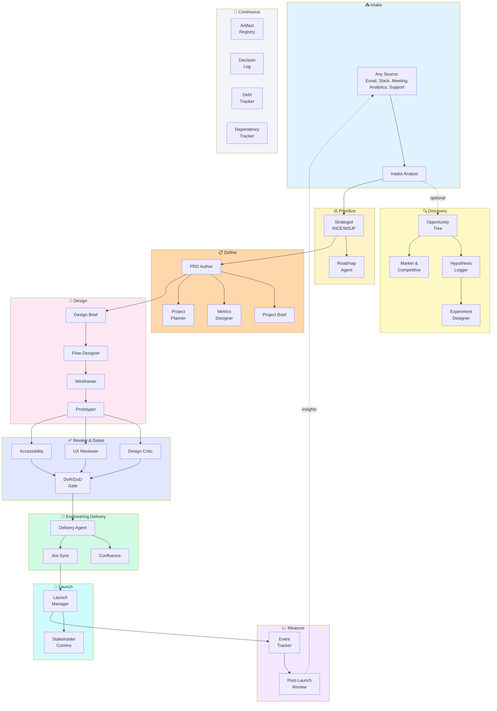
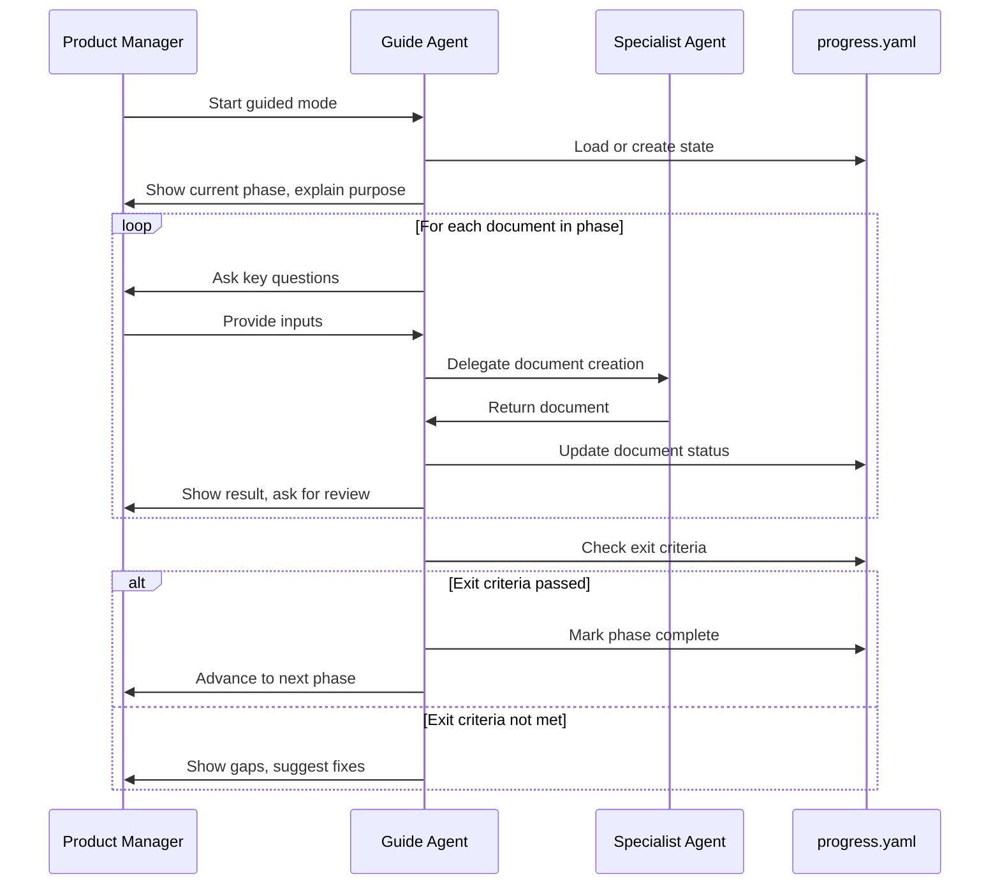

# Product OS

> AI agents that do the artifact work of product management and design, so your PMs spend their time on strategy, decisions and alignment.

**PM rigor leads; design serves product strategy.**

[](LICENSE)

Works in **claude.ai**, **Claude Code** and **Cursor**.

**On this page:** [What it is](#what-is-product-os) · [Where it runs](#-where-it-runs) · [Quick Start](#-quick-start) · [Workflow](#-how-it-works) · [Guided Mode](#-guided-mode) · [Commands](#-commands) · [Agents](#-agents) · [Skills](#-skills) · [Documents](#-documents) · [Configuration](#-configuration)

---

## What is Product OS?

PMs and designers lose hours to artifact work: writing PRDs from scratch, formatting Confluence pages, copying stories into Jira, redrawing the same flow diagrams, chasing consistent documentation across teams. The strategic work (prioritization, trade-offs, stakeholder alignment) gets squeezed.

Product OS gives you **40 specialist AI agents**, each owning one artifact or job, plus playbooks (skills) and templates they follow. You tell an agent what you need, review its output, approve or revise, and move on. Nothing reaches Confluence or Jira until you approve it.

In Claude Code you drive it with 47 commands, all named `/product-os:<command>`.
In claude.ai and Cursor you ask for the same work by name ("Run the PRD Author on this intake").

### Who it's for

| Role | What you get |
|------|--------------|
| **Head of Product** | One standard for PRDs, stories, gates and metrics across every team. OKRs, roadmaps and prioritization frameworks built in. |
| **Product Manager** | PRDs, briefs, plans and Jira-ready stories in a fraction of the time, with consistent quality. |
| **Product Designer** | Design briefs, flows, wireframes and prototypes, plus design critique, UX review and accessibility audits. |

### What stays with you

The agents do the writing; **you make the decisions**: what problem to solve, what to prioritize, which trade-offs to make, when to ship and what success looks like. Every stage waits for your approval.

---

## 💻 Where It Runs

The same agents, skills and templates power all three. Pick the one your team already uses.

| | **claude.ai** | **Claude Code** | **Cursor** |
|---|---|---|---|
| **Best for** | PMs and designers who work in the browser or desktop app | PMs who keep docs in a repo; full automation | Teams already working in Cursor |
| **Setup** | A Claude Project with Product OS instructions and files | Installer + `product-os` plugin | Installer (adds Cursor rules) |
| **How you start work** | Ask by name: "Start guided mode for project X" | `/product-os:guide` and the other slash commands | "Read `.claude/agents/guide.md` and start project X" |
| **Slash commands** | No (ask in plain language) | Yes, `/product-os:*` | No (role-based) |
| **Agents** | Claude takes on one agent role at a time from the project files | Each agent is a registered subagent | 3 native adapters + any agent by file |
| **Where documents live** | In the chat and project; download or copy into your repo | `initiatives/<initiative>/<project>/` in your repo | `initiatives/<initiative>/<project>/` in your repo |
| **Confluence and Jira** | Atlassian connector, if your workspace enables it (approval first) | Atlassian MCP or REST fallback (approval first) | Atlassian MCP or REST fallback (approval first) |

Progress (`progress.yaml`) and session handovers (`HANDOVER.md`) are plain files, so you can start in one tool and continue in another.

---

## 🚀 Quick Start

### claude.ai

1. Download this repo (Code → Download ZIP) and unzip it.
2. In claude.ai, create a **Project** (for example "Product OS").
3. Paste the contents of [`CLAUDE.md`](CLAUDE.md) into the project's **instructions**.
4. Add to the project's **knowledge**: `AGENTS.md`, the files in `.claude/agents/`, the files in `.claude/skills/` and the templates in `templates/` you plan to use.
5. Optional: turn on the Atlassian connector so Claude can publish to Confluence and Jira after you approve.
6. Start a chat in the project: *"Start Product OS guided mode for initiative customer-onboarding, project self-serve-signup."*

Full steps and tips: [Installation and Platform Setup → claude.ai](docs/setup/installation.md#claudeai-setup).

### Claude Code

1. Install into your project:

   ```bash
   git clone https://github.com/johnedelatorre/product-os.git
   cd product-os
   ./scripts/install.sh /path/to/your/project --register-plugin
   ```

   Or, inside Claude Code: `/plugin install product-os --marketplace johnedelatorre/product-os`

2. Point it at Confluence and Jira: edit `product-os.config.yaml` (see [Configuration](#-configuration)).
3. Start guided mode:

   ```bash
   /product-os:guide --initiative customer-onboarding --project self-serve-signup
   ```

### Cursor

1. Run the installer: `./scripts/install.sh /path/to/your/project --platform cursor`
2. Restart Cursor so it loads `.cursor/rules/product-os.mdc`.
3. In chat: *"Read `.claude/agents/guide.md` and help me start a project called self-serve-signup in initiative customer-onboarding."*

In Cursor you get 3 native Cursor agent adapters (Guide, PRD Author, Intake Analyst) in the agent picker; every other agent works by asking Cursor to read its file.

**Then, on any platform:** review and approve each document as it's produced. When you're ready to publish, Product OS shows the exact Confluence pages and Jira issues it will write and waits for your OK.

---

## 🔄 How It Works

A project moves from raw input to a measured launch. Each box is an agent.



**It's a guide, not a gate.** Start anywhere (have a PRD? start at design), skip what a small feature doesn't need, go back and revise, and run reviews in parallel. The continuous agents (Artifact Registry, Decision Log, Debt Tracker, Dependency Tracker) run across the whole lifecycle.

### How the documents connect

```
intake.md ──────────────────────────────────────────────────────────────────┐
    │                                                                        │
    ▼                                                                        │
prd.md (stage: Early → Defined → Delivery-ready)                            │
    │                                                                        │
    ├──▶ prd-review.md (if stage ≥ Defined)                                 │
    │        └── blockers, gaps, suggestions, conflicts                      │
    │                                                                        │
    ├──▶ project-brief.md (one-page summary)                                │
    │                                                                        │
    ├──▶ metrics-framework.md                                               │
    │        └── north star, inputs, guardrails, stop criteria              │
    │                                                                        │
    └──▶ project-plan.md, raci.md, gantt.md                                 │
             │                                                               │
             ▼                                                               │
    design-brief.md ──▶ flows.yaml ──▶ wireframes.md ──▶ prototype.html    │
             │                                                               │
             ▼                                                               │
    design-critique.md, ux-review.md, accessibility-audit.md                │
             │                                                               │
             ▼                                                               │
    gate-report.md (pass/fail/NA/not-verified with evidence)                │
             │                                                               │
             ▼                                                               │
    epics.md (T-shirt estimates) ──▶ stories.md (Fibonacci points)          │
             │                           │                                   │
             │                           ├── Gherkin acceptance criteria     │
             │                           ├── Testing requirements            │
             │                           ├── Observability requirements      │
             │                           └── Rollout/rollback requirements   │
             │                                                               │
             ▼                                                               │
    traceability.md ◀───────────────────────────────────────────────────────┘
             │
             ▼
    Confluence pages + Jira issues (requires human approval)
             │
             ▼
    release-notes.md, enablement.md, launch-checklist.md
             │
             ▼
    post-launch-review.md (metrics vs targets with evidence)
```

---

## 🧭 Guided Mode

Guided mode is the easiest way in, and the recommended path for new PMs. It walks you through 9 phases, asks the key questions, hands each document to the right agent and tracks progress in `progress.yaml`.

| Platform | Start | Where am I? | Next step |
|----------|-------|-------------|-----------|
| claude.ai | "Start Product OS guided mode for initiative X, project Y" | "Product OS status" | "Do the next Product OS step" |
| Claude Code | `/product-os:guide --initiative X --project Y` | `/product-os:status` | `/product-os:next` |
| Cursor | "Read `.claude/agents/guide.md` and start project Y in initiative X" | "Show guided-mode status" | "Do the next step" |

| # | Phase | What happens | Can skip? |
|---|-------|--------------|-----------|
| 1 | **Intake** | Raw input becomes a problem statement | No |
| 2 | **Discovery** | Explore the problem space | Yes |
| 3 | **Prioritize** | Decide if and when to build | No |
| 4 | **Define** | PRD, brief, metrics, plan | No |
| 5 | **Design** | Flows, wireframes, prototype | No |
| 6 | **Review** | Critique, UX review, accessibility | No |
| 7 | **Deliver** | Epics, stories, Confluence, Jira | No |
| 8 | **Launch** | Release notes, enablement | No |
| 9 | **Measure** | Post-launch review, follow-ups | No |



**Already have a PRD or other docs?** Bring them in (copy into `initiatives/<initiative>/<project>/`, or upload them to the claude.ai project) and start guided mode. It detects what exists, marks it done and lets you jump to any phase.

Full playbook: [Guided Workflow](docs/guides/guided-workflow.md).

---

## 🧰 Commands

Every command is a Claude Code slash command. In claude.ai or Cursor, ask for the same thing in plain language ("write the PRD from this intake", "run a UX review on the wireframes").

**Guided mode and sessions**

| Command | What it does |
|---------|--------------|
| `/product-os:guide` | Start or resume guided mode, or jump to a phase |
| `/product-os:status` | Show progress through guided mode |
| `/product-os:next` | Do the next recommended step |
| `/product-os:handover` | Write a handover for the next session: state, evidence, next action |
| `/product-os:new-project` | Run the full pipeline from intake to publishing, with checkpoints |

**Intake and discovery**

| Command | What it does |
|---------|--------------|
| `/product-os:intake` | Turn a raw requirement into a problem/opportunity statement |
| `/product-os:propose` | Research a new idea and propose what to build, interface first |
| `/product-os:opportunity-tree` | Outcome → opportunity → solution tree |
| `/product-os:hypotheses` | Track and validate hypotheses |
| `/product-os:market` | Market analysis brief (TAM/SAM/SOM, trends, segments) |
| `/product-os:competitive` | Competitive analysis (feature matrix, SWOT) |
| `/product-os:research` | Research plan or synthesis |
| `/product-os:experiment` | A/B test design with sample size |

**Prioritize and strategy**

| Command | What it does |
|---------|--------------|
| `/product-os:prioritize` | RICE / WSJF / MoSCoW / Kano scoring |
| `/product-os:roadmap` | Now / Next / Later roadmap |
| `/product-os:okrs` | OKRs and metric trees |
| `/product-os:prfaq` | Amazon-style PR/FAQ |

**Define**

| Command | What it does |
|---------|--------------|
| `/product-os:prd` | Full PRD (19 sections) |
| `/product-os:review-prd` | Multi-perspective PRD review: blockers, gaps, suggestions, conflicts |
| `/product-os:brief` | One-page executive project brief |
| `/product-os:plan` | Project plan, RACI and Gantt chart |
| `/product-os:metrics` | North star, input metrics, guardrails |
| `/product-os:tracking` | Analytics event tracking plan |
| `/product-os:risks` | Risk register |
| `/product-os:dependencies` | Dependencies and risks |

**Design**

| Command | What it does |
|---------|--------------|
| `/product-os:design-brief` | Design brief from the PRD |
| `/product-os:flows` | User flows (happy path, edge cases, errors) |
| `/product-os:wireframes` | Low-fidelity wireframes from flows |
| `/product-os:prototype` | Clickable HTML/React prototype |
| `/product-os:figma` | Work with Figma via MCP |
| `/product-os:artifacts` | Design artifact registry |

**Review and gates**

| Command | What it does |
|---------|--------------|
| `/product-os:critique` | Severity-rated visual design critique |
| `/product-os:ux-review` | Nielsen's heuristics evaluation |
| `/product-os:a11y` | WCAG 2.2 AA accessibility audit |
| `/product-os:gate` | Definition of Ready / Done check |

**Deliver and publish**

| Command | What it does |
|---------|--------------|
| `/product-os:deliver` | Epics and stories with Gherkin acceptance criteria and points |
| `/product-os:publish` | Publish project docs to Confluence (after approval) |
| `/product-os:jira-sync` | Create or update Jira epics and stories (after approval) |

**Launch**

| Command | What it does |
|---------|--------------|
| `/product-os:launch` | Release notes, enablement, changelog |
| `/product-os:comms` | Stakeholder updates |
| `/product-os:release-gate` | Go/no-go, independent review, build verification |

**Measure and learn**

| Command | What it does |
|---------|--------------|
| `/product-os:review-launch` | Post-launch results vs PRD goals |
| `/product-os:retro` | Retrospective and learnings |

**Governance**

| Command | What it does |
|---------|--------------|
| `/product-os:decision` | Log a decision (ADR style) |
| `/product-os:debt` | Tech and design debt tracker |
| `/product-os:cleanup` | Clean version history out of docs, Confluence pages and Jira tickets |
| `/product-os:audit-intent` | Audit code against documented intent |

Arguments and examples for each: [Command Reference](docs/reference/commands.md).

---

## 🤖 Agents

Product OS includes **40 specialist agents**, each with one responsibility. The guide and the commands pick the right one; you can also call any agent directly by name.

| Group | Agent | Command | What it does |
|-------|-------|---------|--------------|
| **Workflow** | Guide | `/product-os:guide` | Walks you through the 9 phases |
| | Orchestrator | `/product-os:new-project` | Runs the full pipeline with checkpoints |
| **Pipeline** | Intake Analyst | `/product-os:intake` | Structures raw requirements |
| | Strategist | `/product-os:prioritize` | RICE/WSJF/MoSCoW/Kano scoring |
| | Roadmap Agent | `/product-os:roadmap` | Now/Next/Later roadmaps |
| | PRD Author | `/product-os:prd` | Comprehensive 19-section PRDs |
| | Project Brief | `/product-os:brief` | One-page executive summaries |
| | Project Planner | `/product-os:plan` | RACI, Gantt, project plans |
| **Discovery** | Opportunity Tree | `/product-os:opportunity-tree` | Outcome → opportunity → solution trees |
| | Hypothesis Logger | `/product-os:hypotheses` | Tracks and validates hypotheses |
| | Market Analyst | `/product-os:market` | TAM/SAM/SOM, trends, segments |
| | Competitive Analyst | `/product-os:competitive` | Feature matrices, SWOT |
| | Experiment Designer | `/product-os:experiment` | A/B tests with sample sizes |
| | UX Researcher | `/product-os:research` | Research plans and synthesis |
| **Design** | Product Designer | `/product-os:design-brief` | Design briefs and direction |
| | Flow Designer | `/product-os:flows` | User flows, journey maps |
| | Wireframer | `/product-os:wireframes` | Low-fidelity layouts |
| | Prototyper | `/product-os:prototype` | Clickable HTML/React |
| | Figma Agent | `/product-os:figma` | Figma MCP integration |
| **Review & gates** | Design Critic | `/product-os:critique` | Severity-rated visual feedback |
| | UX Reviewer | `/product-os:ux-review` | Nielsen's heuristics evaluation |
| | Accessibility Auditor | `/product-os:a11y` | WCAG 2.2 AA audit |
| | Gate Keeper | `/product-os:gate` | DoR/DoD validation |
| **Delivery** | Delivery Agent | `/product-os:deliver` | Epics and stories with points |
| | Confluence Publisher | `/product-os:publish` | Publishes to Confluence |
| | Jira Sync | `/product-os:jira-sync` | Creates/updates Jira issues |
| **Metrics** | Metrics Designer | `/product-os:metrics` | North star, guardrails, success criteria |
| | Event Tracker | `/product-os:tracking` | Analytics event specifications |
| | Post-Launch Reviewer | `/product-os:review-launch` | Results vs PRD goals |
| **Launch** | Launch Manager | `/product-os:launch` | Release notes, enablement, changelog |
| | Stakeholder Comms | `/product-os:comms` | Updates and summaries |
| **Governance** | Artifact Registry | `/product-os:artifacts` | Tracks all design artifacts |
| | Dependency Tracker | `/product-os:dependencies` | Dependencies + risks + RACI |
| | Risk Manager | `/product-os:risks` | Risk register |
| | Debt Tracker | `/product-os:debt` | Tech and design debt |
| | Decision Logger | `/product-os:decision` | ADR-style decisions |
| | Doc Cleaner | `/product-os:cleanup` | Strips version history from docs, pages and tickets |
| **Tools** | OKR Agent | `/product-os:okrs` | Objectives and key results |
| | Retro Facilitator | `/product-os:retro` | Retrospectives |
| | PR/FAQ Author | `/product-os:prfaq` | Amazon-style PR/FAQs |

**Calling an agent directly:**
- **claude.ai:** "Act as the Product OS Wireframer and create wireframes from flows.md."
- **Claude Code:** use its command, or "use the wireframer agent on flows.md".
- **Cursor:** "Read `.claude/agents/wireframer.md` and create wireframes from flows.md."

Each agent's inputs, outputs and examples: [Agent Guide Index](docs/guides/agents/index.md).

---

## 🧠 Skills

Skills are the playbooks agents follow: frameworks, best practices and quality checklists. Product OS ships 41 reusable skills in `.claude/skills/`. Agents read them automatically; you can also point Claude at one ("use the prioritization skill to score these features").

| Area | Skill | What it teaches | Used by |
|------|-------|-----------------|---------|
| **How work is written** | Clear Output | 10 rules for actionable output, TL;DR blocks | All agents |
| | Doc Hygiene | Current-state-only docs; cleanup of version history; lint and invention guard | Doc Cleaner, all artifact-writing agents |
| **Workflow** | Guided Workflow | 9-phase `progress.yaml` state tracking | Guide |
| | Session Handover | State, evidence, next action for the next session | Guide, `/product-os:handover` |
| | Context Freshness | Verify baselines and assumptions are current | Guide, Orchestrator |
| **Strategy** | Proposal | Research an idea, propose a solution interface-first | Intake Analyst, PRD Author |
| | Prioritization | RICE, WSJF, MoSCoW, Kano frameworks | Strategist |
| | Beachhead Segment | Choosing the first market segment to win | Market Analyst, Strategist |
| | Value Proposition | 6-part value proposition with JTBD framing | Market Analyst, Strategist |
| | Value Curve | Differentiation vs. deliberate parity by factor | Competitive Analyst, Strategist |
| | Growth Loops | Product-driven acquisition flywheels | Roadmap Agent |
| | Opportunity Tree | Outcome-opportunity-solution mapping | Opportunity Tree |
| | Hypothesis Logging | Hypothesis format, validation tracking | Hypothesis Logger |
| **Definition** | PRD Writing | 19-section PRD structure, requirements formatting | PRD Author |
| | Project Brief | One-page constraint, executive audience | Project Brief |
| | Metrics Framework | North star, inputs, guardrails | Metrics Designer |
| | Event Tracking | Analytics event specification | Event Tracker |
| **Planning** | Estimation | Early sizing vs. sprint-ready estimates | Orchestrator, Delivery Agent |
| | RACI Matrix | Responsibility assignment, one-R rule | Project Planner |
| | Gantt Generation | Mermaid syntax, Jira Plans integration | Project Planner |
| | Dependency Tracking | Dependencies, risks, RACI integration | Dependency Tracker |
| **Design** | Jobs → Screen Map | Job → screen → question → primary action | Flow Designer, Design Critic |
| | User Flows | Canonical YAML spec, multi-target rendering | Flow Designer |
| | Wireframing | ASCII and HTML formats, layout patterns | Wireframer |
| | Prototype Generation | Self-contained HTML, React artifacts | Prototyper |
| | Artifact Registry | Design artifact tracking, link validation | Artifact Registry |
| **Quality** | Design Critique | Visual hierarchy, Gestalt, severity ratings | Design Critic |
| | UX Heuristics | Nielsen's 10 heuristics, Laws of UX | UX Reviewer |
| | Accessibility Audit | WCAG 2.2 AA criteria, axe-core | Accessibility Auditor |
| | DoR/DoD Gates | Definition of Ready/Done criteria | Gate Keeper |
| **Delivery** | Story Pointing | Fibonacci scale, complexity factors | Delivery Agent |
| | Discipline Labeling | Frontend/backend/fullstack assignment | Delivery Agent |
| | Confluence Publishing | Page hierarchy, backlog tables, approval before writes | Confluence Publisher |
| | Jira Sync | Epic/story creation, dependency links, approval before writes | Jira Sync |
| | Debt Tracking | Tech and design debt prioritization | Debt Tracker |
| **Launch and learn** | Launch GTM | Release notes, enablement, changelog | Launch Manager |
| | Post-Launch Review | Goal comparison, learning loop | Post-Launch Reviewer |
| **Shipping code** | Release Gate | Go/no-go, verification, rollback before shipping | Gate Keeper, Launch Manager |
| | Independent Review | Fresh, unsteered code review with bounded iterations | Gate Keeper |
| | Intended vs. Implemented | Audit code against documented intent | Gate Keeper, `/product-os:audit-intent` |
| | Shipping Artifacts | Docs that make AI-built code reviewable | `/product-os:audit-intent`, `/product-os:release-gate` |

---

## ✅ PM Rigor, Built In

These are the standards every PM gets without having to remember them.

| Practice | What it means for your team |
|----------|-----------------------------|
| **PRD stages** | Every PRD is marked Early (hypotheses), Defined (requirements) or Delivery-ready (evidence-backed), so readers know how much to trust it. |
| **Evidence and hypotheses** | Claims carry their source and confidence; hypotheses carry validation status; alternatives considered and stop criteria (when to kill a feature, and who decides) are written down. |
| **Multi-perspective PRD review** | Reviews a PRD from feasibility, UX, strategy, research, privacy/security and customer angles, and sorts findings into blockers, gaps, suggestions and conflicts (each conflict with an owner). |
| **Estimates that match the phase** | T-shirt sizes to sequence the roadmap, week ranges with confidence for planning, Fibonacci points for sprint commitment. Spikes handle unknowns. |
| **Traceability** | Requirements link to epics, stories and tests; metrics link to instrumentation and dashboards. Gaps need a written reason. |
| **Gates with evidence** | Definition of Ready / Done checks report Pass, Conditional, Fail, N/A or Not Verified, each with evidence. Not Verified blocks a release. |
| **Decision records** | Each decision records reversibility, trade-offs, review triggers and who decided. |
| **Approval before publishing** | Agents show exactly what they will write to Confluence or Jira and wait for your OK. |
| **AI feature specs** | Features with AI or ML get an optional spec section with evaluation criteria. |

### How documents are written

Every agent and document follows the **Clear Output Style** (always on): lead with the next action, numbered steps, short lists, a TL;DR at the top of every document, and no preamble. Full depth stays; the style shapes structure and wording, not content. Details: [Clear Output Style](docs/guides/clear-output-style.md).

**Current state only.** Docs, Confluence pages, epics and tickets describe the plan as it stands today: no version banners, history blocks, change narratives or retired items. Page history, git and Jira history keep the record. If a project's docs have already piled up history, the Doc Cleaner cleans them, with your approval before any Confluence or Jira write.

---

## 📄 Documents

| Document | What it is | When to use | Agent | Destination |
|----------|-----------|-------------|-------|-------------|
| **Intake** | Structured problem statement | First step for any new work | Intake Analyst | Local |
| **Opportunity Tree** | Outcome → opportunities → solutions | Discovery | Opportunity Tree | Confluence |
| **Hypothesis Log** | Assumptions with validation status | Throughout discovery | Hypothesis Logger | Confluence |
| **Market Analysis** | TAM/SAM/SOM, trends, segments | Strategic planning | Market Analyst | Confluence |
| **Competitive Analysis** | Feature matrix, SWOT | Strategic planning | Competitive Analyst | Confluence |
| **Experiment Design** | A/B test setup with sample size | Data-driven decisions | Experiment Designer | Confluence |
| **Prioritization** | RICE/WSJF/MoSCoW/Kano scoring | Backlog grooming | Strategist | Local |
| **Roadmap** | Now/Next/Later view | Stakeholder communication | Roadmap Agent | Confluence |
| **OKRs** | Objectives and key results | Quarterly planning | OKR Agent | Confluence |
| **PR/FAQ** | Amazon-style press release | Early validation | PR/FAQ Author | Local |
| **PRD** | Comprehensive requirements (19 sections) | Features needing a full spec | PRD Author | Confluence |
| **Project Brief** | One-page executive summary | Stakeholder alignment | Project Brief | Confluence |
| **Metrics Framework** | North star, inputs, guardrails | Every initiative | Metrics Designer | Confluence |
| **Project Plan** | Phases, milestones, timeline | Complex projects | Project Planner | Confluence |
| **RACI Matrix** | Responsibility assignment | Cross-functional projects | Project Planner | Confluence |
| **Gantt Chart** | Timeline with dependencies | Sprint planning, Jira Plans | Project Planner | Confluence + Jira |
| **Risk Register** | Risks with mitigations | Project planning | Risk Manager | Confluence |
| **Design Brief** | Design direction and constraints | Before wireframes | Product Designer | Confluence |
| **User Flows** | Step-by-step journeys (YAML + Mermaid) | Multi-step features | Flow Designer | Confluence |
| **Wireframes** | Low-fidelity layouts | Before visual design | Wireframer | Confluence |
| **Prototype** | Clickable HTML/React demo | User testing | Prototyper | Local |
| **Artifact Registry** | Links to all design assets | Throughout project | Artifact Registry | Confluence |
| **Design Critique** | Severity-rated visual feedback | Before handoff | Design Critic | Confluence |
| **UX Review** | Nielsen's heuristics evaluation | Quality gate | UX Reviewer | Confluence |
| **Accessibility Audit** | WCAG 2.2 AA compliance | Before launch | Accessibility Auditor | Confluence |
| **Gate Report** | DoR/DoD compliance | Sprint planning | Gate Keeper | Local |
| **Epics & Stories** | User stories with ACs and points | Sprint backlog | Delivery Agent | Jira |
| **Dependency Register** | Dependencies + risks + RACI | Project planning | Dependency Tracker | Confluence |
| **Event Tracking Plan** | Analytics events spec | Before launch | Event Tracker | Confluence |
| **Release Notes** | Customer-facing changes | Launch | Launch Manager | Confluence |
| **Enablement** | Sales/support materials | Launch | Launch Manager | Local |
| **Stakeholder Update** | Progress summary | Weekly | Stakeholder Comms | Email/Confluence |
| **Post-Launch Review** | Results vs PRD goals | 14+ days after launch | Post-Launch Reviewer | Confluence |
| **Retrospective** | Start/Stop/Continue | End of project | Retro Facilitator | Confluence |
| **Debt Register** | Tech and design debt | Ongoing | Debt Tracker | Confluence |
| **Decision Log** | ADR-style records | Capturing rationale | Decision Logger | Confluence |

In Claude Code and Cursor, every document lives in `initiatives/<initiative>/<project>/` (for example `prd.md`, `flows.yaml`, `stories.md`).

---

## 🔧 Configuration

```yaml
# product-os.config.yaml
confluence:
  base_url: "https://yourcompany.atlassian.net/wiki"
  space_key: "PROD"
  initiatives_parent_page_id: "123456789"

jira:
  base_url: "https://yourcompany.atlassian.net"
  project_key: "PROJ"
```

- **claude.ai:** no config file. Tell Claude your Confluence space and Jira project in the project instructions, and enable the Atlassian connector.
- **Claude Code and Cursor:** with the Atlassian MCP server connected, no credentials are needed. Only the REST fallback (`scripts/atlassian-fallback.py`) needs a `.env`:

  ```bash
  cp .env.example .env
  # ATLASSIAN_EMAIL=your@email.com
  # ATLASSIAN_API_TOKEN=your-api-token
  ```

Setup guides: [Installation and Platform Setup](docs/setup/installation.md) · [Atlassian](docs/setup/atlassian.md) · [Figma MCP](docs/setup/figma-mcp.md)

---

## 📚 Documentation

| Resource | Description |
|----------|-------------|
| [Installation and Platform Setup](docs/setup/installation.md) | claude.ai, Claude Code and Cursor setup; install options; upgrades; repo layout |
| [Guided Workflow](docs/guides/guided-workflow.md) | The 9-phase playbook |
| [Pipeline Overview](docs/guides/pipeline-overview.md) | How stages connect |
| [Command Reference](docs/reference/commands.md) | Every command with arguments and examples |
| [Agent Guides](docs/guides/agents/index.md) | Deep-dive per agent |
| [Platform Compatibility](docs/guides/platform-compatibility.md) | Capabilities and differences by platform |
| [Worked example](examples/acme-dashboard/) | A full project, end to end |
| [CHANGELOG](CHANGELOG.md) | Release history |
| [AGENTS.md](AGENTS.md) · [CLAUDE.md](CLAUDE.md) | Agent orchestration and root instructions |

---

## License

MIT License © 2026 John De La Torre-Ugarte. See [LICENSE](LICENSE).

## Contributing

See [CONTRIBUTING.md](CONTRIBUTING.md).
