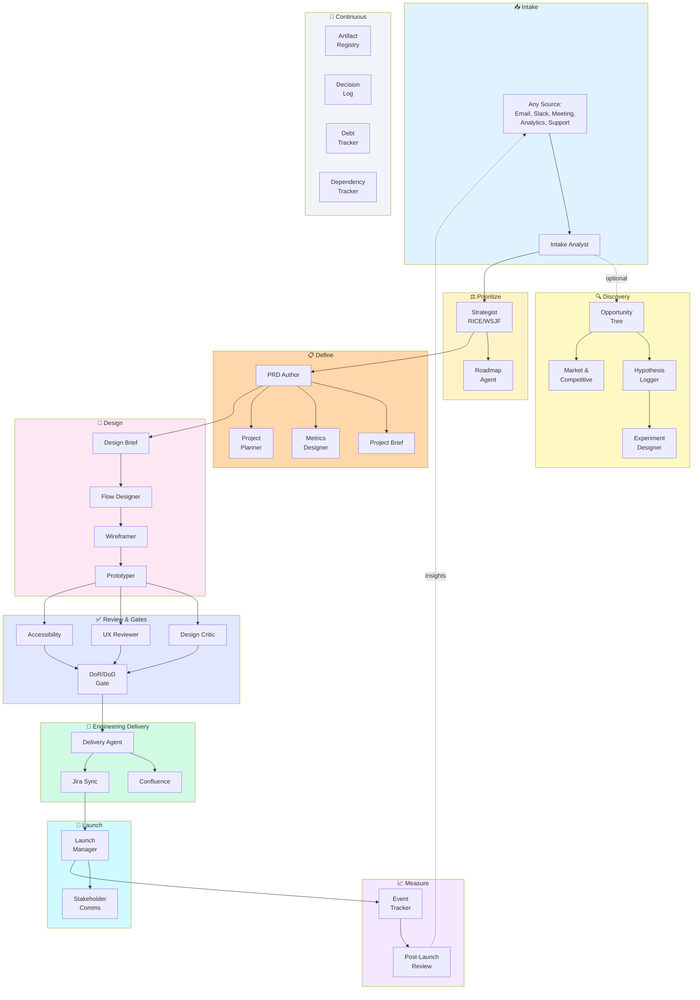

# Product OS

> A portable product management and design operating system for AI-assisted product development.

**PM rigor leads; design serves product strategy.**

[](LICENSE)

---

## What is Product OS?

Product OS is a complete system of AI agents that handles the repetitive work of product management—so you can focus on strategy, decisions, and stakeholder alignment.

### The Problem

Product managers and designers spend too much time creating artifacts:
- Writing PRDs from scratch every time
- Manually formatting Confluence pages
- Copying stories into Jira
- Creating the same flow diagrams over and over
- Chasing consistent documentation across projects

Meanwhile, the strategic work—prioritization, trade-offs, stakeholder alignment—gets squeezed.

### The Solution

Product OS gives you **39 specialist AI agents** that handle artifact creation while you make the decisions. Tell an agent what you need, review its output, approve or revise, and move on.

Every agent follows PM best practices. Every document follows a proven template. Every output can be published to Confluence and Jira once you approve the proposed changes.

### Who It's For

| Role | How Product OS Helps |
|------|---------------------|
| **Product Managers** | Write PRDs, specs, and stories faster. Maintain consistent documentation across projects. |
| **Heads of Product** | Standardize PM practices across teams. Get OKRs, roadmaps, and prioritization frameworks built-in. |
| **Product Designers** | Generate wireframes, prototypes, and flow diagrams. Get design critique and accessibility audits. |

### What You Keep Control Of

Product OS handles the artifact creation, but **you make the decisions**:

- What problems to solve
- Which features to prioritize
- What trade-offs to make
- When to ship
- What success looks like

The agents ask for your approval at every stage. Nothing publishes without your sign-off.

---

## 🔄 How It Works

Product OS follows a PM-led workflow from intake to measurement. Here's the full flow:



### Flexible, Not Rigid

This isn't a waterfall process. Product OS is designed for how product work actually happens:

- **Start anywhere** — Jump in at any stage. Have a PRD? Start at design. Have wireframes? Start at prototype.
- **Skip stages** — Not every project needs discovery. Small features might go straight from intake to stories.
- **Iterate freely** — Go back and revise. Run discovery in parallel with define.
- **Run in parallel** — Design critique, UX review, and accessibility can happen simultaneously.

The pipeline is a guide, not a gate. Use the pieces you need.

**Continuous agents** (Artifact Registry, Decision Log, Debt Tracker, Dependency Tracker) run throughout the entire lifecycle, not just at specific stages.

---

## 🚀 Quick Start

### 1. Install

```bash
git clone https://github.com/johnedelatorre/product-os.git
cd product-os
./scripts/install.sh /path/to/your/project --register-plugin
```

`--register-plugin` enables the `product-os` Claude Code plugin in your project, which is where the `/product-os:*` commands come from. Or install the plugin directly inside Claude Code (≥ 2.1.275):

```
/plugin install product-os --marketplace johnedelatorre/product-os
```

### 2. Configure

```bash
# Edit product-os.config.yaml with your Confluence space and Jira project
```

If the Atlassian MCP server is connected in your client, no credentials are needed. Only the REST fallback (`scripts/atlassian-fallback.py`) needs `.env`:

```bash
cp .env.example .env
# Add your Atlassian email and API token (REST fallback only)
```

### 3. Run Your First Project

```bash
/product-os:new-project \
  --initiative customer-onboarding \
  --project self-serve-signup \
  --input "Users abandoning signup at 34% rate"
```

### 4. Review and Approve

The orchestrator guides you through each stage, showing outputs and waiting for your approval before continuing.

### 5. Ship and Measure

When you're ready to publish, Product OS shows the proposed Confluence pages and Jira issues and writes them only after you approve. After launch, run post-launch review to close the loop.

---

## 🆕 What's New in v1.5

- **Claude Code plugin:** Product OS ships as a plugin (`.claude-plugin/`). Commands are namespaced as `/product-os:<command>` so they never collide with Claude Code built-ins like `/status` or `/plan`.
- **Renamed commands:** `product-os-guide.md` → `guide.md` (and 18 others), so `/product-os:guide`, `/product-os:status`, `/product-os:next` resolve directly.
- **Frontmatter everywhere:** All 46 commands and 39 agents have YAML frontmatter; agents register as Claude Code subagents.
- **Installer:** No longer copies commands into `.claude/commands/`; new `--register-plugin` flag.
- **Doc accuracy:** Every `/product-os:` reference resolves to a real command (enforced by `scripts/validate.sh`).

## 🆕 What's New in v1.4

### PRD Quality

- **PRD Stages:** Mark PRDs as Early (hypotheses), Defined (requirements), or Delivery-ready (evidence-backed)
- **Testable Hypotheses:** New section for hypotheses with validation status
- **Evidence Provenance:** Track where claims come from and confidence levels
- **Alternatives Considered:** Document options not chosen and why
- **Stop Criteria:** Define when to halt or kill a feature, with owners
- **AI Feature Spec:** Optional section for AI/ML features with evaluation criteria

### Multi-Perspective PRD Review

```bash
/product-os:review-prd --from prd.md
```

Synthesizes perspectives from feasibility, UX, strategy, research, privacy/security, and customer viewpoints. Separates:
- **Blockers:** Must fix before proceeding
- **Gaps:** Should address
- **Suggestions:** Nice to have
- **Conflicts:** Where reviewers disagree (with resolution owner)

### Estimation Stages

| Phase | Method | Purpose |
|-------|--------|---------|
| Prioritize | T-shirt (S/M/L/XL) | Roadmap sequencing |
| Define | Epic ranges (weeks) with confidence | Resource planning |
| Deliver | Fibonacci (1-13) | Sprint commitment |

Precision varies by team—calibrate to your own historical data.

Spikes handle unknowns. Provisional estimates marked as TBD. See `estimation.md` skill.

### Traceability

New `traceability.md` template links:
- Requirements → Epics → Stories → Tests
- Stories → Review findings → Resolutions
- Metrics → Instrumentation → Dashboards

Gaps must have documented reasons, not just missing rows.

### Enhanced Gates

Gate reports now have explicit statuses:
| Status | Meaning |
|--------|---------|
| ✅ Pass | Criteria met with evidence |
| ⚠️ Conditional | Minor gaps, proceed with conditions |
| ❌ Fail | Cannot proceed |
| N/A | Not applicable (documented reason) |
| 🔍 Not Verified | Cannot confirm, investigate first |

### Decision Records

Enhanced with:
- Reversibility assessment (Easy / Hard / Irreversible)
- Review triggers (when to re-evaluate)
- Trade-off summary table
- Decision-specific roles (separate from project RACI)

### Installer Improvements

- **Non-destructive:** Backs up modified files, never overwrites CLAUDE.md/AGENTS.md
- **Skills included:** Both copy and submodule modes now include `.claude/skills/`
- **Idempotent:** Safe to run multiple times
- **Tested:** See `scripts/test-install.sh`

---

## 📥 Installation

### Platform Support

Product OS works in both **Claude Code** and **Cursor**.

| Platform | Support Level | Slash Commands | Native Subagents |
|----------|---------------|----------------|------------------|
| Claude Code | Full | Yes (plugin, `/product-os:*`) | Yes (agents with frontmatter) |
| Cursor | Full | Role-based | Partial |

### Fresh Install

```bash
# Clone Product OS
git clone https://github.com/johnedelatorre/product-os.git
cd product-os

# Install for both platforms (default)
./scripts/install.sh /path/to/your/project

# Or install for specific platform
./scripts/install.sh /path/to/your/project --platform claude
./scripts/install.sh /path/to/your/project --platform cursor

# Also enable the Claude Code plugin in the target (needs the claude CLI)
./scripts/install.sh /path/to/your/project --platform claude --register-plugin
```

### Enabling the Claude Code Plugin

Claude Code gets the 46 commands from the `product-os` plugin, namespaced as `/product-os:<command>`. Pick one:

```bash
# A. Let the installer do it
./scripts/install.sh /path/to/your/project --register-plugin

# B. Manually, from your project directory
claude plugin marketplace add /path/to/product-os --scope project   # or: johnedelatorre/product-os
claude plugin install product-os@product-os --scope project
```

```
# C. One step, inside Claude Code (≥ 2.1.275)
/plugin install product-os --marketplace johnedelatorre/product-os
```

**Why a plugin?** Copying commands into `.claude/commands/` registers them un-namespaced (`/status`, `/plan`, `/next`), which collide with Claude Code built-ins. Plugin commands are always prefixed with `/product-os:`.

### What Gets Installed

| Platform | Files Installed |
|----------|-----------------|
| Claude Code | `.claude/agents/` (registered subagents), `.claude/skills/` (reference docs), `.claude/product-os/commands/` (reference copy of commands), `CLAUDE.md`, `AGENTS.md`. Commands themselves come from the plugin. |
| Cursor | `.cursor/rules/product-os.mdc` |
| Both (shared) | `templates/`, `initiatives/`, `product-os.config.yaml` |

### Preserving Existing Files

The installer is non-destructive:
- **Existing CLAUDE.md** → Preserved; Product OS saved as `CLAUDE.product-os.md`
- **Existing .cursor/rules/** → Preserved; Product OS rules added alongside
- **Existing agents/skills/templates** → Preserved; Product OS content merged
- **Modified files** → Backed up before updating

### Update Existing Installation

```bash
./scripts/install.sh /path/to/your/project
```

Modified files are backed up before overwriting. Config files are not overwritten.

In submodule mode (`--submodule`), `.claude/product-os/commands` is a symlink into the submodule instead of a copy.

### Upgrading from ≤1.4

Earlier versions copied (or symlinked) command files into `.claude/commands/`, including `product-os-*.md` files. Those register un-namespaced commands that shadow Claude Code built-ins. After upgrading:

1. Rerun `./scripts/install.sh /path/to/your/project --register-plugin` (or enable the plugin manually).
2. The installer lists any old Product OS command files it finds in `.claude/commands/`. Delete them.
3. Use the namespaced commands: `/product-os:guide`, `/product-os:status`, `/product-os:next`, etc.

---

## 🖥️ Claude Code Setup

Commands come from the `product-os` plugin (see [Enabling the Claude Code Plugin](#enabling-the-claude-code-plugin)), so every command is invoked as `/product-os:<command>`. Agents in `.claude/agents/` register as subagents. Skills in `.claude/skills/` are reference documents that agents read by path.

### Start Guided Mode

```bash
/product-os:guide --initiative my-initiative --project my-project
```

### Check Status

```bash
/product-os:status
```

### Do Next Step

```bash
/product-os:next
```

### Use Specialist Commands

```bash
/product-os:intake --input "<requirement>"           # Structure raw requirements
/product-os:propose --idea "<idea>"                  # Research idea, propose solution
/product-os:prd --from intake.md                     # Create PRD
/product-os:prioritize --items prd.md --framework rice  # RICE/WSJF/MoSCoW/Kano
/product-os:deliver --from prd.md --designs design-brief.md,wireframes.md  # Epics + stories
/product-os:handover                                 # Write session handover
/product-os:release-gate                             # Run release gate process
/product-os:audit-intent                             # Audit code vs documented intent
```

See the [Command Reference](docs/reference/commands.md) for all 46 commands.

---

## 🖱️ Cursor Setup

### After Installation

1. **Restart Cursor** to load `.cursor/rules/product-os.mdc`
2. The rules file references shared content in `.claude/`

### Start Guided Mode

```
Read .claude/agents/guide.md and help me start a project called [name]
in initiative [initiative-name]
```

### Resume Work

```
Read HANDOVER.md and continue from the next action
```

### Use Specialist Agents

In Cursor, invoke specialists by reading their agent file:

```
Read .claude/agents/prd-author.md and create a PRD for [feature]
Read .claude/agents/intake-analyst.md and structure this requirement: [text]
Read .claude/skills/proposal.md and help me research this idea: [idea]
```

### Native Cursor Agents

Product OS provides 3 native Cursor agent adapters in `.cursor/agents/`:

| Adapter | File | Purpose |
|---------|------|---------|
| `product-os-guide` | `product-os-guide.md` | Start/resume workflow |
| `prd-author` | `prd-author.md` | Write PRDs |
| `intake-analyst` | `intake-analyst.md` | Structure requirements |

These work with Cursor's native agent picker. All 39 roles remain available via role-based invocation (read the agent file, follow instructions).

**Note:** Cursor's built-in `subagent_type` options (e.g., `explore`) are platform-controlled and version-dependent. Product OS does not claim or rely on specific subagent_types beyond the 3 native adapters above.

### Session Handover

Before ending a session:

```
Read .claude/skills/session-handover.md and create a handover
```

This creates `HANDOVER.md` with state, evidence, and next action.

---

## 🔄 Cross-Platform Workflow

### Shared Artifacts

These files are portable across platforms:
- `progress.yaml` — Guided workflow state
- `HANDOVER.md` — Session handover
- `STATUS.md` — Long-running status board
- All artifacts in `initiatives/`

### Switching Platforms

1. Commit in-progress `progress.yaml`
2. Create `HANDOVER.md` before switching
3. In new platform, read handover to resume

See `docs/guides/platform-compatibility.md` for full details.

---

## 🧭 Guided Mode

**New to Product OS?** Use Guided Mode to walk through every phase step-by-step.

```bash
# Start guided mode
/product-os:guide --initiative customer-onboarding --project signup

# Check progress
/product-os:status

# Do the next recommended step
/product-os:next
```

### The 9 Phases


| # | Phase | Purpose | Can Skip? |
|---|-------|---------|-----------|
| 1 | **Intake** | Transform requirements into problem statement | No |
| 2 | **Discovery** | Explore problem space | Yes |
| 3 | **Prioritize** | Decide if and when to build | No |
| 4 | **Define** | PRD, brief, metrics, plan | No |
| 5 | **Design** | Flows, wireframes, prototype | No |
| 6 | **Review** | Critique, UX review, accessibility | No |
| 7 | **Deliver** | Epics, stories, Confluence, Jira | No |
| 8 | **Launch** | Release notes, enablement | No |
| 9 | **Measure** | Post-launch review, follow-ups | No |

Progress is tracked in `progress.yaml`. See [`docs/guides/guided-workflow.md`](docs/guides/guided-workflow.md) for the full playbook.

### Bringing Existing Work

Already have a PRD? Don't restart from scratch:

```bash
# Copy your PRD to the project directory
cp ~/existing-prd.md initiatives/my-initiative/my-project/prd.md

# Start guided mode - it detects existing files
/product-os:guide --initiative my-initiative --project my-project
```

Guide detects existing files and marks them complete. You can jump to any phase.

---

## 🔗 How Artifacts Connect

```
intake.md ──────────────────────────────────────────────────────────────────┐
    │                                                                        │
    ▼                                                                        │
prd.md (stage: Early → Defined → Delivery-ready)                            │
    │                                                                        │
    ├──▶ prd-review.md (if stage ≥ Defined)                                 │
    │        └── blockers, gaps, suggestions, conflicts                      │
    │                                                                        │
    ├──▶ project-brief.md (one-page summary)                                │
    │                                                                        │
    ├──▶ metrics-framework.md                                               │
    │        └── north star, inputs, guardrails, stop criteria              │
    │                                                                        │
    └──▶ project-plan.md, raci.md, gantt.md                                 │
             │                                                               │
             ▼                                                               │
    design-brief.md ──▶ flows.yaml ──▶ wireframes.md ──▶ prototype.html    │
             │                                                               │
             ▼                                                               │
    design-critique.md, ux-review.md, accessibility-audit.md                │
             │                                                               │
             ▼                                                               │
    gate-report.md (pass/fail/NA/not-verified with evidence)                │
             │                                                               │
             ▼                                                               │
    epics.md (T-shirt estimates) ──▶ stories.md (Fibonacci points)          │
             │                           │                                   │
             │                           ├── Gherkin acceptance criteria     │
             │                           ├── Testing requirements            │
             │                           ├── Observability requirements      │
             │                           └── Rollout/rollback requirements   │
             │                                                               │
             ▼                                                               │
    traceability.md ◀───────────────────────────────────────────────────────┘
             │
             ▼
    Confluence pages + Jira issues (requires human approval)
             │
             ▼
    release-notes.md, enablement.md, launch-checklist.md
             │
             ▼
    post-launch-review.md (metrics vs targets with evidence)
```

---

## 📄 Documents

Product OS generates these documents. Each follows a proven template and can be published to your tools after your approval.

| Document | What It Is | When to Use | Agent | Destination |
|----------|-----------|-------------|-------|-------------|
| **Intake** | Structured problem statement | First step for any new work | Intake Analyst | Local |
| **Opportunity Tree** | Outcome → opportunities → solutions | Discovery phase | Opportunity Tree | Confluence |
| **Hypothesis Log** | Assumptions with validation status | Throughout discovery | Hypothesis Logger | Confluence |
| **Market Analysis** | TAM/SAM/SOM, trends, segments | Strategic planning | Market Analyst | Confluence |
| **PRD** | Comprehensive requirements (19 sections) | Features needing full spec | PRD Author | Confluence |
| **Project Brief** | One-page executive summary | Stakeholder alignment | Project Brief | Confluence |
| **Metrics Framework** | North star, inputs, guardrails | Every initiative | Metrics Designer | Confluence |
| **Project Plan** | Phases, milestones, timeline | Complex projects | Project Planner | Confluence |
| **RACI Matrix** | Responsibility assignment | Cross-functional projects | Project Planner | Confluence |
| **Gantt Chart** | Timeline with dependencies | Sprint planning, Jira Plans | Project Planner | Confluence + Jira |
| **Prioritization** | RICE/WSJF/MoSCoW/Kano scoring | Backlog grooming | Strategist | Local |
| **Design Brief** | Design direction and constraints | Before wireframes | Product Designer | Confluence |
| **User Flows** | Step-by-step journeys (YAML + Mermaid) | Multi-step features | Flow Designer | Confluence |
| **Wireframes** | Low-fidelity layouts | Before visual design | Wireframer | Confluence |
| **Prototype** | Clickable HTML/React demo | User testing | Prototyper | Local |
| **Design Critique** | Severity-rated visual feedback | Before handoff | Design Critic | Confluence |
| **UX Review** | Nielsen's heuristics evaluation | Quality gate | UX Reviewer | Confluence |
| **Accessibility Audit** | WCAG 2.2 AA compliance | Before launch | Accessibility Auditor | Confluence |
| **Artifact Registry** | Links to all design assets | Throughout project | Artifact Registry | Confluence |
| **Gate Report** | DoR/DoD compliance | Sprint planning | Gate Keeper | Local |
| **Epics & Stories** | User stories with ACs and points | Sprint backlog | Delivery Agent | Jira |
| **Dependency Register** | Dependencies + risks + RACI | Project planning | Dependency Tracker | Confluence |
| **Debt Register** | Tech and design debt | Ongoing | Debt Tracker | Confluence |
| **Event Tracking Plan** | Analytics events spec | Before launch | Event Tracker | Confluence |
| **Release Notes** | Customer-facing changes | Launch | Launch Manager | Confluence |
| **Enablement** | Sales/support materials | Launch | Launch Manager | Local |
| **Post-Launch Review** | Results vs PRD goals | 14+ days after | Post-Launch Reviewer | Confluence |
| **OKRs** | Objectives and key results | Quarterly planning | OKR Agent | Confluence |
| **Roadmap** | Now/Next/Later view | Stakeholder comm | Roadmap Agent | Confluence |
| **Competitive Analysis** | Feature matrix, SWOT | Strategic planning | Competitive Analyst | Confluence |
| **Experiment Design** | A/B test setup with sample size | Data-driven decisions | Experiment Designer | Confluence |
| **Risk Register** | Risks with mitigations | Project planning | Risk Manager | Confluence |
| **Decision Log** | ADR-style records | Capturing rationale | Decision Logger | Confluence |
| **PR/FAQ** | Amazon-style press release | Early validation | PR/FAQ Author | Local |
| **Retrospective** | Start/Stop/Continue | End of project | Retro Facilitator | Confluence |
| **Stakeholder Update** | Progress summary | Weekly | Stakeholder Comms | Email/Confluence |

<details>
<summary><strong>Where documents live locally</strong></summary>

```
initiatives/
└── [initiative-name]/
    └── [project-name]/
        ├── intake.md
        ├── opportunity-tree.yaml
        ├── hypothesis-log.yaml
        ├── prd.md
        ├── project-brief.md
        ├── metrics-framework.md
        ├── project-plan.md
        ├── raci.md
        ├── gantt.md
        ├── design-brief.md
        ├── flows.yaml
        ├── flows.md
        ├── wireframes.md
        ├── prototype.html
        ├── artifacts.yaml
        ├── design-critique.md
        ├── ux-review.md
        ├── accessibility-audit.md
        ├── gate-report.md
        ├── epics.md
        ├── stories.md
        ├── dependency-register.yaml
        ├── debt-register.yaml
        ├── tracking-plan.yaml
        ├── release-notes.md
        ├── post-launch-review.md
        ├── publish-manifest.json
        └── jira-sync-manifest.json
```

</details>

---

## ✍️ Output Style

**All agents and documents follow the Clear Output Style.** This is always on—no command needed.

The 10 rules:
1. **Lead with the next action** — First line is something you can do
2. **Number multi-step tasks** — Each step is one bounded action
3. **End with one concrete next step** — Name ONE thing under 2 minutes
4. **Suppress tangents** — Finish first issue, then offer the second
5. **Restate state every turn** — "Step 3 of 5 done. Next: X"
6. **Give specific time estimates** — "15 minutes if ready. 2 hours if not."
7. **Make wins visible** — Show what now works, in concrete terms
8. **State errors matter-of-factly** — Cause and fix, no "Uh oh"
9. **Cap lists to 5 items** — Group and rank, surface more when needed
10. **No preamble, no recap, no closers** — Start with the answer. End when done.

Documents include a **TL;DR block** at top with problem, solution, and next action.

> Attribution: Adapted from [ayghri/i-have-adhd](https://github.com/ayghri/i-have-adhd) (MIT License). See NOTICE.md.

---

## 🧠 Skills

Skills are reusable knowledge that agents draw on. Each skill documents best practices, frameworks, and quality checklists.

| Skill | What It Teaches | Used By |
|-------|-----------------|---------|
| **Clear Output** | 10 rules for actionable output, TL;DR blocks | All Agents |
| **Guided Workflow** | 9-phase `progress.yaml` state tracking | Guide |
| **Session Handover** | State, evidence, next action for the next session | Guide, `/product-os:handover` |
| **Context Freshness** | Verify baselines and assumptions are current | Guide, Orchestrator |
| **Proposal** | Research an idea, propose a solution interface-first | Intake Analyst, PRD Author |
| **PRD Writing** | 19-section PRD structure, requirements formatting | PRD Author |
| **Project Brief** | One-page constraint, executive audience | Project Brief |
| **Prioritization** | RICE, WSJF, MoSCoW, Kano frameworks | Strategist |
| **Beachhead Segment** | Choosing the first market segment to win | Market Analyst, Strategist |
| **Value Proposition** | 6-part value proposition with JTBD framing | Market Analyst, Strategist |
| **Value Curve** | Differentiation vs. deliberate parity by factor | Competitive Analyst, Strategist |
| **Growth Loops** | Product-driven acquisition flywheels | Roadmap Agent |
| **Estimation** | Early sizing vs. sprint-ready estimates | Orchestrator, Delivery Agent |
| **Story Pointing** | Fibonacci scale, complexity factors | Delivery Agent |
| **Discipline Labeling** | Frontend/backend/fullstack assignment | Delivery Agent |
| **RACI Matrix** | Responsibility assignment, one-R rule | Project Planner |
| **Gantt Generation** | Mermaid syntax, Jira Plans integration | Project Planner |
| **Jobs → Screen Map** | Job → screen → question → primary action | Flow Designer, Design Critic |
| **User Flows** | Canonical YAML spec, multi-target rendering | Flow Designer |
| **Wireframing** | ASCII and HTML formats, layout patterns | Wireframer |
| **Prototype Generation** | Self-contained HTML, React artifacts | Prototyper |
| **Design Critique** | Visual hierarchy, Gestalt, severity ratings | Design Critic |
| **UX Heuristics** | Nielsen's 10 heuristics, Laws of UX | UX Reviewer |
| **Accessibility Audit** | WCAG 2.2 AA criteria, axe-core | Accessibility Auditor |
| **Confluence Publishing** | Page hierarchy, backlog tables, approval before writes | Confluence Publisher |
| **Jira Sync** | Epic/story creation, dependency links, approval before writes | Jira Sync |
| **Artifact Registry** | Design artifact tracking, link validation | Artifact Registry |
| **Opportunity Tree** | Outcome-opportunity-solution mapping | Opportunity Tree |
| **Hypothesis Logging** | Hypothesis format, validation tracking | Hypothesis Logger |
| **Metrics Framework** | North star, inputs, guardrails | Metrics Designer |
| **Event Tracking** | Analytics event specification | Event Tracker |
| **Post-Launch Review** | Goal comparison, learning loop | Post-Launch Reviewer |
| **Launch GTM** | Release notes, enablement, changelog | Launch Manager |
| **Dependency Tracking** | Dependencies, risks, RACI integration | Dependency Tracker |
| **DoR/DoD Gates** | Definition of Ready/Done criteria | Gate Keeper |
| **Debt Tracking** | Tech and design debt prioritization | Debt Tracker |
| **Release Gate** | Go/no-go, verification, rollback before shipping | Gate Keeper, Launch Manager |
| **Independent Review** | Fresh, unsteered code review with bounded iterations | Gate Keeper |
| **Intended vs. Implemented** | Audit code against documented intent | Gate Keeper, `/product-os:audit-intent` |
| **Shipping Artifacts** | Docs that make AI-built code reviewable | `/product-os:audit-intent`, `/product-os:release-gate` |

<details>
<summary><strong>Full skill files</strong></summary>

All 40 skills are in `.claude/skills/`. They are reference documents that agents read by path (not registered Claude Code skills):

```
.claude/skills/
├── accessibility-audit.md
├── artifact-registry.md
├── beachhead-segment.md
├── clear-output.md          # Always-on output style
├── confluence-publishing.md
├── context-freshness.md
├── debt-tracking.md
├── dependency-tracking.md
├── design-critique.md
├── discipline-labeling.md
├── dor-dod-gates.md
├── estimation.md
├── event-tracking.md
├── gantt-generation.md
├── growth-loops.md
├── guided-workflow.md
├── hypothesis-logging.md
├── independent-review.md
├── intended-vs-implemented.md
├── jira-sync.md
├── jobs-screen-map.md
├── launch-gtm.md
├── metrics-framework.md
├── opportunity-tree.md
├── post-launch-review.md
├── prd-writing.md
├── prioritization.md
├── project-brief.md
├── proposal.md
├── prototype-generation.md
├── raci-matrix.md
├── release-gate.md
├── session-handover.md
├── shipping-artifacts.md
├── story-pointing.md
├── user-flows.md
├── ux-heuristics.md
├── value-curve.md
├── value-proposition.md
└── wireframing.md
```

</details>

---

## 🤖 Agents at a Glance

Product OS includes **39 specialist agents**, each with a single responsibility.

### Pipeline Agents

Core workflow from intake through prioritization and definition.

| Agent | Command | What It Does |
|-------|---------|--------------|
| **Orchestrator** | `/product-os:new-project` | Runs full pipeline with checkpoints |
| **Intake Analyst** | `/product-os:intake` | Structures raw requirements |
| **Strategist** | `/product-os:prioritize` | RICE/WSJF/MoSCoW/Kano scoring |
| **Roadmap Agent** | `/product-os:roadmap` | Now/Next/Later roadmaps |
| **PRD Author** | `/product-os:prd` | Comprehensive 19-section PRDs |
| **Project Brief** | `/product-os:brief` | One-page executive summaries |
| **Project Planner** | `/product-os:plan` | RACI, Gantt, project plans |

### Discovery Agents

Optional/parallel phase for exploring problem space.

| Agent | Command | What It Does |
|-------|---------|--------------|
| **Opportunity Tree** | `/product-os:opportunity-tree` | Outcome → opportunity → solution trees |
| **Hypothesis Logger** | `/product-os:hypotheses` | Track and validate hypotheses |
| **Market Analyst** | `/product-os:market` | TAM/SAM/SOM, trends, segments |
| **Competitive Analyst** | `/product-os:competitive` | Feature matrices, SWOT |
| **Experiment Designer** | `/product-os:experiment` | A/B test design with sample sizes |
| **UX Researcher** | `/product-os:research` | Research plans, synthesis |

### Design Agents

Artifacts from brief through prototype.

| Agent | Command | What It Does |
|-------|---------|--------------|
| **Product Designer** | `/product-os:design-brief` | Design briefs and direction |
| **Flow Designer** | `/product-os:flows` | User flows, journey maps |
| **Wireframer** | `/product-os:wireframes` | Low-fidelity layouts |
| **Prototyper** | `/product-os:prototype` | Clickable HTML/React |
| **Figma Agent** | `/product-os:figma` | Figma MCP integration |

### Review & Gate Agents

Quality gates before delivery.

| Agent | Command | What It Does |
|-------|---------|--------------|
| **Design Critic** | `/product-os:critique` | Severity-rated visual feedback |
| **UX Reviewer** | `/product-os:ux-review` | Nielsen's heuristics evaluation |
| **Accessibility Auditor** | `/product-os:a11y` | WCAG 2.2 AA audit |
| **Gate Keeper** | `/product-os:gate` | DoR/DoD validation |

### Delivery Agents

Tickets and documentation.

| Agent | Command | What It Does |
|-------|---------|--------------|
| **Delivery Agent** | `/product-os:deliver` | Epics and stories with points |
| **Confluence Publisher** | `/product-os:publish` | Publishes to Confluence |
| **Jira Sync** | `/product-os:jira-sync` | Creates/updates Jira issues |

### Metrics & Measurement Agents

Success definition and tracking.

| Agent | Command | What It Does |
|-------|---------|--------------|
| **Metrics Designer** | `/product-os:metrics` | North star, guardrails, success criteria |
| **Event Tracker** | `/product-os:tracking` | Analytics event specifications |
| **Post-Launch Reviewer** | `/product-os:review-launch` | Results vs PRD goals |

### Launch & GTM Agents

Go-to-market and communications.

| Agent | Command | What It Does |
|-------|---------|--------------|
| **Launch Manager** | `/product-os:launch` | Release notes, enablement, changelog |
| **Stakeholder Comms** | `/product-os:comms` | Updates and summaries |

### Governance Agents

Ongoing tracking and compliance.

| Agent | Command | What It Does |
|-------|---------|--------------|
| **Artifact Registry** | `/product-os:artifacts` | Track all design artifacts |
| **Dependency Tracker** | `/product-os:dependencies` | Dependencies + risks + RACI |
| **Risk Manager** | `/product-os:risks` | Risk register |
| **Debt Tracker** | `/product-os:debt` | Tech and design debt |
| **Decision Logger** | `/product-os:decision` | ADR-style decisions |

### Tool Agents

Specialized tasks.

| Agent | Command | What It Does |
|-------|---------|--------------|
| **OKR Agent** | `/product-os:okrs` | Objectives and key results |
| **Retro Facilitator** | `/product-os:retro` | Retrospectives |
| **PR/FAQ Author** | `/product-os:prfaq` | Amazon-style PR/FAQs |

<details>
<summary><strong>Full agent documentation</strong></summary>

Every agent has detailed documentation in `docs/guides/agents/`:
- What it does
- When to use it
- Required and optional inputs
- Outputs produced
- Example usage
- Tips and best practices

See the [Agent Guide Index](docs/guides/agents/index.md) for the complete list.

</details>

---

## 🔧 Configuration

### Quick Config

```yaml
# product-os.config.yaml
confluence:
  base_url: "https://yourcompany.atlassian.net/wiki"
  space_key: "PROD"
  initiatives_parent_page_id: "123456789"

jira:
  base_url: "https://yourcompany.atlassian.net"
  project_key: "PROJ"
```

With the Atlassian MCP server connected, no credentials are needed. `.env` is only for the REST fallback (`scripts/atlassian-fallback.py`):

```bash
# .env (REST fallback only)
ATLASSIAN_EMAIL=your@email.com
ATLASSIAN_API_TOKEN=your-api-token
```

### Setup Guides

| Guide | What It Covers |
|-------|---------------|
| [Atlassian Setup](docs/setup/atlassian.md) | Confluence and Jira configuration |
| [Figma Setup](docs/setup/figma-mcp.md) | Figma MCP integration |

---

## 📚 Documentation

| Resource | Description |
|----------|-------------|
| [Pipeline Overview](docs/guides/pipeline-overview.md) | How stages connect |
| [Command Reference](docs/reference/commands.md) | All slash commands |
| [Agent Guides](docs/guides/agents/index.md) | Deep-dive per agent |
| [AGENTS.md](AGENTS.md) | Agent orchestration spec |
| [CLAUDE.md](CLAUDE.md) | Root agent instructions |

---

## 📁 Repository Structure

<details>
<summary><strong>Click to expand</strong></summary>

```
product-os/
├── CLAUDE.md                 # Root agent instructions
├── AGENTS.md                 # Agent orchestration
├── README.md                 # This file
├── LICENSE                   # MIT License
├── CHANGELOG.md
├── CONTRIBUTING.md
├── product-os.config.yaml    # Configuration template
├── .env.example              # Credentials template (REST fallback only)
│
├── .claude-plugin/
│   ├── plugin.json           # Claude Code plugin manifest (name: product-os)
│   └── marketplace.json      # Marketplace "product-os" (plugin source ./)
│
├── .claude/
│   ├── agents/               # 39 specialist agents (subagents, with frontmatter)
│   ├── commands/             # 46 commands, served by the plugin as /product-os:<name>
│   └── skills/               # 40 reusable skills (reference docs)
│
├── .cursor/
│   ├── rules/product-os.mdc  # Cursor rules
│   └── agents/               # 3 native Cursor adapters
│
├── templates/                # Document templates
│   ├── intake/
│   ├── pm/
│   ├── design/
│   ├── delivery/
│   └── tools/
│
├── docs/
│   ├── guides/
│   │   ├── agents/           # Per-agent documentation
│   │   └── pipeline-overview.md
│   ├── reference/
│   │   └── commands.md
│   └── setup/
│       ├── atlassian.md
│       └── figma-mcp.md
│
├── examples/
│   └── acme-dashboard/       # Worked example
│
├── initiatives/              # Your project workspace
│
└── scripts/
    ├── install.sh
    ├── validate.sh
    ├── test-install.sh
    └── atlassian-fallback.py
```

</details>

---

## License

MIT License © 2026 John De La Torre-Ugarte

See [LICENSE](LICENSE) for full text.

---

## Contributing

See [CONTRIBUTING.md](CONTRIBUTING.md) for guidelines.
