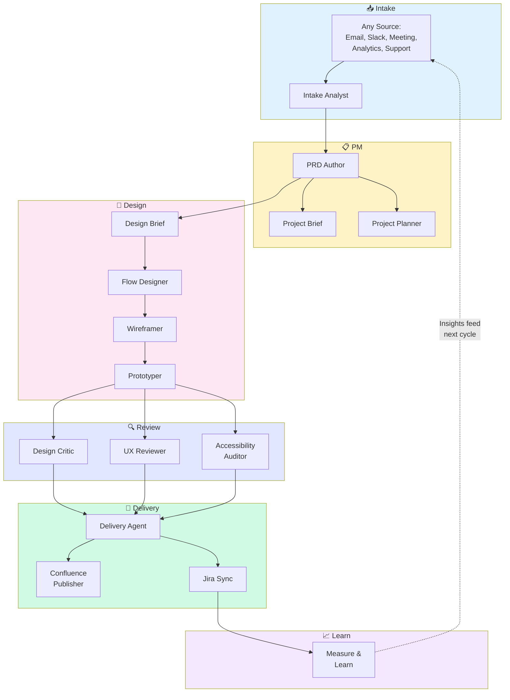

# Product OS

> A portable product management and design operating system for AI-assisted product development.

**PM rigor leads; design serves product strategy.**

[](LICENSE)

---

## What is Product OS?

Product OS is a complete system of AI agents that handles the repetitive work of product management—so you can focus on strategy, decisions, and stakeholder alignment.

### The Problem

Product managers and designers spend too much time creating artifacts:
- Writing PRDs from scratch every time
- Manually formatting Confluence pages
- Copying stories into Jira
- Creating the same flow diagrams over and over
- Chasing consistent documentation across projects

Meanwhile, the strategic work—prioritization, trade-offs, stakeholder alignment—gets squeezed.

### The Solution

Product OS gives you **27 specialist AI agents** that handle artifact creation while you make the decisions. Tell an agent what you need, review its output, approve or revise, and move on.

Every agent follows PM best practices. Every document follows a proven template. Every output syncs to Confluence and Jira automatically.

### Who It's For

| Role | How Product OS Helps |
|------|---------------------|
| **Product Managers** | Write PRDs, specs, and stories faster. Maintain consistent documentation across projects. |
| **Heads of Product** | Standardize PM practices across teams. Get OKRs, roadmaps, and prioritization frameworks built-in. |
| **Product Designers** | Generate wireframes, prototypes, and flow diagrams. Get design critique and accessibility audits. |

### What You Keep Control Of

Product OS handles the artifact creation, but **you make the decisions**:

- What problems to solve
- Which features to prioritize
- What trade-offs to make
- When to ship
- What success looks like

The agents ask for your approval at every stage. Nothing publishes without your sign-off.

---

## 🔄 How It Works

Product OS follows a flexible pipeline from intake to delivery. Here's the full flow:



### Flexible, Not Rigid

This isn't a waterfall process. Product OS is designed for how product work actually happens:

- **Start anywhere** — Jump in at any stage. Have wireframes already? Start at prototype. Have a PRD? Start at design.
- **Skip stages** — Not every project needs every artifact. Small features might go straight from intake to stories.
- **Iterate freely** — Go back and revise. The agents update downstream documents automatically.
- **Run in parallel** — Design critique and UX review can happen simultaneously. So can Confluence and Jira sync.

The pipeline is a guide, not a gate. Use the pieces you need.

---

## 🚀 Quick Start

### 1. Install

```bash
git clone https://github.com/johnedelatorre/product-os.git
cd product-os
./scripts/install.sh /path/to/your/project
```

### 2. Configure

```bash
cp .env.example .env
# Add your Atlassian email and API token to .env
# Edit product-os.config.yaml with your Confluence space and Jira project
```

### 3. Run Your First Project

```bash
/product-os:new-project \
  --initiative customer-onboarding \
  --project self-serve-signup \
  --input "Users abandoning signup at 34% rate"
```

### 4. Review and Approve

The orchestrator guides you through each stage, showing outputs and waiting for your approval before continuing.

### 5. Ship

Once approved, Confluence pages and Jira tickets are created automatically. Your backlog is ready for sprint planning.

---

## 📄 Documents

Product OS generates these documents. Each follows a proven template and syncs to your tools.

| Document | What It Is | When to Use | Agent | Destination |
|----------|-----------|-------------|-------|-------------|
| **Intake** | Structured problem statement from raw input | First step for any new work | Intake Analyst | Local |
| **PRD** | Comprehensive requirements (18 sections) | Features that need full specification | PRD Author | Confluence |
| **Project Brief** | One-page executive summary | Stakeholder alignment, kickoffs | Project Brief | Confluence |
| **Project Plan** | Phases, milestones, timeline | Complex multi-phase projects | Project Planner | Confluence |
| **RACI Matrix** | Who's responsible, accountable, consulted, informed | Cross-functional projects | Project Planner | Confluence |
| **Gantt Chart** | Timeline with dependencies (Mermaid) | Sprint planning, Jira Plans | Project Planner | Confluence + Jira |
| **Prioritization** | RICE/WSJF/MoSCoW/Kano scoring | Backlog grooming, roadmap decisions | Strategist | Local |
| **Design Brief** | Design direction and constraints | Before wireframes begin | Product Designer | Confluence |
| **User Flows** | Step-by-step user journeys (YAML + Mermaid) | Any feature with multiple steps | Flow Designer | Confluence |
| **Wireframes** | Low-fidelity screen layouts | Before visual design | Wireframer | Confluence |
| **Prototype** | Clickable HTML/React demo | User testing, stakeholder demos | Prototyper | Local |
| **Design Critique** | Severity-rated visual feedback | Before handoff to engineering | Design Critic | Confluence |
| **UX Review** | Heuristics evaluation | Quality gate | UX Reviewer | Confluence |
| **Accessibility Audit** | WCAG 2.2 AA compliance check | Before launch | Accessibility Auditor | Confluence |
| **Epics** | High-level work containers | Grouping related stories | Delivery Agent | Jira |
| **Stories** | User stories with acceptance criteria | Sprint backlog | Delivery Agent | Jira |
| **OKRs** | Objectives and key results | Quarterly planning | OKR Agent | Confluence |
| **Roadmap** | Now/Next/Later prioritized view | Stakeholder communication | Roadmap Agent | Confluence |
| **Competitive Analysis** | Feature matrix, SWOT | Strategic planning | Competitive Analyst | Confluence |
| **Experiment Design** | A/B test hypothesis and setup | Data-driven decisions | Experiment Designer | Confluence |
| **Risk Register** | Risks with probability and mitigation | Project planning | Risk Manager | Confluence |
| **Decision Log** | ADR-style decision records | Capturing rationale | Decision Logger | Confluence |
| **PR/FAQ** | Amazon-style press release + FAQ | Early concept validation | PR/FAQ Author | Local |
| **Retrospective** | Start/Stop/Continue + actions | End of project | Retro Facilitator | Confluence |
| **Stakeholder Update** | Progress summary for executives | Weekly updates | Stakeholder Comms | Email/Confluence |

<details>
<summary><strong>Where documents live locally</strong></summary>

```
initiatives/
└── [initiative-name]/
    └── [project-name]/
        ├── intake.md
        ├── prd.md
        ├── project-brief.md
        ├── project-plan.md
        ├── raci.md
        ├── gantt.md
        ├── design-brief.md
        ├── flows.yaml          # Canonical spec
        ├── flows.md            # Mermaid render
        ├── wireframes.md
        ├── prototype.html
        ├── design-critique.md
        ├── ux-review.md
        ├── accessibility-audit.md
        ├── epics.md
        ├── stories.md
        ├── publish-manifest.json
        └── jira-sync-manifest.json
```

</details>

---

## 🧠 Skills

Skills are reusable knowledge that agents draw on. Each skill documents best practices, frameworks, and quality checklists.

| Skill | What It Teaches | Used By |
|-------|-----------------|---------|
| **PRD Writing** | 18-section PRD structure, requirements formatting, success metrics | PRD Author |
| **Project Brief** | One-page constraint, executive audience, what to include/exclude | Project Brief |
| **Prioritization** | RICE, WSJF, MoSCoW, Kano frameworks with scoring guides | Strategist |
| **Story Pointing** | Fibonacci scale, complexity factors, estimation rationale | Delivery Agent |
| **Discipline Labeling** | Frontend/backend/fullstack assignment with decision criteria | Delivery Agent |
| **RACI Matrix** | Responsibility assignment, one-R rule, stakeholder mapping | Project Planner |
| **Gantt Generation** | Mermaid syntax, dependency types, Jira Plans integration | Project Planner |
| **User Flows** | Canonical YAML spec, multi-target rendering, flow patterns | Flow Designer |
| **Wireframing** | ASCII and HTML formats, layout patterns, annotation style | Wireframer |
| **Prototype Generation** | Self-contained HTML, React artifacts, state management | Prototyper |
| **Design Critique** | Visual hierarchy, Gestalt principles, severity ratings | Design Critic |
| **UX Heuristics** | Nielsen's 10 heuristics, Laws of UX, evaluation process | UX Reviewer |
| **Accessibility Audit** | WCAG 2.2 AA criteria, axe-core integration, remediation | Accessibility Auditor |
| **Confluence Publishing** | Page hierarchy, backlog tables, Mermaid embedding | Confluence Publisher |
| **Jira Sync** | Epic/story creation, custom fields, dependency links | Jira Sync |

<details>
<summary><strong>Full skill files</strong></summary>

All skills are in `.claude/skills/`:

```
.claude/skills/
├── accessibility-audit.md
├── confluence-publishing.md
├── design-critique.md
├── discipline-labeling.md
├── gantt-generation.md
├── jira-sync.md
├── prd-writing.md
├── prioritization.md
├── project-brief.md
├── prototype-generation.md
├── raci-matrix.md
├── story-pointing.md
├── user-flows.md
├── ux-heuristics.md
└── wireframing.md
```

</details>

---

## 🤖 Agents at a Glance

Product OS includes **27 specialist agents**, each with a single responsibility.

### Pipeline Agents

These agents form the core workflow from intake to delivery.

| Agent | Command | What It Does |
|-------|---------|--------------|
| **Orchestrator** | `/product-os:new-project` | Runs the full pipeline with human checkpoints |
| **Intake Analyst** | `/product-os:intake` | Structures raw requirements into problem statements |
| **PRD Author** | `/product-os:prd` | Writes comprehensive 18-section PRDs |
| **Project Brief** | `/product-os:brief` | Creates one-page executive summaries |
| **Project Planner** | `/product-os:plan` | Generates RACI, Gantt, and project plans |
| **Strategist** | `/product-os:prioritize` | Applies RICE/WSJF/MoSCoW/Kano prioritization |

### Design Agents

These agents handle design artifacts from brief to prototype.

| Agent | Command | What It Does |
|-------|---------|--------------|
| **Product Designer** | `/product-os:design-brief` | Creates design briefs and direction |
| **Flow Designer** | `/product-os:flows` | Generates user flows, journey maps, sitemaps |
| **Wireframer** | `/product-os:wireframes` | Creates low-fidelity screen layouts |
| **Prototyper** | `/product-os:prototype` | Builds clickable HTML/React prototypes |
| **Figma Agent** | `/product-os:figma` | Integrates with Figma via MCP |
| **UX Researcher** | `/product-os:research` | Plans studies and synthesizes findings |

### Review Agents

These agents provide quality gates before delivery.

| Agent | Command | What It Does |
|-------|---------|--------------|
| **Design Critic** | `/product-os:critique` | Gives severity-rated visual feedback |
| **UX Reviewer** | `/product-os:ux-review` | Evaluates against Nielsen's heuristics |
| **Accessibility Auditor** | `/product-os:a11y` | Audits for WCAG 2.2 AA compliance |

### Delivery Agents

These agents create tickets and publish documentation.

| Agent | Command | What It Does |
|-------|---------|--------------|
| **Delivery Agent** | `/product-os:deliver` | Creates epics and stories with points |
| **Confluence Publisher** | `/product-os:publish` | Publishes all docs to Confluence |
| **Jira Sync** | `/product-os:jira-sync` | Creates/updates Jira issues |
| **Stakeholder Comms** | `/product-os:comms` | Writes updates and release notes |

### Tool Agents

These agents handle specialized PM tasks.

| Agent | Command | What It Does |
|-------|---------|--------------|
| **OKR Agent** | `/product-os:okrs` | Defines objectives and key results |
| **Roadmap Agent** | `/product-os:roadmap` | Creates Now/Next/Later roadmaps |
| **Competitive Analyst** | `/product-os:competitive` | Analyzes competitors and market |
| **Experiment Designer** | `/product-os:experiment` | Designs A/B tests with sample sizes |
| **Risk Manager** | `/product-os:risks` | Maintains risk registers |
| **Decision Logger** | `/product-os:decision` | Records decisions in ADR format |
| **Retro Facilitator** | `/product-os:retro` | Runs retrospectives |
| **PR/FAQ Author** | `/product-os:prfaq` | Writes Amazon-style PR/FAQs |

<details>
<summary><strong>Full agent documentation</strong></summary>

Every agent has detailed documentation in `docs/guides/agents/`:
- What it does
- When to use it
- Required and optional inputs
- Outputs produced
- Example usage
- Tips and best practices

See the [Agent Guide Index](docs/guides/agents/index.md) for the complete list.

</details>

---

## 🔧 Configuration

### Quick Config

```yaml
# product-os.config.yaml
confluence:
  base_url: "https://yourcompany.atlassian.net/wiki"
  space_key: "PROD"
  initiatives_parent_page_id: "123456789"

jira:
  base_url: "https://yourcompany.atlassian.net"
  project_key: "PROJ"
```

```bash
# .env
ATLASSIAN_EMAIL=your@email.com
ATLASSIAN_API_TOKEN=your-api-token
```

### Setup Guides

| Guide | What It Covers |
|-------|---------------|
| [Atlassian Setup](docs/setup/atlassian.md) | Confluence and Jira configuration |
| [Figma Setup](docs/setup/figma-mcp.md) | Figma MCP integration |

---

## 📚 Documentation

| Resource | Description |
|----------|-------------|
| [Pipeline Overview](docs/guides/pipeline-overview.md) | How stages connect |
| [Command Reference](docs/reference/commands.md) | All slash commands |
| [Agent Guides](docs/guides/agents/index.md) | Deep-dive per agent |
| [AGENTS.md](AGENTS.md) | Agent orchestration spec |
| [CLAUDE.md](CLAUDE.md) | Root agent instructions |

---

## 📁 Repository Structure

<details>
<summary><strong>Click to expand</strong></summary>

```
product-os/
├── CLAUDE.md                 # Root agent instructions
├── AGENTS.md                 # Agent orchestration
├── README.md                 # This file
├── LICENSE                   # MIT License
├── CHANGELOG.md
├── CONTRIBUTING.md
├── product-os.config.yaml    # Configuration template
├── .env.example              # Credentials template
│
├── .claude/
│   ├── agents/               # 27 specialist agents
│   ├── commands/             # 25 slash commands
│   └── skills/               # 15 reusable skills
│
├── templates/                # Document templates
│   ├── intake/
│   ├── pm/
│   ├── design/
│   ├── delivery/
│   └── tools/
│
├── docs/
│   ├── guides/
│   │   ├── agents/           # Per-agent documentation
│   │   └── pipeline-overview.md
│   ├── reference/
│   │   └── commands.md
│   └── setup/
│       ├── atlassian.md
│       └── figma-mcp.md
│
├── examples/
│   └── acme-dashboard/       # Worked example
│
├── initiatives/              # Your project workspace
│
└── scripts/
    ├── install.sh
    └── atlassian-fallback.py
```

</details>

---

## License

MIT License © 2026 John De La Torre-Ugarte

See [LICENSE](LICENSE) for full text.

---

## Contributing

See [CONTRIBUTING.md](CONTRIBUTING.md) for guidelines.
