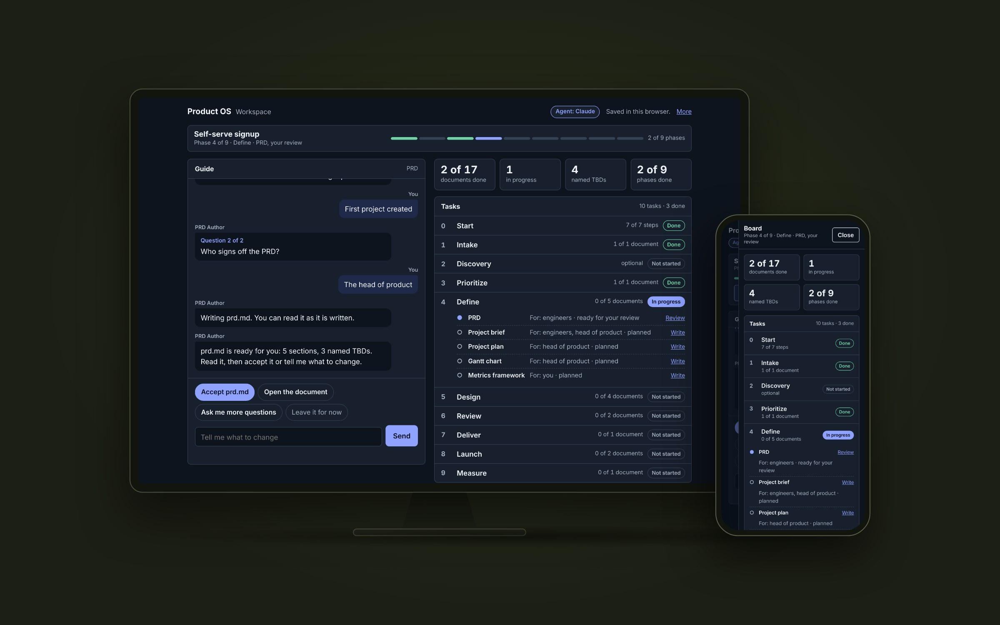

# The Product OS Board

> **TL;DR:** The board is a page that shows a Product OS project at a glance. Claude runs the project in your chat and keeps the board up to date. You open it, and tick your tasks on it. It comes with the Product OS plugin: there is nothing to set up.

## What It Shows

1. **Working on now**: the file in hand, first on the board. What it is, what it is for, the step it is at, what is happening and what is left. A green dot marks a file in progress; the card also shows Paused, Blocked and Just finished.
2. **How Product OS works**: a one-minute guide that opens from the Guide button at the top. Four steps, with three sections that open: how to get started, what the badges mean, and what you can say in your chat. It sits above the board until you press "Hide the guide".
3. **Where the project is**: the phase, the document in hand, and a bar of the nine phases.
4. **The next step**: what Claude is waiting for from you, in your chat.
5. **Your tasks**: what you and your team have to do, one row each, with a checkbox, the owner's name, a priority tag and the Jira link. Tick a task when it is done, and Claude closes its ticket the next time you write in the chat. With more than one owner, a row of buttons shows one person's tasks.
6. **Four numbers**: documents done, in progress, open questions (each with an owner), phases done.
7. **How the project is doing**: up to six notes written by Claude. What is going well, a gap in the material, a risk.
8. **Four views, one at a time**: Tasks (the start questions, the nine phases and their documents), Documents (a table of every document, what it was made as, its status, its link, and where it is published), Published and connected (the Jira epic and tickets, the Confluence pages, and your connectors), and Agents (all 41 roles by phase, what each one does, and what to say in your chat to call it).
9. **Badges for every state**: Done, In progress, Questions for you, Ready for your review, Paused, Blocked, Not started, Skipped, and the number of open questions, each with an owner. Each badge has a sign and a word, so it does not depend on colour.

You answer Claude in the chat, and the board changes by itself. The one thing you do on the board is tick a task when it is done. It follows your device's light or dark setting, or your own choice with the Auto, Light and Dark switch at the top. It fits a phone. The "Open in new tab" button at the top opens the board in its own browser tab, and every document link opens in a new tab too.

## How You Get It

1. Add the Product OS plugin to Claude ([steps](../README.md#path-a--claude-chat)).
2. Say *"Start Product OS"*.
3. When the project has a name, Claude makes the board as your own artifact and gives you the link.

The board is yours and private to you, until you share it from its page. **For a team:** share the board with the people who should follow the project. They see it update, and they cannot change it.

## How It Works

| Part | What it does |
|------|--------------|
| `product-os-board.html` | The page. It reads the project from its own database and redraws when the data changes. |
| Claude, in your chat | Writes the project's state to that database after every step: where it is, the next step, each document, each ticket, the insights, the connectors it checked. |
| The plugin skill | Tells Claude when to make the board and what to write (`marketplace/product-os/skills/product-os/SKILL.md`, "The board"). |

The page's `capabilities` block lists what it needs from Claude: a database, and who is viewing. It asks Claude nothing and it calls no connector.

## What It Does and Does Not Do

| It does | It does not |
|---------|-------------|
| Show every task, document, ticket and connector, with links | Run the project. Claude does that in your chat. |
| Update by itself while Claude works | Let you answer questions. You answer in the chat. |
| Work on a phone and when shared | Show anything before Claude has written to it |

Opened as a plain file, outside Claude, the page says that it needs to be opened in Claude.
