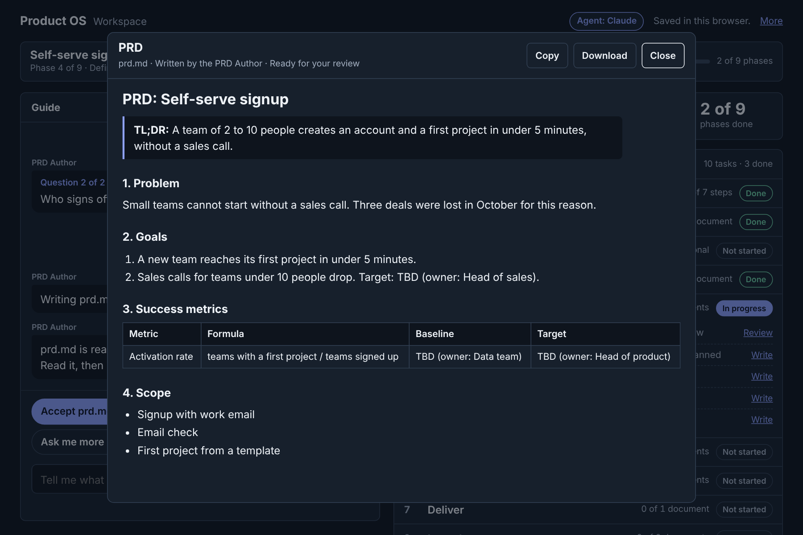

# Product OS as a Claude Artifact

> **TL;DR:** `product-os.html` is all of Product OS as one page, for a PM who does not use Claude Code. A guide asks, you answer with chips, each agent writes its document, and you review it. It reads the files you attach, uses your own Jira, Confluence and Figma connectors, and publishes to Confluence and Jira after you approve the plan. All 41 agents, 48 commands and 44 playbooks are in the page.

## What It Looks Like

The page shows only what you need at each step.

1. **First: only the conversation.** The guide asks seven short questions, one at a time, with chips to answer.
2. **At question 7: the plan.** "See the plan" slides out every phase and the documents it will make. Nothing is written before your yes.
3. **After your yes: the board.** Four numbers (documents done, in progress, named TBDs, phases done), then Start and the nine phases. Each document has a status and one action: Write, Continue, Review or Open.
4. **When a document is written: the reading panel.** It opens over the page, and you can read the document as it is written. Copy it, download it, or close it and tell the guide what to change.
5. **Under "More": the rest.** Connectors and settings, your files, all agents and commands, and saving or moving the project. Each opens only when you ask for it.

The page follows your device's light or dark setting. On a phone, and in a narrow Claude panel, the board is a panel that slides out over the conversation.

## How a Document Is Written

1. Tap **Start: PRD** in the conversation, or **Write** next to the document on the board.
2. The PRD Author reads the project, your files and the earlier documents, then asks up to five questions with chips. "I don't know yet" is always an answer, and it becomes a named TBD.
3. It writes `prd.md` from its agent file, the template and the playbooks. You can read it as it is written, and stop it.
4. You accept it, type a change, or ask for more questions. A document is done only when you accept it.
5. The guide offers the next document. You can skip it, or pick another from the board.

## Your Files, Connectors and Publishing

| What | How it works |
|------|--------------|
| **Your files** | "Attach files" at question 6, or under More. The page reads text files (.md, .txt, .csv, .json, .yaml, .html) and gives their text to every agent. It cannot read PDF, Word, Excel or PowerPoint files: paste their text or save them as text. |
| **Jira and Confluence** | Under More → Connectors and settings, tap **Check**. Claude asks you to allow your Atlassian connector for the page, once. The page then shows the real status and loads your sites, Jira projects and Confluence spaces, and you pick them from lists. |
| **Figma** | For a review (design critique, UX writing guide, UX review, accessibility audit), tap **Use a Figma link** and paste the link to each frame. The page gets the screens through your Figma connector. You can also attach screenshots. |
| **Publishing** | Tap **Publish** (under More options). The guide shows the plan first: which pages go to which Confluence space, and the ticket tree for Jira. Nothing is created until you tap the Publish or Create button. |

Publishing details:

1. **Confluence:** one project page, then one page per accepted document under it.
2. **Jira:** the guide reads `stories.md` into an epic, tickets and sub-tasks, and shows the tree. After your tap it creates the epic, each ticket under it, and each sub-task. Estimates go into each ticket's text. The epic ends with links to the Confluence pages.
3. **If something stops:** the guide says which item, and why. What was created is saved in the page and is not created twice. When a connector did not answer, the item may still exist, and the guide tells you to look before you publish again.

The page uses connectors named **Atlassian Rovo** and **Figma**, as they appear in Claude's connector settings. A connector with another name shows as not connected. Adding or reconnecting a connector is done in Claude: Settings, then Connectors.

## Setup (about 2 minutes)

1. **With the Product OS plugin** in your Claude account ([how to add it](../README.md#path-a--claude-chat)): say *"Open the Product OS workspace."* Claude publishes the page as your own artifact.
   **Without it:** download [`product-os.html`](product-os.html), attach it in Claude (claude.ai or the desktop app) and say: *"Publish this page as an artifact, and declare the capabilities listed in its `capabilities` block."*
2. Open the artifact. The first time the guide needs Claude or a connector, Claude asks you to allow it. The page uses your own Claude usage and your own sign-ins.
3. Answer the seven start questions, then tap **Start: Intake**.

The artifact is yours and private to you. **For a team:** each PM adds the plugin and opens their own workspace.

**Without Claude:** opened as a plain file in a browser, the page asks the start questions and tracks the documents. It cannot write them, use connectors or publish there. "Copy the brief" takes your answers to a chat.

## Where Your Work Is Kept

| What | Where |
|------|-------|
| Your answers, files and documents | In this browser. "Start over" (under More) erases them, after a second tap. |
| What was published | In this browser, with the links, so nothing is created twice |
| Another device | "Save the project file" on one device, "Open a project file" on the other |
| Claude Code or a chat | "Copy progress.yaml" and download each document |

## What It Does and Does Not Do

| It does | It does not |
|---------|-------------|
| Run all nine phases, each document with its own agent, template and playbooks | Run tools that need a code repo: the release gate and code audit commands write their document only |
| Read the text files you attach, and the screens you attach or link from Figma | Read PDF, Word, Excel or PowerPoint files |
| Check your Jira, Confluence and Figma connectors, and load your real projects and spaces | Add a connector. That is done in Claude's settings. |
| Publish to Confluence and create the epic, tickets and sub-tasks in Jira, after you approve | Update a page or a ticket it already created. It creates new ones only. |
| Keep every document, with copy and download | Sync between devices. You move the project file. |

## How It Is Built

`product-os.html` is generated. `artifact/src/workspace.html` is the page, and `scripts/build-workspace.py` puts every agent, playbook, command and template into it. Edit the source or the Product OS files, then run the script. `scripts/validate.sh` fails when the page is out of date. The page's `capabilities` block lists what it needs from Claude: asking Claude (with images), saving files, and the two connectors with the tools it calls.

## How It Fits the Other Paths

"Copy the brief" and "Copy progress.yaml" use the same `audience`, `design_system`, `context` and `phases` blocks as `progress.yaml` (`.claude/skills/guided-workflow.md`). Claude Code, Claude chat and ChatGPT read them and continue from there.
