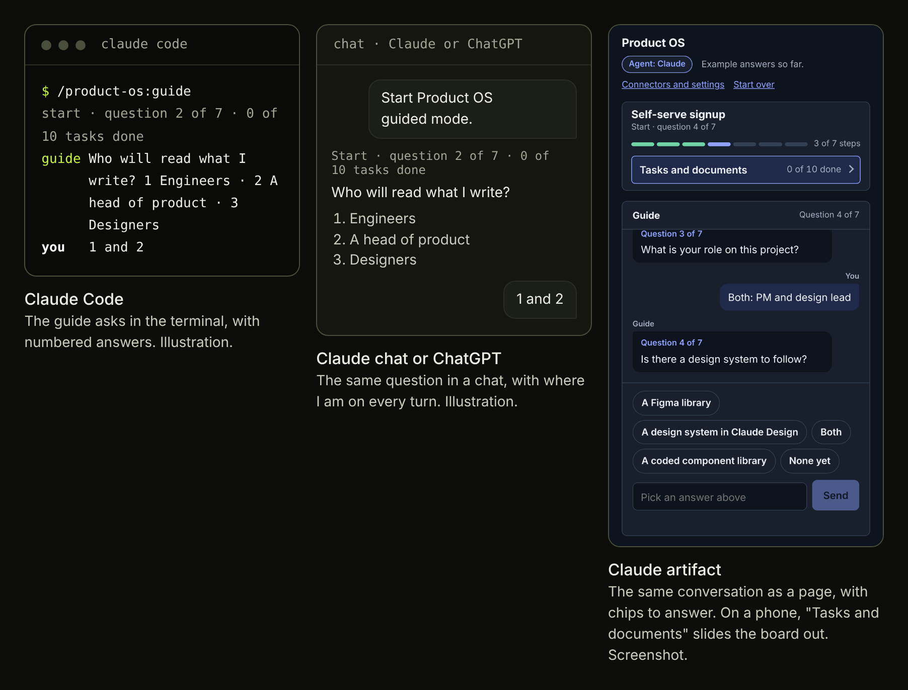

# Product OS in ChatGPT

> **TL;DR:** Product OS runs in ChatGPT with no terminal and no code editor. Create a ChatGPT Project, paste [`project-instructions.md`](project-instructions.md) into its Instructions, upload the 8 files in [`pack/`](pack/), then say "Start Product OS guided mode for initiative X, project Y." ChatGPT asks the guided questions in the chat, writes each document as a file, and waits for your yes at every step. A head of product can also build it once as a custom GPT and share one link with every PM.

## What It Looks Like for a PM

*The middle panel is an illustration of the chat. It is the same conversation in ChatGPT and in Claude.*

1. **You open the project and say what you want**, in plain words: "Start a new project."
2. **ChatGPT asks, one question at a time**: what you are building and who will use it, who will read the documents, your role, the design system to follow, where it came from. Each question says its place ("Question 2 of 7") and marks a recommended answer.
3. **You drop in everything you have**: emails, screenshots, an existing PRD, a schema. ChatGPT sorts it and answers with Found and Missing.
4. **ChatGPT plays back what it understood and what it will make.** Nothing is written before you say yes.
5. **Each document arrives as a file** you can open, download or edit in canvas: the intake, the PRD, the project brief, the flows, the prototype as one HTML file, the design critique, the UX writing guide, the epic and the tickets.

Before each document it asks the decisions that document needs. You never have to say "ask me guided questions".

**Want a page for the first questions?** The visual start in [`artifact/`](../artifact/README.md) asks the seven start questions on a page and copies a brief you paste here.

## Setup: a ChatGPT Project (about 10 minutes)

1. **Download Product OS.** On GitHub choose Code → Download ZIP, then unzip it. Open the `chatgpt` folder.
2. **Create a Project** in ChatGPT (for example "Product OS").
3. **Instructions:** open [`project-instructions.md`](project-instructions.md), copy everything below its line, and paste it into the project's Instructions. Fill in your Confluence space and Jira project under "Our team", or delete those lines.
4. **Files:** upload the 8 files in [`pack/`](pack/). ChatGPT takes 10 files per upload, so one upload is enough.
5. **Confluence and Jira (optional):** connect the Atlassian Rovo app in ChatGPT if your workspace and region offer it ([Atlassian's setup guide](https://support.atlassian.com/atlassian-rovo-mcp-server/docs/setting-up-chatgpt/)). ChatGPT shows the publish plan and waits for your OK before any write. Without it, ChatGPT gives you the content to paste.
6. **Start:** open a chat in the project and say *"Start Product OS guided mode for initiative customer-onboarding, project self-serve-signup."*

## On Your Phone

ChatGPT Projects and custom GPTs open in the ChatGPT apps for iOS and Android. Set the project up once on a computer (pasting the instructions and uploading 8 files is easier there), then run it from your phone: the same questions, in the same order.

Five words work at any time: `board` (every task and its status), `task 4` (one task and its documents), `docs` (every document), `connectors` and `settings`. The replies are short lists that fit a phone screen.

## Setup for a Team: One Custom GPT, One Link

For PMs who should not do any setup at all:

1. One person (for example the head of product) creates a custom GPT named "Product OS".
2. They paste the text from [`project-instructions.md`](project-instructions.md) into its Instructions. It fits the 8,000-character limit.
3. They upload the 8 files in [`pack/`](pack/) as Knowledge. A custom GPT holds 20 files.
4. They share the GPT's link with the team.
5. Each PM opens the link and says "Start a new project."

**If your workspace cannot create custom GPTs** (OpenAI has turned off new custom GPTs in some Enterprise workspaces): share a ChatGPT Project with your team instead. The setup is the same as above.

## Which Plans It Fits

| ChatGPT plan | Files per project | Does the pack fit? |
|--------------|-------------------|--------------------|
| Free | 5 | Partly: upload `01`, `02`, `03`, `07` and `08`. The role files in `04` to `06` are left out, so the roles follow the templates and formats only. |
| Go, Plus | 25 | Yes: 8 files, with room for your own documents |
| Pro, Business, Enterprise, Edu | 40 | Yes |
| Custom GPT (any plan that can build one) | 20 | Yes |

Limits are from OpenAI's [Projects in ChatGPT](https://help.openai.com/en/articles/10169521-projects-in-chatgpt) help page. Check it for your plan, as limits change.

## What Is in the Pack

Each file bundles several Product OS files. Each bundled file starts on a line `FILE: <path>`, so the instructions can point at it.

| File | Holds |
|------|-------|
| `01-how-to-work.md` | Clear Output style, the always-on guided questions, document hygiene |
| `02-guided-workflow.md` | The nine phases, `progress.yaml`, and the Guide |
| `03-handoff.md` | The start questions, the engineering handoff, UX writing, and the Delivery Agent |
| `04-pm-agents.md` | Intake Analyst, PRD Author, Project Brief, Metrics Designer |
| `05-design-agents.md` | Product Designer, Flow Designer, Wireframer, Prototyper |
| `06-review-agents.md` | Design Critic, UX Writer, UX Reviewer, Accessibility Auditor |
| `07-document-format.md` | The standard header, the Confluence page tree, the epic and ticket formats |
| `08-templates.md` | PRD, project brief, metrics framework, design brief, design critique, UX writing guide, epic, ticket |

The pack is built from the repo by `python3 scripts/build-chatgpt-pack.py`. `scripts/validate.sh` fails when the pack does not match the source files.

## How It Differs From Claude Code

| | ChatGPT | Claude Code |
|---|---------|-------------|
| How you ask | Plain sentences in a chat | `/product-os:<command>` |
| Who does the work | One assistant, one role at a time | 41 specialist agents |
| Where documents go | Files in the chat or canvas, which you download | Files in the project folder |
| Progress between sessions | You add the `progress.yaml` it gives you to the project files | Saved in the project folder |
| Confluence and Jira | The Atlassian Rovo app, when your workspace has it; otherwise copy and paste | Atlassian MCP tools |
| Roles beyond the core path | Upload the role's file from `.claude/agents/` when you need it | All included |
| Code shipping (release gate, intent audit) | Not available | Included |

The questions, the documents, the formats and the handoff are the same on every platform.

## Add More Roles Later

Upload more files from `.claude/agents/`, `.claude/skills/` and `templates/` when you reach a step that needs them: for example `.claude/agents/strategist.md` for RICE scoring, or `.claude/agents/launch-manager.md` for release notes. A Go or Plus project has room for 17 more files.

## Codex

Engineers who use OpenAI's Codex in the repo can point it at `AGENTS.md`, which describes every agent, stage and format.
