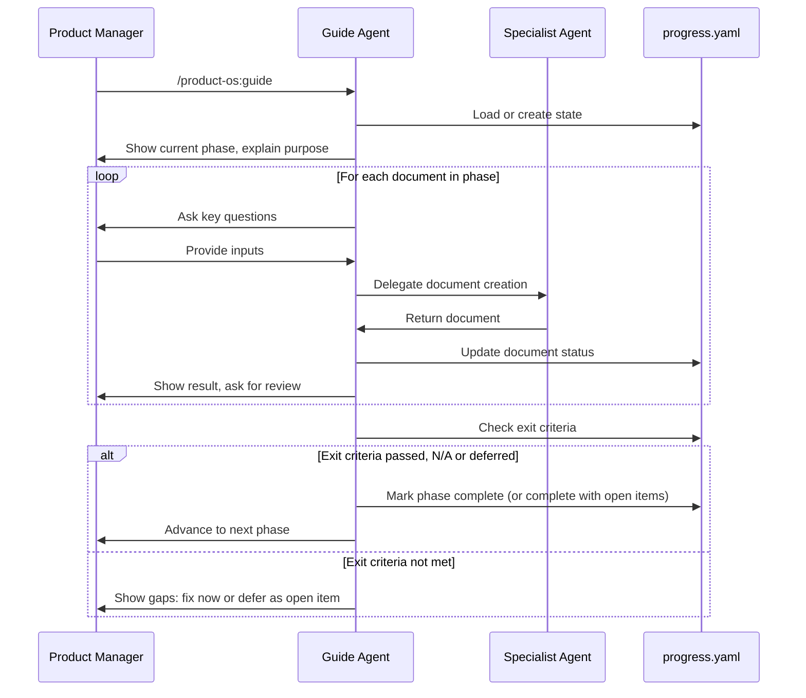

# Guided Workflow Playbook

> **TL;DR:** Run `/product-os:guide` to walk through all 9 phases step-by-step. Progress tracked in `progress.yaml`. Missing information? Defer it and keep going; it is tracked as an open item and resurfaced later. Skip Discovery with documented risks. Check status with `/product-os:status`.

**See also:** [Document Format Standard](../reference/document-format.md) (the header every document and page uses) · [Example gallery](../../examples/acme-dashboard/README.md) (a full project, filled in) · [From PRD to Reviewed Designs](design-workflow.md) (phases 5 and 6 in detail)

---

## Quick Start

```bash
# Start guided mode for a new initiative
/product-os:guide --initiative customer-onboarding --project signup

# Resume where you left off
/product-os:guide

# Check progress
/product-os:status

# Do the next step
/product-os:next
```

---

## The 9 Phases

| # | Phase | Purpose | Skip or defer |
|---|-------|---------|---------------|
| 1 | **Intake** | Transform raw requirements into clear problem statement | Defer items |
| 2 | **Discovery** | Explore problem space before committing | Skip phase, or defer items |
| 3 | **Prioritize** | Decide if and when to build | Defer items |
| 4 | **Define** | PRD, brief, metrics, plan | Defer items |
| 5 | **Design** | Flows, wireframes, prototype | Defer items |
| 6 | **Review** | Critique, UX review, accessibility, review exit check | Defer items |
| 7 | **Deliver** | Epics, stories, Confluence, Jira | Defer items |
| 8 | **Launch** | Release notes, enablement | Defer items |
| 9 | **Measure** | Post-launch review, follow-ups | Defer items |

Only Discovery can be skipped as a whole phase. In every phase you can defer a document or exit criterion you don't have the information for yet, and come back to it later.

---

## Missing Information? Keep Going

1. **Say you don't have it yet.** For example: "No baseline yet, come back to it later."
2. **Answer one short question.** What's missing, who can provide it (TBD is fine), and by which phase to revisit. The default is the next phase that depends on it, or Launch.
3. **Keep going.** The item is marked `deferred` and added to `open_items` in `progress.yaml`. Documents still get written, with each gap marked as a named TBD (what's missing and the owner).
4. **Phases still advance.** A phase whose remaining items are complete, N/A or deferred moves on as `complete_with_open_items`.
5. **Items come back.** `/product-os:status` lists open items first. `/product-os:next` says how many are open and, when you reach an item's revisit phase, offers to resolve it first. You can decline. Resolve any item any time: "I have the baseline now."
6. **Decide before Launch.** The guide lists every open item. For each, you choose: resolve now, or carry forward as an accepted risk (recorded with who accepted it).

A failed exit criterion works the same way: fix it, or defer it as an open item.

**Still hard stops:**

| Rule | Why |
|------|-----|
| Nothing is published to Confluence or Jira without your explicit approval | Published pages and tickets reach other teams |
| Code-shipping release gates: Not Verified blocks release, owner gives explicit GO | Unverified code reaches users |

---

## Phase Flow



---

## What Gets Created

### Phase 1: Intake

| Document | Agent | Template |
|----------|-------|----------|
| `intake.md` | intake-analyst | `templates/intake/intake.md` |

**Exit Criteria:**
- [ ] Problem stated without solution bias
- [ ] Evidence documented
- [ ] Stakeholders identified
- [ ] PM approved problem framing

**After Intake: Routing Decision**

The Guide routes based on intake type:

| Intake Type | Route | Reason |
|-------------|-------|--------|
| **New idea** | → Proposal (1.5) | Needs research, interface-first thinking |
| **Agreed change** | → Discovery (2) or Define (4) | Solution direction known |
| **Bug fix** | → Deliver (7) | Skip PM phases |
| **Small tweak** | → Direct implementation | No full workflow needed |

---

### Phase 1.5: Proposal (For New Ideas)

| Document | Agent | Template |
|----------|-------|----------|
| `proposal.md` | (via skill) | See `.claude/skills/proposal.md` |

**When Required:**
- New product idea
- Major feature requiring research
- Direction not yet agreed

**Exit Criteria:**
- [ ] Research phase complete with claim types documented
- [ ] Feasibility rough-checked
- [ ] Interface draft shows key screens
- [ ] Jobs-screen mapping complete
- [ ] Proposal accepted, rejected, or deferred

**If Rejected:** Archive with reason, stop workflow.
**If Deferred:** Park for later, stop workflow.
**If Accepted:** Continue to Discovery or Define.

See `.claude/skills/proposal.md` for the full proposal process.

---

### Phase 2: Discovery (Optional)

| Document | Agent | Template |
|----------|-------|----------|
| `opportunity-tree.yaml` | opportunity-tree | — |
| `hypothesis-log.yaml` | hypothesis-logger | — |
| `market-analysis.md` | market-analyst | `templates/discovery/market-analysis.md` |
| `research-synthesis.md` | ux-researcher | — |

**Exit Criteria:**
- [ ] Key hypotheses documented
- [ ] At least one opportunity identified with evidence

**Skip Risks (if skipping):**
- Hypotheses not formally validated
- May miss edge cases in user journeys
- Competitive blind spots possible

---

### Phase 3: Prioritize

| Document | Agent | Template |
|----------|-------|----------|
| `prioritization.md` | strategist | `templates/pm/prioritization.md` |
| `roadmap.md` | roadmap-agent | `templates/pm/roadmap.md` |

**Exit Criteria:**
- [ ] Priority score calculated (RICE/WSJF)
- [ ] Roadmap placement decided
- [ ] Stakeholders aligned on priority

---

### Phase 4: Define

| Document | Agent | Template |
|----------|-------|----------|
| `prd.md` | prd-author | `templates/pm/prd.md` |
| `prd-review.md` | (multi-perspective) | `templates/pm/prd-review.md` |
| `project-brief.md` | project-brief | `templates/pm/project-brief.md` |
| `metrics-framework.md` | metrics-designer | `templates/pm/metrics-framework.md` |
| `project-plan.md` | project-planner | `templates/pm/project-plan.md` |

**PRD Stages:**
| Stage | When to Use | PRD Review Required |
|-------|-------------|---------------------|
| Early | Exploring, hypotheses only | No (optional) |
| Defined | Requirements complete | Yes |
| Delivery-ready | Evidence gathered, metrics baselined | Yes |

**Exit Criteria:**
- [ ] PRD stage matches intent (Early for exploration, Defined+ for design)
- [ ] PRD review complete with blockers resolved (if stage ≥ Defined)
- [ ] Success metrics have baselines (with dates) and targets
- [ ] Stop criteria defined with owners
- [ ] RACI has one R per row
- [ ] Timeline has dependencies mapped

---

### Phase 5: Design

| Document | Agent | Template |
|----------|-------|----------|
| `design-brief.md` | product-designer | `templates/design/design-brief.md` |
| `flows.yaml` | flow-designer | — |
| `wireframes.md` | wireframer | — |
| `prototype.html` | prototyper | — |

**Exit Criteria:**
- [ ] Flows cover happy path + error states
- [ ] Wireframes address all PRD requirements
- [ ] Prototype is testable

Step-by-step guide to this phase (where flows, wireframes and the clickable prototype are made and how to open them): [From PRD to Reviewed Designs](design-workflow.md). Filled-in examples: [flows](../../examples/acme-dashboard/design/flows.md), [wireframes](../../examples/acme-dashboard/design/wireframes.md), [prototype](../../examples/acme-dashboard/design/prototype.html).

---

### Phase 6: Review

| Document | Agent | Template |
|----------|-------|----------|
| `design-critique.md` | design-critic | `templates/design/design-critique.md` |
| `ux-review.md` | ux-reviewer | `templates/design/ux-review.md` |
| `accessibility-audit.md` | accessibility-auditor | `templates/design/accessibility-audit.md` |

**Exit Criteria (review exit check):**
- [ ] Every critique, UX and accessibility finding resolved, or accepted with documented risk
- [ ] No critical design issues left open
- [ ] WCAG 2.2 AA compliance verified
- [ ] Not-verified items have investigation plan

The Definition of Ready gate (`gate-report.md`) runs in Phase 7, on the stories, once they exist.

Reviews run on the real designs and cite the screen for every finding: see [From PRD to Reviewed Designs, Step 6](design-workflow.md#step-6-reviews-on-the-real-designs) and the [example design critique](../../examples/acme-dashboard/design/design-critique.md).

---

### Phase 7: Deliver

| Document | Agent | Template |
|----------|-------|----------|
| `epics.md` | delivery-agent | `templates/delivery/epic.md` |
| `stories.md` | delivery-agent | `templates/delivery/user-story.md` |
| `gate-report.md` (Definition of Ready gate on the stories) | gate-keeper | — |
| `traceability.md` | — | `templates/delivery/traceability.md` |
| `tracking-plan.yaml` | event-tracker | — |
| Confluence pages | confluence-publisher | — |
| Jira issues | jira-sync | — |

**Definition of Ready Gate Status Key:**
| Status | Meaning |
|--------|---------|
| ✅ Pass | Criteria met with evidence |
| ⚠️ Conditional | Minor gaps, can proceed with conditions |
| ❌ Fail | Critical missing: fix, or defer as an open item |
| N/A | Not applicable (documented reason) |
| 🔍 Not Verified | Cannot confirm, investigate first |

**Estimation Guidance:**
| Level | Method | Who |
|-------|--------|-----|
| Epic | T-shirt (S/M/L/XL) or weeks range | Tech Lead |
| Story | Fibonacci (1-13) | Delivery team |
| Unknown | Spike first | Team |

**Exit Criteria:**
- [ ] Stories have testable acceptance criteria (Gherkin)
- [ ] Definition of Ready gate report complete with evidence for each criterion
- [ ] Stories have points with rationale
- [ ] Spikes created for unknown scope (no fabricated AC)
- [ ] Testing and observability requirements specified
- [ ] Traceability matrix complete (gaps have reasons)
- [ ] **Human approved** Confluence/Jira publish (can be deferred; nothing is published until approved)

---

### Phase 8: Launch

| Document | Agent | Template |
|----------|-------|----------|
| `release-notes.md` | launch-manager | `templates/launch/release-notes.md` |
| `enablement.md` | launch-manager | — |
| `launch-checklist.md` | launch-manager | — |
| `decision-log.md` | decision-logger | — |

**Open Items Decision:**
On entering Launch, the guide lists every open item. For each, you choose:
- Resolve now
- Carry forward as an accepted risk (recorded with who accepted it)

This is a decision point, not a block.

**Context Freshness Check:**
Before launch, verify:
- [ ] PRD reflects what was actually built
- [ ] Metrics baselines are recent (within 30 days)
- [ ] Dependencies confirmed ready
- [ ] Rollback procedure still valid

**Exit Criteria:**
- [ ] Release notes published
- [ ] Support team enabled
- [ ] Monitoring and alerting in place
- [ ] Rollback procedure documented and tested
- [ ] Stop criteria defined with owners

---

### Phase 9: Measure

| Document | Agent | Template |
|----------|-------|----------|
| `post-launch-review.md` | post-launch-reviewer | `templates/pm/post-launch-review.md` |
| `decision-log.md` | decision-logger | — |
| `followup-intake.md` | intake-analyst | `templates/intake/intake.md` |

**Metrics Review:**
| Check | Evidence Required |
|-------|-------------------|
| Did we hit targets? | Actual vs target with dashboard link |
| Did guardrails breach? | Guardrail metrics status |
| Should we stop/rollback? | Stop criteria evaluation |
| Decision review triggers met? | Check each logged decision |

**Exit Criteria:**
- [ ] Metrics compared to targets **with evidence**
- [ ] Guardrails verified (not assumed ok)
- [ ] Learnings documented with specifics
- [ ] Decision review triggers evaluated
- [ ] Follow-up items created (or explicit "none needed")

---

## Commands Reference

| Command | Description |
|---------|-------------|
| `/product-os:guide` | Start or resume guided mode |
| `/product-os:guide <phase>` | Jump to a specific phase |
| `/product-os:guide --skip` | Skip current phase with documented risks |
| `/product-os:status` | Show current progress, open items first |
| `/product-os:status --verbose` | Show detailed document status |
| `/product-os:next` | Execute next recommended step; offers to resolve open items that are due |

---

## Progress Tracking

Progress is tracked in `initiatives/<slug>/<project>/progress.yaml`:

```yaml
schema_version: "1.2"
initiative: customer-onboarding
project: self-serve-signup
current_phase: define
current_document: prd.md

phases:
  intake:
    status: complete
    exit_criteria_passed: true
  discovery:
    status: skipped
    skip_reason: "Time-sensitive feature"
    skip_risks:
      - "May miss edge cases"
  define:
    status: in_progress
    documents:
      prd.md:
        status: in_progress
      metrics-framework.md:
        status: deferred
        missing: "Activation-rate baseline"
        owner: "Data team"
        revisit_by: design
        deferred_on: 2026-11-06T19:00:00Z
        open_item: OI-1

gates_passed:
  - intake_approved
  - priority_confirmed

open_items:
  - id: OI-1
    phase: define
    item: metrics-framework.md
    missing: "Activation-rate baseline"
    owner: "Data team"
    revisit_by: design
    status: open
```

---

## Best Practices

### 1. Don't Skip Too Much

Discovery is optional, but skipping it has risks. Document why you're skipping and what could go wrong.

### 2. Review Exit Criteria

Each phase has exit criteria. Meet them, or defer the ones you can't meet yet so they're tracked as open items.

### 3. Use Verbose Status

`/product-os:status --verbose` shows exactly which sections of which documents need attention.

### 4. Trust the Flow

Guided mode is designed to ensure nothing falls through the cracks. Let it prompt you for what's next.

---

## Bringing Existing Work

### Existing PRD

If you already have a PRD and want to use guided mode:

1. Copy your PRD to `initiatives/<initiative>/<project>/prd.md`
2. Run `/product-os:guide --initiative <slug> --project <slug>`
3. Guide detects `prd.md` exists and marks Define phase partially complete
4. Continue from current state

### Existing Progress

If you have a `progress.yaml` from an earlier version:

1. Guide auto-migrates older schemas to `1.2`
2. New fields get sensible defaults; documents marked `tbd` become `deferred` with an open item
3. All existing progress preserved
4. Review the migrated file to add new optional fields

### Mid-Project Start

You don't have to start at Intake:

1. Run `/product-os:guide <phase>` to jump directly to any phase
2. Prior phases marked as skipped (you can fill them in later)
3. Guide warns about missing dependencies but doesn't block

---

## FAQ

**Q: Can I jump around phases?**
A: Yes. Run `/product-os:guide <phase>` to jump. Progress is tracked per-phase, so you can always go back.

**Q: What if I already have some documents?**
A: Guide will detect existing files and mark them complete in `progress.yaml`.

**Q: Can I use Product OS without guided mode?**
A: Of course. Run individual commands like `/product-os:prd` directly. Guided mode is optional.

**Q: How do I restart from scratch?**
A: Delete the `progress.yaml` file and run `/product-os:guide` again.

**Q: What if PRD review finds blockers?**
A: Resolve them, or defer the ones you can't resolve yet. Deferred blockers are tracked as open items and resurface at their revisit phase.

**Q: What if I don't have the information for a step?**
A: Say so and keep going. The guide records what's missing, who can provide it and when to revisit, and tracks it as an open item. See [Missing Information? Keep Going](#missing-information-keep-going).

**Q: Can I have an Early-stage PRD and still proceed?**
A: Yes. Early PRDs can skip PRD Review and proceed to design for exploration. Mark the PRD as Defined once requirements are solid.

**Q: What about publishing to Confluence/Jira?**
A: Publishing always requires explicit human approval. Guide will prompt; never auto-publishes.
