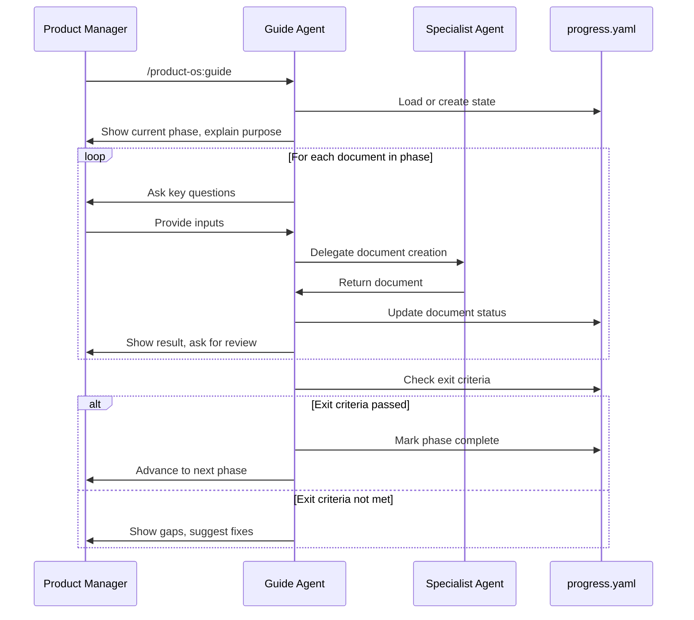

# Guided Workflow Playbook

> **TL;DR:** Run `/product-os:guide` to walk through all 9 phases step-by-step. Progress tracked in `progress.yaml`. Skip phases with documented risks. Check status with `/product-os:status`.

---

## Quick Start

```bash
# Start guided mode for a new initiative
/product-os:guide --initiative customer-onboarding --project signup

# Resume where you left off
/product-os:guide

# Check progress
/product-os:status

# Do the next step
/product-os:next
```

---

## The 9 Phases

| # | Phase | Purpose | Can Skip? |
|---|-------|---------|-----------|
| 1 | **Intake** | Transform raw requirements into clear problem statement | No |
| 2 | **Discovery** | Explore problem space before committing | Yes |
| 3 | **Prioritize** | Decide if and when to build | No |
| 4 | **Define** | PRD, brief, metrics, plan | No |
| 5 | **Design** | Flows, wireframes, prototype | No |
| 6 | **Review** | Critique, UX review, accessibility, gates | No |
| 7 | **Deliver** | Epics, stories, Confluence, Jira | No |
| 8 | **Launch** | Release notes, enablement | No |
| 9 | **Measure** | Post-launch review, follow-ups | No |

---

## Phase Flow



---

## What Gets Created

### Phase 1: Intake

| Document | Agent | Template |
|----------|-------|----------|
| `intake.md` | intake-analyst | `templates/intake/intake.md` |

**Exit Criteria:**
- [ ] Problem stated without solution bias
- [ ] Evidence documented
- [ ] Stakeholders identified
- [ ] PM approved problem framing

---

### Phase 2: Discovery (Optional)

| Document | Agent | Template |
|----------|-------|----------|
| `opportunity-tree.yaml` | opportunity-tree | — |
| `hypothesis-log.yaml` | hypothesis-logger | — |
| `market-analysis.md` | market-analyst | `templates/discovery/market-analysis.md` |
| `research-synthesis.md` | ux-researcher | — |

**Exit Criteria:**
- [ ] Key hypotheses documented
- [ ] At least one opportunity identified with evidence

**Skip Risks (if skipping):**
- Hypotheses not formally validated
- May miss edge cases in user journeys
- Competitive blind spots possible

---

### Phase 3: Prioritize

| Document | Agent | Template |
|----------|-------|----------|
| `prioritization.md` | strategist | `templates/pm/prioritization.md` |
| `roadmap.md` | roadmap-agent | `templates/pm/roadmap.md` |

**Exit Criteria:**
- [ ] Priority score calculated (RICE/WSJF)
- [ ] Roadmap placement decided
- [ ] Stakeholders aligned on priority

---

### Phase 4: Define

| Document | Agent | Template |
|----------|-------|----------|
| `prd.md` | prd-author | `templates/pm/prd.md` |
| `project-brief.md` | project-brief | `templates/pm/project-brief.md` |
| `metrics-framework.md` | metrics-designer | `templates/pm/metrics-framework.md` |
| `project-plan.md` | project-planner | `templates/pm/project-plan.md` |

**Exit Criteria:**
- [ ] PRD approved by stakeholders
- [ ] Success metrics have baselines and targets
- [ ] RACI has one R per row
- [ ] Timeline has dependencies mapped

---

### Phase 5: Design

| Document | Agent | Template |
|----------|-------|----------|
| `design-brief.md` | product-designer | `templates/design/design-brief.md` |
| `flows.yaml` | flow-designer | — |
| `wireframes.md` | wireframer | — |
| `prototype.html` | prototyper | — |

**Exit Criteria:**
- [ ] Flows cover happy path + error states
- [ ] Wireframes address all PRD requirements
- [ ] Prototype is testable

---

### Phase 6: Review & Gates

| Document | Agent | Template |
|----------|-------|----------|
| `design-critique.md` | design-critic | `templates/design/design-critique.md` |
| `ux-review.md` | ux-reviewer | `templates/design/ux-review.md` |
| `accessibility-audit.md` | accessibility-auditor | `templates/design/accessibility-audit.md` |
| `gate-report.md` | gate-keeper | — |

**Exit Criteria:**
- [ ] No critical design issues
- [ ] WCAG 2.2 AA compliance
- [ ] All stories pass Definition of Ready

---

### Phase 7: Deliver

| Document | Agent | Template |
|----------|-------|----------|
| `epics.md` | delivery-agent | `templates/delivery/epic.md` |
| `stories.md` | delivery-agent | `templates/delivery/user-story.md` |
| `tracking-plan.yaml` | event-tracker | — |
| Confluence pages | confluence-publisher | — |
| Jira issues | jira-sync | — |

**Exit Criteria:**
- [ ] Stories have acceptance criteria
- [ ] Stories have points and discipline labels
- [ ] Confluence pages published
- [ ] Jira issues created

---

### Phase 8: Launch

| Document | Agent | Template |
|----------|-------|----------|
| `release-notes.md` | launch-manager | `templates/launch/release-notes.md` |
| `enablement.md` | launch-manager | — |
| `launch-checklist.md` | launch-manager | — |

**Exit Criteria:**
- [ ] Release notes published
- [ ] Support team enabled
- [ ] Monitoring in place

---

### Phase 9: Measure

| Document | Agent | Template |
|----------|-------|----------|
| `post-launch-review.md` | post-launch-reviewer | `templates/pm/post-launch-review.md` |
| `followup-intake.md` | intake-analyst | `templates/intake/intake.md` |

**Exit Criteria:**
- [ ] Metrics compared to targets
- [ ] Learnings documented
- [ ] Follow-up items created (if any)

---

## Commands Reference

| Command | Description |
|---------|-------------|
| `/product-os:guide` | Start or resume guided mode |
| `/product-os:guide <phase>` | Jump to a specific phase |
| `/product-os:guide --skip` | Skip current phase with documented risks |
| `/product-os:status` | Show current progress |
| `/product-os:status --verbose` | Show detailed document status |
| `/product-os:next` | Execute next recommended step |

---

## Progress Tracking

Progress is tracked in `initiatives/<slug>/<project>/progress.yaml`:

```yaml
initiative: customer-onboarding
project: self-serve-signup
current_phase: define
current_document: prd.md

phases:
  intake:
    status: complete
    exit_criteria_passed: true
  discovery:
    status: skipped
    skip_reason: "Time-sensitive feature"
    skip_risks:
      - "May miss edge cases"
  define:
    status: in_progress
    documents:
      prd.md:
        status: in_progress

gates_passed:
  - intake_approved
  - priority_confirmed
```

---

## Best Practices

### 1. Don't Skip Too Much

Discovery is optional, but skipping it has risks. Document why you're skipping and what could go wrong.

### 2. Review Exit Criteria

Each phase has exit criteria. Don't advance until they're met — or explicitly document why you're proceeding anyway.

### 3. Use Verbose Status

`/product-os:status --verbose` shows exactly which sections of which documents need attention.

### 4. Trust the Flow

Guided mode is designed to ensure nothing falls through the cracks. Let it prompt you for what's next.

---

## FAQ

**Q: Can I jump around phases?**
A: Yes. Run `/product-os:guide <phase>` to jump. Progress is tracked per-phase, so you can always go back.

**Q: What if I already have some documents?**
A: Guide will detect existing files and mark them complete in `progress.yaml`.

**Q: Can I use Product OS without guided mode?**
A: Of course. Run individual commands like `/product-os:prd` directly. Guided mode is optional.

**Q: How do I restart from scratch?**
A: Delete the `progress.yaml` file and run `/product-os:guide` again.
