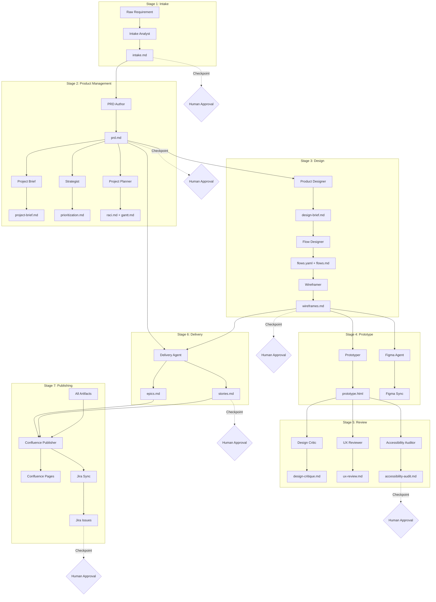

# Pipeline Overview

How Product OS transforms raw requirements into shipped features.

---

## Pipeline Diagram



---

## Stage Details

### Stage 1: Intake

**Input:** Raw requirement from any source
**Output:** `intake.md`
**Checkpoint:** Human approves problem framing

The Intake Analyst:
- Parses unstructured input
- Extracts the underlying problem (not solutions)
- Captures evidence and affected users
- Lists open questions for PM investigation

---

### Stage 2: Product Management

**Input:** Approved `intake.md`
**Output:** `prd.md`, `project-brief.md`, `raci.md`, `gantt.md`
**Checkpoint:** Human approves PRD and plan

Three agents work in sequence:
1. **PRD Author** — Comprehensive 19-section PRD
2. **Project Brief** — One-page executive summary
3. **Project Planner** — RACI, Gantt, timeline

The Strategist can be invoked for prioritization scoring.

---

### Stage 3: Design

**Input:** Approved `prd.md`
**Output:** `design-brief.md`, `flows.yaml`, `flows.md`, `wireframes.md`
**Checkpoint:** Human approves design direction

Three agents work in sequence:
1. **Product Designer** — Design brief with goals and principles
2. **Flow Designer** — User flows, journey maps, sitemap
3. **Wireframer** — Lo-fi wireframes with annotations

---

### Stage 4: Prototype & Figma

**Input:** `wireframes.md`, `flows.yaml`
**Output:** `prototype.html`, Figma sync
**Checkpoint:** Human approves prototype

Two agents can run in parallel:
1. **Prototyper** — Clickable HTML/React prototype
2. **Figma Agent** — Sync with Figma (if MCP available)

---

### Stage 5: Review

**Input:** Design artifacts, prototype
**Output:** `design-critique.md`, `ux-review.md`, `accessibility-audit.md`
**Checkpoint:** Human addresses critical findings

Three agents run in parallel:
1. **Design Critic** — Visual design critique with scorecard
2. **UX Reviewer** — Nielsen's heuristics, Laws of UX
3. **Accessibility Auditor** — WCAG 2.2 AA checklist

---

### Stage 6: Delivery

**Input:** `prd.md`, design artifacts
**Output:** `epics.md`, `stories.md`
**Checkpoint:** Human approves stories

The Delivery Agent:
- Creates epics mapped to PRD goals
- Writes stories with Given/When/Then acceptance criteria
- Assigns story points with rationale
- **Assigns discipline labels** (frontend/backend/fullstack)

---

### Stage 7: Publishing

**Input:** All approved artifacts
**Output:** Confluence pages, Jira issues
**Checkpoint:** Human confirms publication

Two agents work in sequence:
1. **Confluence Publisher** — Creates full page hierarchy
2. **Jira Sync** — Creates epics/stories with dates and dependencies

---

## Checkpoint Protocol

At each checkpoint, the orchestrator:

1. **Presents Summary** — Key outputs and decisions
2. **Quality Report** — Checklist pass/fail status
3. **Requests Approval** — Waits for human input

**Approval Responses:**
- `approved` / `yes` / `continue` → Proceed
- `feedback:` with notes → Revise and re-present
- `skip` → Skip stage (with warning)
- `stop` → Halt pipeline

---

## Parallel vs Sequential

| Stage | Execution |
|-------|-----------|
| PM agents | Sequential (PRD → Brief → Plan) |
| Design agents | Sequential (Brief → Flows → Wireframes) |
| Prototype + Figma | Parallel |
| Review agents | Parallel |
| Publisher + Jira | Sequential |

---

## Skipping Stages

Use `--skip-stages` to bypass stages:

```bash
/product-os:new-project \
  --initiative onboarding \
  --project signup \
  --input "..." \
  --skip-stages prototype,figma
```

**Warning:** Skipping stages may break downstream dependencies.

---

## Resuming Pipeline

If the pipeline is interrupted:

```bash
/product-os:new-project \
  --initiative onboarding \
  --project signup
```

Re-running `/product-os:new-project` for an existing project reads `pipeline-state.json` and continues from the first stage that is not completed. Use `--skip-stages` to skip stages explicitly. For guided mode, `/product-os:guide` resumes from `progress.yaml`.
