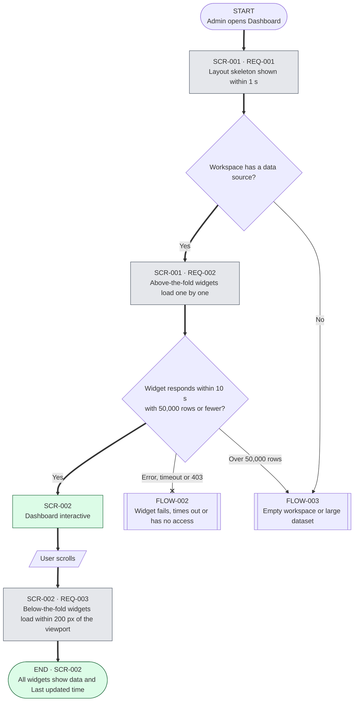
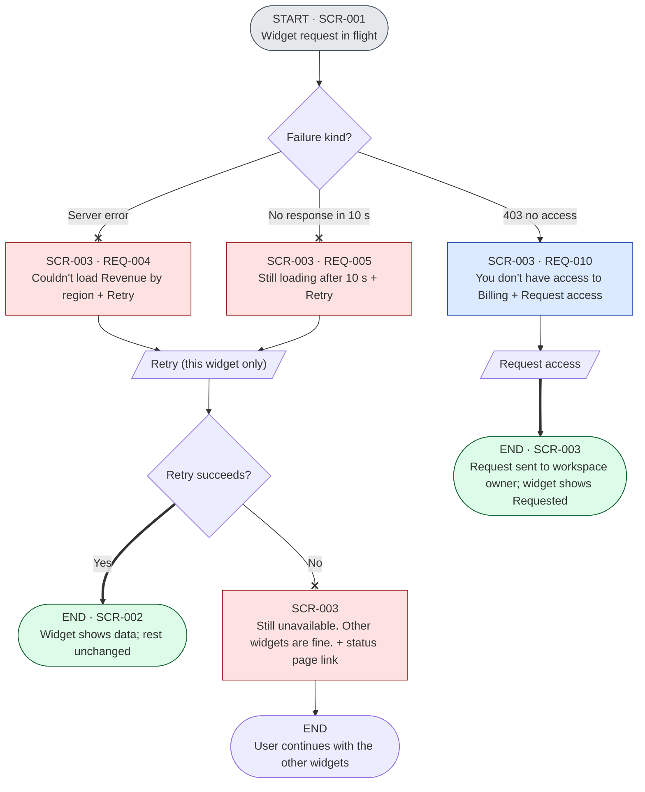
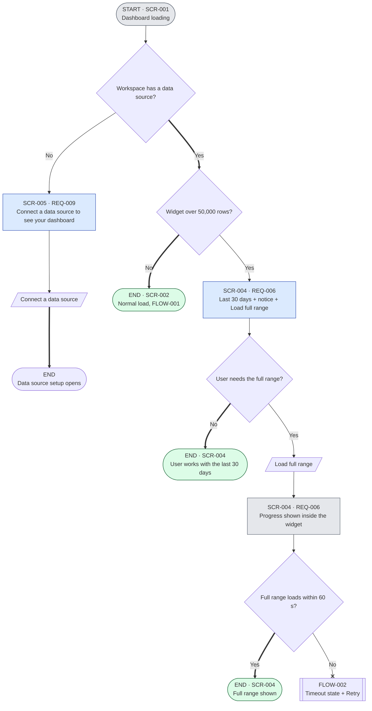

# Dashboard Performance — User Flows

**Step-by-step journeys for opening the dashboard, widget failures and edge cases; for design, engineering and QA.**

| Initiative | Project | Owner | Status | Last updated |
|------------|---------|-------|--------|--------------|
| Platform Performance | Dashboard Performance | Kenji Mori (Design) | Approved | 2026-11-10 |

> **Fictional example.** Acme Corp, every person, number and link in this project are invented to show the Product OS format.

## Description
Three flows show every path a user can take through the new progressive dashboard: the happy path (FLOW-001), widget problems (FLOW-002) and edge cases (FLOW-003). Each flow has a Mermaid diagram and a step table that names the screen (SCR-### in [wireframes.md](wireframes.md) and [prototype.html](prototype.html)) and the PRD requirement. Source of truth: [flows.yaml](flows.yaml); this page is rendered from it.

## Problem Statement
Enterprise admins wait 16.4 s (p95) at a blank page, and one failed widget breaks the whole dashboard ([PRD §1](../pm/prd.md#1-problem-statement)). The flows must show that users always see progress, and that no single widget can block them.

## Solution
Skeleton first, then per-widget loading; every widget problem stays inside that widget with its own recovery; empty workspaces and very large datasets get a clear next step. Every path ends in a next action (no dead ends).

## Success Metrics
| Metric | Baseline | Target | How we measure |
|--------|----------|--------|----------------|
| MET-002 Time to skeleton (p95) | 16.4 s | ≤ 1 s | `dashboard_skeleton_shown` |
| MET-020 Widget failure rate | 0.6% of loads fail the whole page | ≤ 1% of widget loads, none page-wide | `widget_failed` |
| MET-006 Large-dataset full-range rate | No baseline yet | < 20% | `large_dataset_full_range_clicked` |

Full framework: [metrics-framework.md](../pm/metrics-framework.md).

## Next Action
Kenji Mori runs the H-2 preference test on the prototype with 8 admins on 2026-11-13.

---

## 1. Notation

| Shape | Meaning |
|---|---|
| `([ ])` | Start / end |
| `[ ]` | System step / screen |
| `{ }` | Decision |
| `[/ /]` | User input |
| `[[ ]]` | Sub-flow (another FLOW) |

| Arrow | Meaning |
|---|---|
| `==>` | Primary (happy) path |
| `-->` | Alternate branch |
| `--x` | Error |

| Colour class | State |
|---|---|
| `loading` (gray) | Waiting on data |
| `success` (green) | Goal reached |
| `error` (red) | Failure with recovery |
| `neutral` (blue) | Empty, notice or permission state |

## 2. Flow index and traceability

| Flow | Name | Type | Screens | PRD refs | Stories |
|------|------|------|---------|----------|---------|
| FLOW-001 | Open the dashboard | Happy path | SCR-001, SCR-002 | REQ-001, 002, 003, 007 | DASH-101, DASH-102 |
| FLOW-002 | Widget fails, times out or has no access | Error | SCR-003 | REQ-004, 005, 010 | DASH-103 |
| FLOW-003 | Empty workspace or large dataset | Edge case | SCR-004, SCR-005 | REQ-006, 009 | DASH-104 |

### Required states coverage

| State | Where | Screen |
|-------|-------|--------|
| Happy path | FLOW-001 | SCR-002 |
| Loading | FLOW-001, FLOW-003 | SCR-001, SCR-004 |
| System error | FLOW-002 | SCR-003 (Revenue by region) |
| Timeout | FLOW-002 | SCR-003 (Active users) |
| Permission denied | FLOW-002 | SCR-003 (Billing) |
| Empty state | FLOW-003 | SCR-005 |
| Validation error | Not applicable: the dashboard takes no form input | — |

## 3. Flows

### FLOW-001: Open the dashboard (happy path)

| Step | Screen | User action | System response | REQ |
|------|--------|-------------|-----------------|-----|
| 1 | — | Opens Dashboard from the side nav | Requests layout (`/api/dashboard/layout`) | REQ-001 |
| 2 | SCR-001 | Waits | Skeleton in the final layout within 1 s; fires `dashboard_skeleton_shown` | REQ-001, REQ-007 |
| 3 | SCR-001 | Waits | Above-the-fold widgets request data in parallel (≤ 6 in flight) and render as each arrives | REQ-002 |
| 4 | SCR-002 | Reads KPIs, filters, clicks into a widget | Fires `dashboard_interactive` when all above-the-fold widgets render | REQ-007 |
| 5 | SCR-002 | Scrolls | Below-the-fold widgets load when within 200 px of the viewport | REQ-003 |

**Scope line:** enterprise and SMB accounts get the same flow; the flag `dashboard_progressive_load` gates it.

### FLOW-002: Widget fails, times out or has no access (error)

| Step | Screen | User action | System response | REQ |
|------|--------|-------------|-----------------|-----|
| 1 | SCR-001 | Waits | One widget request returns 5xx, exceeds 10 s, or returns 403; fires `widget_failed` with `kind` | REQ-004, 005, 010 |
| 2 | SCR-003 | Keeps using other widgets | Only the affected widget shows its problem state; all others stay interactive | REQ-004 |
| 3 | SCR-003 | Selects Retry on that widget | Re-requests that widget only; fires `widget_retry_clicked` | REQ-004, 005 |
| 4a | SCR-002 | — | Retry succeeds: widget renders data in place | REQ-004 |
| 4b | SCR-003 | Reads message | Retry fails: "Still unavailable. Other widgets are fine." with status page link | REQ-004 |
| 5 | SCR-003 | Selects Request access (Billing) | Sends request to the workspace owner; widget shows "Requested" | REQ-010 |

**Scope line:** a failure never reloads or blocks the page; the dashboard header and every other widget stay usable.

### FLOW-003: Empty workspace or large dataset (edge cases)

| Step | Screen | User action | System response | REQ |
|------|--------|-------------|-----------------|-----|
| 1a | SCR-005 | Opens a workspace with no data source | Empty state with "Connect a data source" (primary) | REQ-009 |
| 1b | SCR-004 | Opens a workspace where "Orders" has 2.3M rows | Widget loads the last 30 days and shows "Showing the last 30 days (2.3M rows in total)" | REQ-006 |
| 2 | SCR-004 | Selects Load full range | Progress inside the widget; fires `large_dataset_full_range_clicked` | REQ-006 |
| 3a | SCR-004 | — | Full range renders within 60 s | REQ-006 |
| 3b | SCR-003 | — | Over 60 s: timeout state with Retry (FLOW-002) | REQ-005 |

**Scope line:** the 50,000-row threshold is open (PRD Q-3); beta data for H-4 decides.

## 4. Completeness checklist

- [x] All entry points documented (side nav, direct URL; both start at FLOW-001 step 1)
- [x] Every decision has 2+ exits
- [x] Happy path marked with `==>`
- [x] Every error path has a recovery (Retry, Request access, status page)
- [x] Empty state has a CTA
- [x] No dead ends
- [x] Every REQ-001 to REQ-010 traced (REQ-008 alerting has no user-facing flow)
